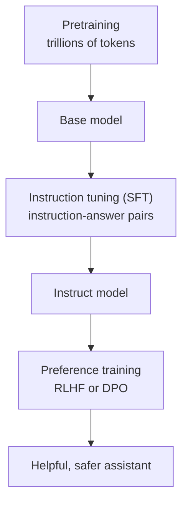
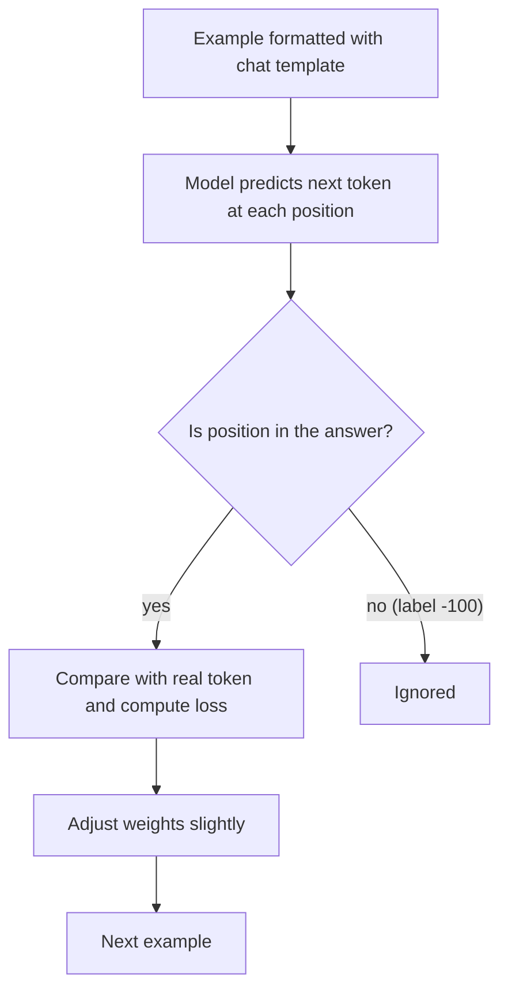

# How does Instruction Tuning work?

> **Step 7: Training, Fine-Tuning, and Alignment** · ⏱️ 17 min read · [Read original](https://outcomeschool.com/blog/instruction-tuning)

## TL;DR
Instruction tuning (a.k.a. supervised fine-tuning, SFT) trains a pretrained base model on many (instruction, ideal answer) pairs so it answers helpfully instead of just continuing text. It uses the same next-token loss as pretraining, formatted with a chat template, with loss computed only on the answer. It unlocks existing knowledge and teaches style and behavior, not new facts.

## Key Concepts
- **Pretraining / base model** — first and biggest stage: predict the next token over huge text (web, books, code). The result only continues text.
- **Instruction tuning / SFT** — train an already-trained model a bit more (fine-tuning) on instruction-answer pairs; "supervised" because the correct answer is shown for every example.
- **Instruction dataset example** — `instruction` (what to do), `input` (optional extra content), `output` (ideal answer).
- **Chat template** — fixed text format with markers: `<|user|>` starts user message, `<|assistant|>` starts answer, `<|end|>` ends it so the model learns when to stop. Each model family has its own.
- **Loss** — how wrong the predictions are; **weights** are nudged to reduce it.
- **Loss masking** — prompt tokens get label `-100` (ignored by PyTorch / Hugging Face), so only answer tokens are graded.
- **Superficial Alignment Hypothesis** (LIMA) — nearly all knowledge comes from pretraining; tuning mainly teaches style and format.
- **Preference training** — later stage (RLHF, DPO) learning from "A is better than B" comparisons.
- **Catastrophic forgetting** — losing earlier skills from too much or too narrow training.

## How It Works

### The problem with a base model
Given "Write a short poem about the rain.", a base model may output more exercises ("...about the sun", "...about the sea") because that text looks like a list of writing exercises online. "What is the capital of Japan?" may continue with "What is the capital of China?". It has the knowledge but does not know it should answer.

Analogy: a graduate (base model) knows a lot but not the company's style; the manager shows hundreds of "customer asks X, we reply Y" examples (instruction tuning = on-the-job training).

### The dataset
Covers varied task types: Q&A, summarizing, translation, writing, coding, classification, reasoning, multi-turn conversation. Variety is crucial.

Sources:
1. **Human-written** — best quality, slow and expensive.
2. **Converted existing datasets** — wrap translation, QA, sentiment sets in templates (e.g. "Translate the following sentence into French: ..."); Google's FLAN did this at scale.
3. **LLM-generated** — fast and cheap (Stanford Alpaca: 52,000 examples from an OpenAI model, used to tune Llama); risk of copying the generator's mistakes.

Teams usually mix all three and filter for quality.

### Step 1: Chat template
Each example becomes one text: `<|user|>` instruction + input `<|assistant|>` answer `<|end|>`. The markers teach "this is what was asked" vs "this is where I answer". Use the same template at inference; a mismatch confuses the model.

### Step 2: Training
Same objective as pretraining (next-token prediction); only data differs.
1. Feed formatted example.
2. Model predicts the next token at each position.
3. Compare with the real answer token.
4. Measure loss.
5. Slightly adjust weights.
6. Repeat, usually a few passes over the dataset.

Scale vs pretraining: thousands to a few million examples (vs trillions of tokens); hours to days (vs weeks or months on thousands of chips). Weight changes are small to preserve pretraining knowledge.

### Step 3: Learn only from the answer
The model should learn to write answers, not questions. Instruction tokens are input only; loss is on answer tokens (including `<|end|>`).

| Part | Graded? |
|---|---|
| User marker + instruction | No (read only) |
| Assistant marker | No (read only) |
| Answer + end marker | Yes (loss here) |

```python
tokens = prompt_tokens + answer_tokens
labels = [-100] * len(prompt_tokens) + answer_tokens
```
Some teams train on the whole text, but masking is the common choice.

### Worked example
"What is the capital of Japan?" / "The capital of Japan is Tokyo." Formatted with template. After `<|assistant|>` the base model gives high probability to "What" while the correct token is "The", so loss is high and weights adjust. The same happens for each token ("capital", "of", "Japan", "is", "Tokyo", ".", `<|end|>`). Repeated over thousands of examples. Result: after `<|assistant|>` the model starts answering and stops at the right time.

### Why it works
The model learns the general pattern "someone asks, I help", not memorized examples.
- **FLAN (2021)**: tuned on many task groups, tested on unseen task types; did much better than the untuned model, and more task variety gave better results on new tasks.
- **InstructGPT**: people preferred a 1.3B instruction-trained model over 175B GPT-3 (100x+ smaller). Caveat: InstructGPT also used a preference stage after instruction tuning.
- Tuning does not add knowledge; it unlocks it.

### Quality over quantity
LIMA fine-tuned a large Llama on only 1,000 carefully chosen examples with strong results. Lessons: clean, correct, well-written answers beat volume; wide task variety beats copies of one task; wrong answers teach wrong behavior.

### Base vs instruction-tuned
| Point | Base | Instruction-tuned |
|---|---|---|
| Training | Pretraining only | Pretraining + instruction tuning |
| Behavior | Continues text | Follows instruction |
| Questions | Often continues with more questions | Direct answer |
| Stops | Not reliably | Yes, at end marker |
| Best for | Further training, research, completion | Chat, assistants, apps |
| Usability | Needs careful prompts | Plain requests work |

Instruct/Chat-named releases are for apps; the base version is for your own training from a clean start.

### Pipeline position
Preference training follows (RLHF, DPO) because instruction tuning shows only one good answer per example, never what a bad answer looks like; preference training teaches choosing the more helpful, honest, or safer answer.

## Diagram(s)

### Training pipeline of an assistant model


### One training step with loss masking


## Trade-offs & Pitfalls
- Adds little new knowledge; unknown facts are not reliably taught.
- Copies data quality: mistakes in answers are learned.
- Can teach confident tone even when wrong, leading to made-up answers.
- Sees only good answers, never what to avoid (hence preference training).
- Too much or too narrow training causes catastrophic forgetting.
- Template mismatch between training and use confuses the model.
- LLM-generated data can propagate the generator's errors.

## Key Takeaways
- A base model has knowledge but just continues text; instruction tuning teaches it to follow instructions.
- Instruction tuning = SFT: next-token training on (instruction, ideal answer) pairs.
- Chat template markers (`<|user|>`, `<|assistant|>`, `<|end|>`) teach turns and when to stop; reuse the same template at inference.
- Loss masking (label -100) grades only the answer tokens.
- It is tiny compared with pretraining (thousands to millions of examples, hours to days) with small weight updates.
- It generalizes (FLAN) and unlocks knowledge rather than adding it (Superficial Alignment Hypothesis, LIMA's 1,000 examples).
- Quality and task variety beat quantity.
- Preference training (RLHF, DPO) comes next because SFT shows only good answers.
