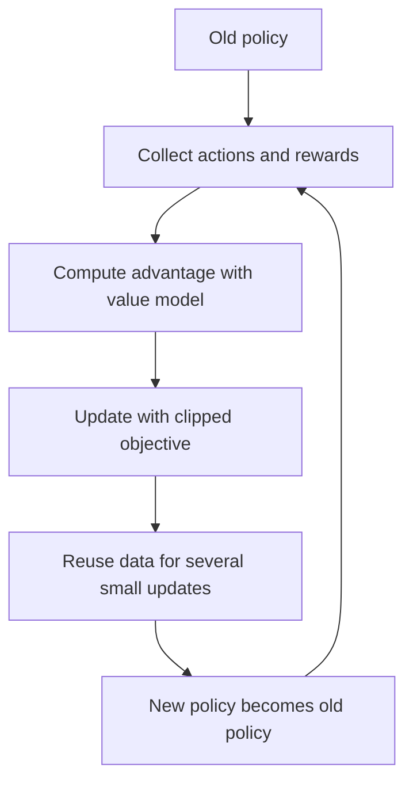
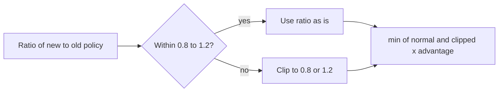
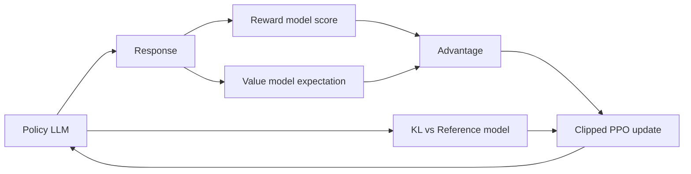

# What is Proximal Policy Optimization (PPO)?

> **Step 7: Training, Fine-Tuning, and Alignment** · ⏱️ 13 min read · [Read original](https://outcomeschool.com/blog/proximal-policy-optimization-ppo)

## TL;DR
PPO is a reinforcement learning algorithm that improves a policy in small, safe steps by clipping the ratio between new and old policy, keeping them close. It makes training stable and is the classic algorithm behind RLHF for LLMs like ChatGPT, at the cost of needing a value model.

## Key Concepts
- **Reinforcement learning** — learn by trial and error from rewards and penalties (dog gets a treat).
- **Policy** — strategy deciding the action in a situation (robot choosing doors). Goal: the policy with highest total reward over time.
- **Policy gradient** — update the policy toward higher reward.
- **Problem** — too big an update makes the policy strange/unstable, maybe unrecoverable; too small is very slow (bicycle handle analogy).
- **PPO** = Proximal (close) + Policy + Optimization: improve while staying close to the old policy.
- **Ratio** — new policy probability / old policy probability for an action. 1 = same, >1 more likely, <1 less likely.
- **Epsilon** — clip range, usually 0.2, so ratio stays in [0.8, 1.2].
- **Advantage** — how much better/worse an action was than expected (positive = better).
- **Value model (critic)** — predicts expected reward; supplies the expectation for the advantage.
- **Reference model** — frozen copy of the original LLM.

## How It Works

### Clipping and objective
If ratio is too far from 1, clip it. Example: new policy wants an action 3x more (ratio 3), so it is clipped to 1.2.

$$
L = \min\big(\rho\,A,\; \text{clip}(\rho,\,1-\epsilon,\,1+\epsilon)\,A\big)
$$

$\rho$ = ratio, $A$ = advantage, $\epsilon$ = 0.2. The `min` takes the smaller of normal and clipped update, which prevents large jumps even if data suggests a big change. For positive advantage and a very high ratio, the clipped value is smaller and gets used: right direction, small step.

### Steps
1. Start with an initial (old) policy.
2. Interact with environment using the old policy; collect actions and rewards.
3. Compute advantages with the value model.
4. Update the policy with the clipped objective.
5. Reuse the same data for multiple small updates (efficient).
6. Replace old policy with the new one; go to step 2.

### PPO in LLMs (RLHF)
1. LLM pre-trained on lots of text, but responses not always helpful/safe.
2. Humans rank responses.
3. Reward model trained on the rankings (idea from 2017 paper on games and robots), scoring any response.
4. PPO updates the LLM (the policy): LLM generates, RM scores, PPO pushes toward higher scores.
- Value model predicts expected reward; advantage = actual RM reward minus prediction, used in the clipped objective.
- Four models: **policy** (LLM being trained), **value**, **reward**, **reference** (frozen original).
- Staying close to the original (else strange text or forgotten skills): (1) clipping limits change per update; (2) a KL penalty added to reward grows as the model drifts from the reference.
- Alternatives: DPO (no PPO, no RM), GRPO.

## Diagram(s)

### PPO training loop

### Clipping behavior

### Four models in RLHF with PPO

## Trade-offs & Pitfalls

| Advantages | Disadvantages |
|---|---|
| Stable training (no big jumps) | Hyperparameter sensitive (epsilon etc.) |
| Simple to implement vs other advanced RL | Needs a value model about as large as the policy: big memory/compute cost |
| Sample efficient (data reused) | Slower than newer methods like GRPO for LLMs |
| Works in robotics, games, LMs | Can still be unstable with noisy reward |
| Widely adopted | |

## FAQ
- Epsilon? → 0.2, ratio in [0.8, 1.2].
- Models in RLHF-PPO? → Four.
- Clipping the only guard? → No, KL penalty to reference model too.
- Reuse data? → Yes, many small updates.
- Only way to align? → No: DPO, GRPO.

## Key Takeaways
- PPO = safe small policy updates via ratio clipping ($\epsilon=0.2$).
- Objective uses `min(ratio x A, clipped ratio x A)`.
- Advantage comes from a value model (critic).
- RLHF with PPO uses policy, value, reward, and reference models.
- Clipping plus KL penalty keeps the LLM close to its original behavior.
- Main costs: value model overhead and hyperparameter sensitivity.
