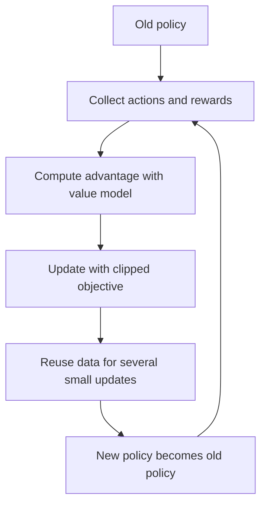

# What is Proximal Policy Optimization (PPO)?

> **Step 7: Training, Fine-Tuning, and Alignment** · ⏱️ 13 min read · [Read original](https://outcomeschool.com/blog/proximal-policy-optimization-ppo)

## TL;DR
PPO is a reinforcement learning algorithm that improves a policy in small, safe steps by clipping how far the new policy can move from the old one. It is the standard RL algorithm in RLHF for training LLMs like ChatGPT.

## Key Concepts
- **Reinforcement learning** — learn by trial and error from rewards and penalties.
- **Policy** — the strategy that picks an action in a situation; for an LLM, the model itself.
- **Policy gradient problem** — too large an update destabilizes training; too small is painfully slow.
- **Ratio** — new policy probability divided by old; 1 means unchanged.
- **Clipping** — keep the ratio within $[1-\epsilon, 1+\epsilon]$, with $\epsilon$ usually 0.2 (0.8 to 1.2).
- **Advantage** — how much better or worse an action was than expected, using a value model (critic).

## How It Works
### Objective
$$L = \min\big(\text{ratio}\cdot A,\ \text{clip}(\text{ratio}, 1-\epsilon, 1+\epsilon)\cdot A\big)$$

Taking the min prevents large jumps even if the data suggests a big change. Example: if the new policy wants an action 3 times more often (ratio 3), it is clipped to 1.2.

### Steps
1. Start with an old policy.
2. Collect interaction data (actions, rewards).
3. Compute advantages with the value model.
4. Update with the clipped objective.
5. Reuse the same data for several small updates (sample efficient).
6. Old policy becomes the new one; repeat.

### PPO in RLHF
Humans rank responses, a reward model is trained on the rankings, and PPO updates the LLM (the policy) to produce higher-scoring responses. Four models are involved:
- **Policy model** — the LLM being trained.
- **Value model (critic)** — predicts expected reward.
- **Reward model** — scores responses by human preference.
- **Reference model** — frozen copy of the original LLM.

Two safeguards keep the LLM from drifting: PPO clipping per update, and a KL penalty against the reference model added to the reward.

### Pros and cons
| Advantages | Disadvantages |
|---|---|
| Stable training | Sensitive to hyperparameters (epsilon etc.) |
| Simple vs other advanced RL | Needs a value model about as large as the policy |
| Sample efficient (data reuse) | Slower than newer methods such as GRPO |
| Works in robotics, games, LLMs | Can still be unstable with noisy rewards |

DPO is a simpler alternative that avoids PPO and the reward model.

## Diagram

## Key Takeaways
- PPO = take small, safe policy steps; clipping is the core idea.
- Ratio clipped to 0.8-1.2 (epsilon 0.2); min of clipped and unclipped terms.
- The advantage comes from a separate value model, which adds memory and compute cost.
- RLHF with PPO uses four models: policy, value, reward, reference.
- KL penalty plus clipping protect what the LLM already knows.
