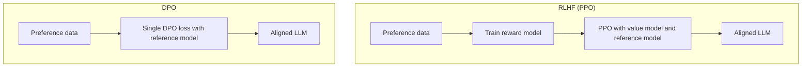
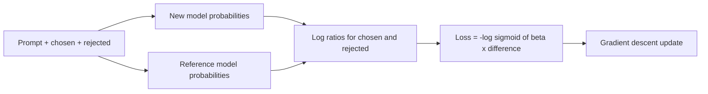

# What is Direct Preference Optimization (DPO)?

> **Step 7: Training, Fine-Tuning, and Alignment** · ⏱️ 15 min read · [Read original](https://outcomeschool.com/blog/direct-preference-optimization-dpo)

## TL;DR
DPO trains an LLM directly on human preference pairs with a single supervised loss: no separate reward model, no reinforcement learning, no value model. The key insight is that the LLM itself can act as its own reward model via its probabilities. It is simpler, more stable and cheaper than RLHF with PPO, and widely used in open models.

## Key Concepts
- **RLHF** — humans rank responses, a reward model is trained, PPO updates the LLM; a frozen **reference model** anchors it. From InstructGPT, which built on the 2017 Deep RL from Human Preferences paper.
- **Value model (critic)** — PPO's expected-reward predictor, about the same size as the LLM.
- **DPO = Direct + Preference + Optimization** — go straight to preferences, no reward model in between.
- **Preference data** — (prompt, chosen response, rejected response) triples.
- **Reference model** — frozen copy of the original model; safety anchor.
- **beta** — how far the model may move from the reference (common 0.1).

## How It Works

### Why RLHF is painful
Example: "How do I learn to code?" — model gives a long academic answer; humans prefer short, friendly, step-by-step.
RLHF needs: a trained reward model, PPO (careful tuning, can be unstable, strange text if RM is imperfect), a value model of near-LLM size (two huge models trained together). Moving parts: base model, reward model, reference model, value model, PPO; each can fail (ten machines baking one cake vs one oven).

### Key idea
RLHF: train RM to score, then train LLM on scores (hire a critic, chef cooks by the critic's scores). DPO: the LM's own probabilities already express its preference, so it is its own reward model (tell the chef directly: this dish is better). If the model gives higher probability to the rejected than the chosen response, DPO raises chosen and lowers rejected. RL becomes a simple supervised problem.

### Loss

$$\mathcal{L} = -\log \sigma\Big(\beta\big[\underbrace{\log\tfrac{\pi_\theta(y_w|x)}{\pi_{\text{ref}}(y_w|x)}}_{\text{chosen}} - \underbrace{\log\tfrac{\pi_\theta(y_l|x)}{\pi_{\text{ref}}(y_l|x)}}_{\text{rejected}}\big]\Big)$$

$\pi_\theta$ = new model, $\pi_{\text{ref}}$ = frozen reference, $y_w$ chosen, $y_l$ rejected, $\sigma$ = sigmoid, $\beta$ = strength of anchoring.
- Want chosen probability up relative to rejected, without drifting far from the reference.
- Small $\beta$: model may change a lot. Large $\beta$: stays near the reference.
- If model already strongly prefers chosen: sigmoid near 1, loss near 0 (nothing to learn). If it prefers rejected: negative inside sigmoid, loss large, update fixes it.
- Just one loss minimized like normal supervised learning.

### Steps
1. Start with a pretrained (usually instruction-tuned) LM; freeze a copy as reference.
2. Collect preference data.
3. For each example compute chosen and rejected probabilities under the new and reference models.
4. Compute DPO loss.
5. Minimize with gradient descent.
6. Repeat over examples and epochs.

### DPO vs RLHF (PPO)

| Aspect | DPO | RLHF (PPO) |
|---|---|---|
| Reward model | Not needed | Needed |
| Value model (critic) | Not needed | Needed |
| Algorithm | Supervised learning | Reinforcement learning |
| Training stability | Stable | Can be unstable |
| Implementation | Simple | Complex |
| Compute cost | Lower | Higher |
| Hyperparameter tuning | Easy | Hard |
| Memory usage | Lower | Higher |
| Performance | Competitive in many cases | Strong, harder to achieve |

DPO is the pick for a simple reliable preference method; RLHF can still help with ample resources and top performance needs on complex tasks.

## Diagram(s)

### RLHF vs DPO pipelines

### One DPO training step

## Trade-offs & Pitfalls
Advantages: no reward model (saves time/compute/memory); no RL; stable; few lines of code; lower compute; often matches or beats RLHF.

Disadvantages:
- Needs paired data (still human effort).
- Limited by data quality; noisy data teaches wrong preferences.
- Sensitive to beta.
- Can overfit, especially on small datasets.
- Less exploration than RL; learns only from given data.
- Needs a good, instruction-tuned starting model.

## FAQ
- Removes need for preference data? → No, only RM and RL.
- Why reference model? → Safety anchor against drift and forgetting.
- Beta? → Often 0.1; tune.
- Non-instruction-tuned base? → Possible but works best after instruction tuning.
- Used in real models? → Yes, many open-source LMs.

## Key Takeaways
- DPO = preference learning with one supervised loss; no RM, no RL, no critic.
- The LM is its own reward model through probability ratios against a frozen reference.
- $\beta$ trades off preference fitting vs staying close to the reference (common 0.1).
- More stable, simpler and cheaper than PPO-RLHF, with competitive quality.
- Still needs good paired data and a solid SFT start; can overfit and does not explore.
