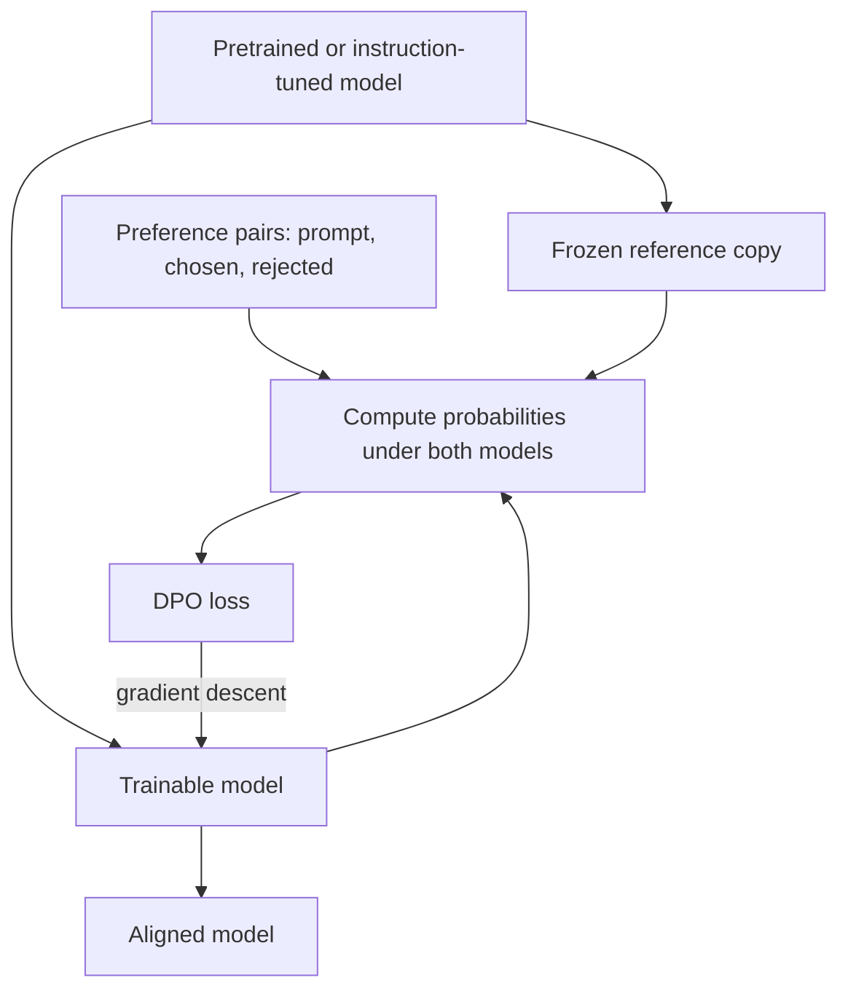

# What is Direct Preference Optimization (DPO)?

> **Step 7: Training, Fine-Tuning, and Alignment** · ⏱️ 15 min read · [Read original](https://outcomeschool.com/blog/direct-preference-optimization-dpo)

## TL;DR
DPO trains an LLM directly on human preference pairs with a single supervised-style loss, with no separate reward model and no reinforcement learning. The key insight is that the language model itself can act as its own reward model.

## Key Concepts
- **RLHF problem** — needs a reward model, PPO (finicky, can be unstable), a value model about the size of the LLM, and a reference model: many moving parts.
- **Preference data** — prompt, chosen response, rejected response.
- **Reference model** — frozen copy of the original model; a safety anchor against drift.
- **Beta** — controls how far the model may move from the reference (common value 0.1); small beta allows more change, large beta keeps it close.

## How It Works
### Key idea
The probabilities the model assigns to responses already express its preference. DPO raises the probability of the chosen response and lowers that of the rejected one (relative to the reference), turning RL into supervised learning. Analogy: instead of hiring a critic to train the chef, show the chef which dish is better.

### Loss
$$\mathcal{L} = -\log\sigma\Big(\beta\big(\log\tfrac{\pi(y_c)}{\pi_{ref}(y_c)} - \log\tfrac{\pi(y_r)}{\pi_{ref}(y_r)}\big)\Big)$$

If the model already prefers chosen over rejected, the sigmoid input is large, sigmoid near 1, loss near 0. If it prefers rejected, the input is negative and loss is large, so it updates.

### Steps
1. Start from a pretrained (ideally instruction-tuned) model; freeze a copy as reference.
2. Collect preference pairs.
3. Compute chosen and rejected probabilities under both new and reference models.
4. Compute the DPO loss.
5. Minimize it with gradient descent.
6. Repeat over many examples and epochs.

### DPO vs RLHF (PPO)
| Aspect | DPO | RLHF (PPO) |
|---|---|---|
| Reward model | Not needed | Needed |
| Value model | Not needed | Needed |
| Algorithm | Supervised learning | Reinforcement learning |
| Stability | Stable | Can be unstable |
| Implementation | Simple | Complex |
| Compute and memory | Lower | Higher |
| Tuning | Easy | Hard |
| Performance | Competitive in many cases | Strong but harder to reach |

### Pros and cons
- **Pros:** no reward model, no RL, stable, few lines of code, cheaper, often competitive.
- **Cons:** still needs paired human data; noisy data hurts; beta-sensitive; can overfit small datasets; no exploration of new responses; needs a good starting model.

## Diagram

## Key Takeaways
- DPO removes the reward model and the RL loop; the LLM is its own reward model.
- It still needs human preference pairs and a frozen reference model.
- Beta balances preference-fitting against staying near the reference.
- Simpler, more stable, and cheaper than PPO-based RLHF, and widely used in open models.
- Works best from an already instruction-tuned model.
