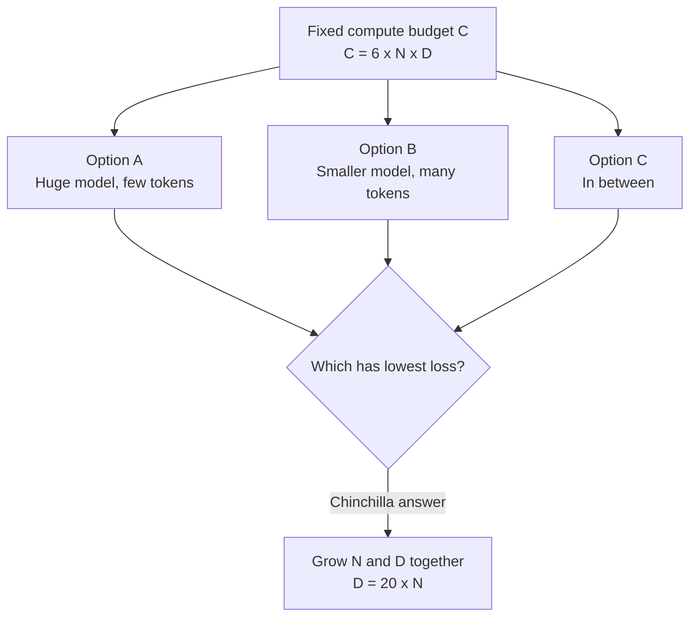
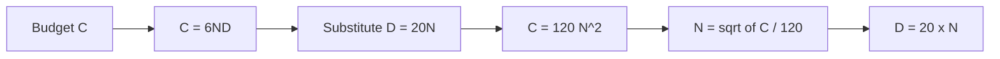

# What are the Chinchilla scaling laws?

> **Step 7: Training, Fine-Tuning, and Alignment** · ⏱️ 16 min read · [Read original](https://outcomeschool.com/blog/chinchilla-scaling-laws)

## TL;DR
The Chinchilla scaling laws tell us how to split a fixed training compute budget between model size and training data. The main finding is that both must grow in equal proportion, at roughly 20 training tokens per parameter. DeepMind's 70B Chinchilla, trained this way, beat the much larger 280B Gopher at the same compute.

## Key Concepts
- **Parameters (N)** — numbers the model learns; they store its knowledge.
- **Tokens (D)** — small pieces of text; the number read in training is the data size.
- **Compute (C)** — total training calculation, in FLOPs (basic math operations).
- **Compute estimate** — $C \approx 6ND$: about 2 operations per parameter per token for the guess, about 4 for learning from it.
- **Scaling law** — a rule predicting model quality as size, data, or compute grows; works like a forecast (train small models cheaply, predict big ones).
- **Loss** — how wrong the guesses are; lower is better. It falls smoothly and predictably with size, data, or compute.
- **Compute-optimal** — the best loss achievable for a given compute budget.
- **Undertrained** — a model too big for the text it has read.
- **IsoFLOP curves** — loss vs model size at fixed compute; valley bottom is the best size.
- **Inference** — using the trained model after training.

## How It Works

### The problem: a fixed budget
Training needs thousands of GPUs for weeks, so every team has a fixed budget $C$. Since $C = 6ND$, options at equal cost: (A) very big model, few tokens; (B) smaller model, many tokens; (C) in between. Which gives the lowest loss? (Analogy: a giant brain that reads few books vs a normal brain that reads many, with fixed study hours.)

### The belief before Chinchilla
- 2020, OpenAI (Jared Kaplan): spend most of a larger budget on a bigger model, less on data. A 10x budget meant roughly 5x model but only about 2x data.
- Industry followed; models got huge, data did not keep pace.

| Model | Parameters | Training tokens |
|---|---|---|
| GPT-3 | 175 billion | 300 billion |
| Gopher (DeepMind) | 280 billion | 300 billion |

That is only about 1 to 2 tokens per parameter.

### What the Chinchilla paper did
2022, DeepMind (Jordan Hoffmann), "Training Compute-Optimal Large Language Models". Question: for a fixed budget, what is the best model size and token count? They trained 400+ models (70M to 16B+ parameters, 5B to 500B tokens) and analyzed three ways:
1. **Approach 1** — fix model size, vary training length, find the lowest loss per budget.
2. **Approach 2** — fix compute, try many sizes (IsoFLOP curves, valley-shaped).
3. **Approach 3** — fit one formula to all results.

All three gave the same answer.

### Main finding and the 20 tokens per parameter rule
Scale model size and tokens in equal proportion: double the model, double the data. If compute grows 4x, make the model 2x bigger AND give 2x more data (2 x 2 = 4x), rather than a much bigger model with a bit more data.

Rule of thumb: a compute-optimal model needs roughly 20 tokens per parameter ($D = 20N$).

| Model size N | Tokens D = 20N |
|---|---|
| 1 billion | 20 billion |
| 10 billion | 200 billion |
| 70 billion | 1.4 trillion |

GPT-3 and Gopher (1 to 2 tokens/param) were undertrained.

### Chinchilla vs Gopher
DeepMind trained a new model with about Gopher's compute budget, the Chinchilla way.

| Point | Gopher | Chinchilla |
|---|---|---|
| Parameters | 280 billion | 70 billion |
| Training tokens | 300 billion | 1.4 trillion |
| Tokens per parameter | About 1 | 20 |
| Compute | Roughly the same | Roughly the same |
| Result | Good | Better on most tests |

- 4x smaller, read more than 4x more text, better on a wide range of tasks.
- Also beat GPT-3 (175B) and Megatron-Turing NLG (530B).
- MMLU average accuracy 67.5%, over 7 percentage points above Gopher.
- Being 4x smaller, it is cheaper and faster at inference.

### Step-by-step calculation
Budget $C = 1.2 \times 10^{22}$ FLOPs.
1. Rules: $C = 6ND$ and $D = 20N$.
2. Substitute: $C = 6N(20N) = 120N^2$.
3. Solve: $N^2 = C/120 = 10^{20}$, so $N = 10^{10}$ = 10 billion parameters.
4. $D = 20N$ = 200 billion tokens.

```python
import math

def chinchilla_optimal(compute_flops):
    n = math.sqrt(compute_flops / 120)   # best number of parameters
    d = 20 * n                           # best number of tokens
    return n, d

n, d = chinchilla_optimal(1.2e22)
# Parameters: 1.00e+10, Tokens: 2.00e+11
```

Check with real Chinchilla: 70B params, 1.4T tokens gives $C = 6 \times 70\text{B} \times 1.4\text{T} \approx 5.9 \times 10^{23}$ FLOPs, and 1.4T / 70B = exactly 20.

### The Chinchilla formula (Approach 3)

$$
\text{Loss}(N, D) = E + \frac{A}{N^{\alpha}} + \frac{B}{D^{\beta}}
$$

- **E** — irreducible loss even with infinite model and data, from the natural randomness of language (after "I had a cup of", both "tea" and "coffee" fit).
- **A / N^alpha** — extra loss from a model that is too small; shrinks as N grows.
- **B / D^beta** — extra loss from too little data; shrinks as D grows.
- A, B, alpha, beta were fitted from the 400 training runs.
- All budget into N leaves the data term large; all into D leaves the size term large. Lowest loss comes from balancing both.

### Why earlier models were undertrained
The earlier study did not match the learning rate schedule to each (shorter) run. The learning rate controls step size and normally decays over the run, with the schedule matched to run length. Mismatch made models trained on less data look worse, so "more data" looked less useful and "bigger model" more useful. Matching the schedule for every run revealed the value of data.

### What changed after Chinchilla
- Stopped building giant models on too little text.
- Data quantity and quality became as important as model size.
- Smaller models trained on much more data became popular (good results, cheaper to run).
- But Chinchilla optimizes the training budget only, ignoring inference cost. A smaller model makes every inference cheaper and faster, so many teams train small models far beyond 20 tokens/param. Example: Llama 3 8B trained on over 15 trillion tokens, nearly 1,900 tokens per parameter. This spends more training compute but yields a model that is cheaper to serve, sensible for heavily used models.

## Diagram(s)

### Fixed budget: three ways to spend it


### Finding the optimal N and D


## Trade-offs & Pitfalls
- **Training cost only** — ignores post-training inference cost, hence over-trained small models (e.g. Llama 3 8B).
- **20 is not a law of nature** — from one set of experiments, one model type, one kind of data; different data, tokenization, or architecture can shift the ratio.
- **Assumes unlimited data** — high-quality internet text is limited.
- **Loss is not everything** — lower loss usually means better, but does not capture task-specific ability.
- **Fits re-checked** — later researchers found fitting errors in Approach 3's formula; after correction it agreed with Approaches 1 and 2, and the core idea held.

## Key Takeaways
- $C \approx 6ND$ links compute, parameters, and tokens.
- For a fixed budget, grow model size and data in equal proportion.
- Compute-optimal rule of thumb: about 20 tokens per parameter.
- Chinchilla (70B, 1.4T tokens) beat Gopher (280B, 300B tokens) at the same compute, with 67.5% on MMLU.
- Earlier Kaplan-style results favored bigger models partly due to unmatched learning-rate schedules.
- Loss = irreducible E + model-size term + data term; balance both.
- Chinchilla ignores inference cost, so teams deliberately over-train small models (Llama 3 8B at about 1,900 tokens/param).
- The 20 ratio depends on data, tokenizer, and architecture, and assumes plentiful data.
