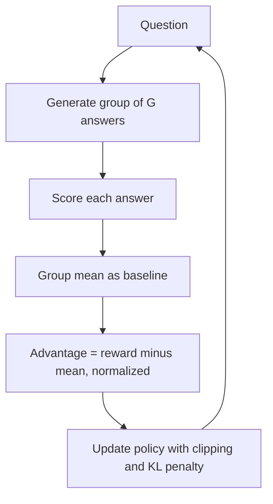

# What is Group Relative Policy Optimization (GRPO)?

> **Step 7: Training, Fine-Tuning, and Alignment** · ⏱️ 17 min read · [Read original](https://outcomeschool.com/blog/group-relative-policy-optimization-grpo)

## TL;DR
GRPO, introduced by DeepSeek, is an RL algorithm for LLMs that samples a group of answers per question, scores them, and uses the group average as the baseline. This removes PPO's expensive value model while keeping the reward model, making training cheaper and simpler, especially for reasoning tasks with verifiable rewards.

## Key Concepts
- **Group** — several answers generated for the same question (typically 8 to 64).
- **Relative advantage** — an answer's reward minus the group mean (usually divided by the group std).
- **Reward model vs value model** — the reward model scores a complete answer (the ground truth signal); the value model predicts expected future reward at each step to assign credit. GRPO drops only the value model.
- **Reference model + KL penalty** — usually the post-SFT model; prevents drift and reward hacking.
- **Verifiable reward** — rule-based or code-execution check (math correct, tests pass).

## How It Works
### Why PPO is costly
PPO trains a policy plus a value model of almost the same size: more memory, more compute, slower, and the value model is hard to train accurately. PPO uses the value model for per-step credit assignment.

### GRPO idea
Skip per-step credit. Compare full answers to the group average; every token in a good answer is nudged up, in a bad one nudged down. Analogy: a teacher tells each of 8 students whether they beat the class average.

### Steps
1. Take a question.
2. Generate G answers with the current policy.
3. Score each (reward model, rule check, or code execution).
4. Compute the group mean (baseline).
5. Advantage per answer = (reward - mean) / (std + small constant).
6. Update the policy to raise probability of positive-advantage answers and lower negative ones.

### Example
"What is 12 + 7?" with 4 answers and rewards 1, 0, 1, 0: mean 0.5, advantages +0.5, -0.5, +0.5, -0.5.

### Objective (three parts)
Policy ratio (new vs old) × group advantage, clipped to about 0.8 to 1.2 as in PPO, minus a KL penalty to the reference model; averaged over the group and batch.

### PPO vs GRPO
| Aspect | PPO | GRPO |
|---|---|---|
| Value model | Yes | No |
| Reward model | Yes | Yes |
| Memory and compute | High | Lower |
| Baseline | Learned by value model | Group average reward |
| Implementation | Complex | Simpler |
| Best fit | Open-ended tasks | Reasoning with verifiable rewards |

### Practical notes
Group size trades baseline stability against compute. If all answers get the same reward, advantage is zero and there is no learning signal (balance question difficulty). The reward function must be good, and the KL penalty guards against reward hacking.

## Diagram

## Key Takeaways
- GRPO replaces the learned value baseline with the group's mean reward.
- It still needs a reward signal, but not a critic.
- Credit goes to whole answers, not individual steps; ideal when only the final answer matters (math, code).
- Cheaper and simpler than PPO; used to train DeepSeek's reasoning models.
- Watch group size, zero-variance groups, reward quality, and KL anchoring.
