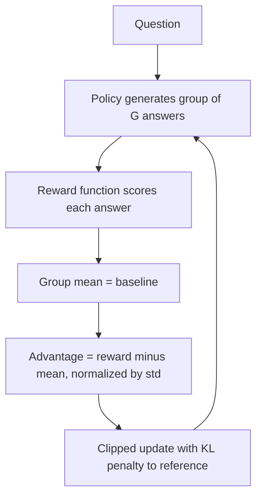
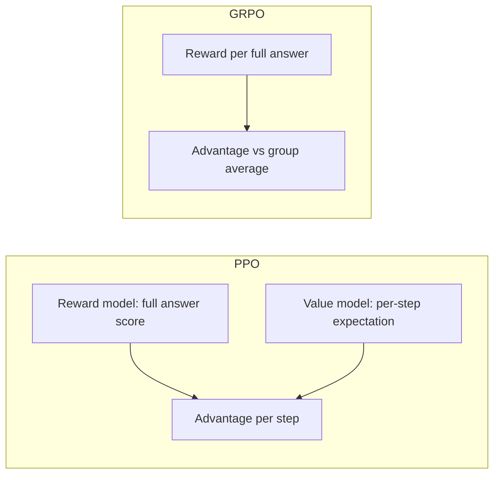

# What is Group Relative Policy Optimization (GRPO)?

> **Step 7: Training, Fine-Tuning, and Alignment** · ⏱️ 17 min read · [Read original](https://outcomeschool.com/blog/group-relative-policy-optimization-grpo)

## TL;DR
GRPO (introduced by DeepSeek, used for their reasoning models) is an RL algorithm that samples a group of answers per question, scores each, and uses the group average as the baseline. Answers above average are pushed up, below average pushed down. It removes PPO's expensive value model while keeping the reward model, making training cheaper, simpler and faster.

## Key Concepts
- **GRPO = Group + Relative + Policy + Optimization** — group of answers per question, compared relative to each other; policy = the LLM choosing tokens (see MDP); update to get better answers. Analogy: teacher compares each of 8 students to the class average.
- **PPO** — popular RL algorithm (e.g. InstructGPT) using multiple large models.
- **Policy model** — LLM being trained. **Value model (critic)** — separate, near-policy-size model predicting expected future reward at every step.
- **Reward model** — final score for a complete answer. PPO uses reward + value; GRPO keeps reward, drops value.
- **Advantage** — how much better/worse than expected.
- **Reference model** — usually the model right after SFT, for the KL penalty.
- **Verifiable reward** — rule or code-execution check.

## How It Works

### Why PPO needs a value model, and its cost
- Reward model gives one score for the full answer, but the LLM writes word by word. Value model supplies per-step credit assignment (advantage). Without it, every word gets the same credit/blame, making training unstable.
- Value model learns to predict what the reward model would say; reward model is the source of truth. Not duplicates.
- Cost: value model about policy size, so two huge models at once: lots of memory and compute, slow, and the critic is hard to train accurately.

### GRPO's core idea
- Baseline = group average, not a learned critic. Credit goes to the full answer, not each step: every word in a good answer gets a small push up, every word in a bad one a push down. Fits math, code, reasoning where the final answer matters.

### Steps
1. Take a question.
2. Generate a group (e.g. 8) of answers with the current policy.
3. Score each (reward model, rule-based check such as correct math answer, or code tests).
4. Compute the group mean as baseline.
5. Relative advantage per answer: positive if above mean, negative if below.
6. Update policy: more likely for positive, less for negative.

### Worked example: "What is 12 + 7?" (answer 19), 4 answers, reward 1 if correct

| Answer | Reward | Advantage (r - 0.5) |
|---|---|---|
| "The answer is 19." | 1 | +0.5 |
| "It is 18." | 0 | -0.5 |
| "19." | 1 | +0.5 |
| "I think it is 20." | 0 | -0.5 |

Mean = (1+0+1+0)/4 = 0.5. In practice advantages are also divided by the group's standard deviation (normalization):

$$
A_i = \frac{r_i - \text{mean}(r)}{\text{std}(r)+\varepsilon}
$$

### Objective (three parts)
1. **Policy ratio** — new vs old policy probability of each answer.
2. **Clipping** — keep the ratio in e.g. [0.8, 1.2] (as in PPO).
3. **KL penalty** — stay close to the reference model (prevents drift/forgetting).

Multiply clipped ratio by group-based advantage, subtract KL, average over answers in the group and questions in the batch. Key change from PPO: advantage comes from the group.

```python
answers = [policy.generate(q) for _ in range(G)]
rewards = [reward_fn(q, a) for a in answers]
adv = [(r - mean_r) / (std_r + 1e-8) for r in rewards]
loss = grpo_loss(policy, old_policy, ref_policy, answers, adv)
```

### PPO vs GRPO

| Aspect | PPO | GRPO |
|---|---|---|
| Value model | Yes | No |
| Reward model | Yes | Yes |
| Memory | High | Lower |
| Compute | High | Lower |
| Speed | Slower | Faster |
| Baseline | Learned by value model | Group average reward |
| Implementation | Complex | Simpler |
| Best fit | Open-ended tasks | Reasoning with verifiable rewards |

Also trains Sakana's Fugu-Ultra to write effective multi-model workflows.

## Diagram(s)

### GRPO step


### PPO vs GRPO credit assignment


## Trade-offs & Pitfalls
- **Group size**: typically 8 to 64. Larger gives a stabler baseline but costs more; smaller is cheaper but noisy.
- **Identical rewards in a group** (all right or all wrong): advantage zero, no learning signal. Fine occasionally; if frequent, rebalance question difficulty.
- **Reward function quality**: wrong reward means wrong behavior. Easy for math/code; open-ended tasks need a strong reward model.
- **KL penalty is essential**: otherwise drift and reward hacking.
- Less suited to open-ended tasks (PPO better there).

## When to use
Training LLMs with RL; having a rule-based/verifiable reward; wanting to save memory/compute by dropping the value model; training step-by-step reasoning models.

## FAQ
- Still uses a reward model? → Yes (RM, rules, or code execution), no value model.
- All same reward? → Zero advantage, no signal.
- Group size? → 8-64.
- Open-ended tasks? → PPO fits better; GRPO needs a strong reward model.
- Why KL? → Prevent drift/reward hacking.

## Key Takeaways
- GRPO replaces PPO's learned critic with the group mean reward as baseline.
- Advantage = (reward - group mean) / std.
- Credit is per full answer, ideal for verifiable tasks (math, code).
- Keeps PPO-style clipping and a KL penalty to a reference model.
- Cheaper, simpler, faster than PPO; powered DeepSeek's reasoning models.
- Watch group size, zero-variance groups, and reward quality.
