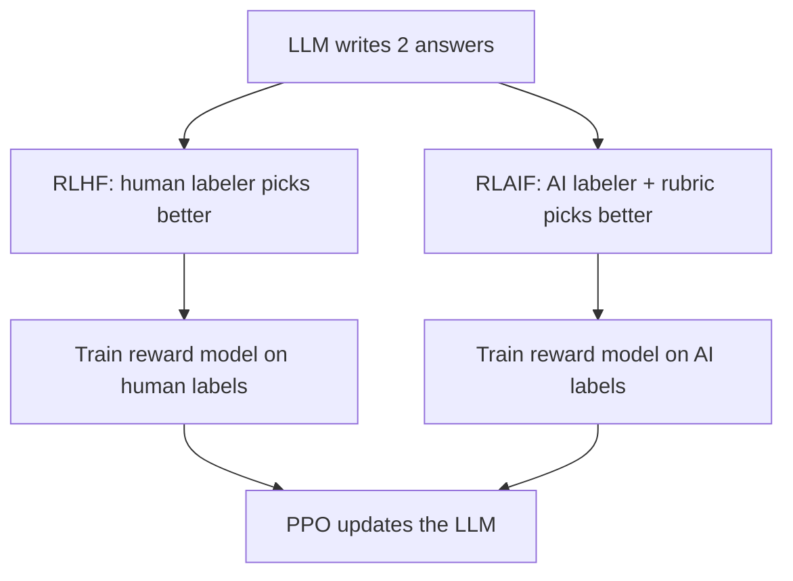
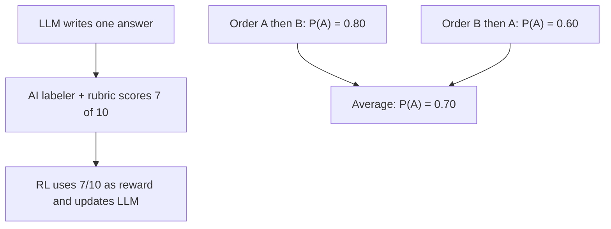

# What is RLAIF? Reinforcement Learning from AI Feedback Explained

> **Step 7: Training, Fine-Tuning, and Alignment** · ⏱️ 15 min read · [Read original](https://outcomeschool.com/blog/reinforcement-learning-from-ai-feedback-rlaif)

## TL;DR
RLAIF trains an LLM like RLHF, but the preference labels (which of two answers is better) come from an AI labeler guided by a written rubric instead of humans. The labels train a reward model, then PPO updates the LLM. It is cheaper, faster and more consistent than human labeling, but inherits the labeler's biases and errors.

## Key Concepts
- **RLHF** — LLM writes two answers, human picks the better one (preference label), labels train a reward model, PPO updates the LLM to raise the score.
- **Reward model** — model that scores an answer; higher means better.
- **RLAIF** — same pipeline as RLHF with the human labeler swapped for an AI labeler.
- **AI labeler** — usually a strong, already trained LLM, not retrained; just prompted (LLM-as-a-judge).
- **Rubric** — written principles in the prompt defining "better" (correct, easy to understand, not harmful, not longer than needed).
- **Soft label** — labeler's probabilities (e.g. 0.8 for answer 1, 0.2 for answer 2) instead of a plain 1 or 2; carries more information.
- **Direct RLAIF** — the AI labeler scores each answer directly (e.g. 1 to 10) and the score is the RL reward; no separate reward model.
- **Constitutional AI** — Anthropic (2022) method; the constitution is the rubric.
- **Position bias** — labeler favors an answer because of its order.

## How It Works

### Why replace human labelers
RLHF works well, but humans cause three problems:
1. **Cost** — tens to hundreds of thousands of labels, each from a trained reader.
2. **Speed** — weeks to collect; change the model or rules and you relabel.
3. **Consistency** — people differ (short vs detailed answers); even one person varies when tired, so labels are noisy.

Analogy: in RLHF the manager reads every report; in RLAIF a senior employee follows a written checklist the manager wrote once.

### The AI labeler and its principles
- Prompt = rubric + question + Answer 1 + Answer 2 + "Which answer is better? Reply with 1 or 2." The reply is the preference label.
- In practice use the probabilities (soft label), not just the final token.
- Often ask the labeler to explain its reasoning first, then answer; this often improves label quality.
- To change what "better" means, edit the rubric; no team to hire or retrain.

### RLAIF pipeline
1. Generate two different answers per prompt, for thousands of prompts.
2. AI labeler compares each pair using the rubric.
3. Train a reward model on the AI labels (exactly as in RLHF).
4. Run RL with PPO: LLM writes, reward model scores, PPO updates. Keep the LLM close to its original version so it does not drift into strange answers chasing the score (see reward hacking).

Only the source of the preference label differs from RLHF.

### Direct RLAIF
- AI labeler gives the reward directly: "Rate this answer 1 to 10 by these principles" (e.g. 7/10 used as reward).
- **Pro** — no reward model to train and maintain; a separate reward model goes stale as the LLM changes, while the labeler judges each new answer fresh.
- **Con** — calling a large labeler on every answer during training is slow and costly (labeler is often much larger than a reward model).

### RLAIF and Constitutional AI
- Stage 1 (supervised): model writes an answer, critiques it using a constitution principle, rewrites it; train on the improved answers.
- Stage 2 (RL): model writes two answers, an AI picks the better one using the constitution; labels train a preference model (= reward model), then RL. **Stage 2 is RLAIF** (the paper coined the term).
- In that work AI feedback was used for harmlessness; helpfulness labels still came from humans.

### What research says
- Google 2023 paper "RLAIF vs. RLHF: Scaling Reinforcement Learning from Human Feedback with AI Feedback": tasks were summarization, helpful dialogue, harmless dialogue.
- RLAIF performed comparably to RLHF; in summarization both were preferred over the starting model at similar rates and preferred equally when compared head to head. On harmless dialogue RLAIF did better.
- Direct RLAIF beat normal RLAIF with a reward model in their setup.
- Caveat: specific tasks and models; does not mean AI feedback replaces human feedback everywhere.

### Position bias and its fix
- Example: A shown first gives P(A better) = 0.80; swap order (A second) gives 0.60. Same answers, only order changed.
- Fix: ask in both orders and average: (0.80 + 0.60) / 2 = 0.70, so P(B better) = 0.30. Each answer gets each position once.

```python
p_a = (0.80 + 0.60) / 2   # 0.70
p_b = 1 - p_a             # 0.30
```

## Diagram(s)

### RLHF vs RLAIF pipelines


### Direct RLAIF and position-bias fix


## Trade-offs & Pitfalls
- **Labeler bias** — may prefer longer answers or its own style; passes into reward model and LLM.
- **Errors copied** — wrong facts get rewarded and learned.
- **Limited by labeler** — unreliable on very hard or very new topics.
- **Position bias** — fix by averaging both orders.
- Humans still write the rubric; hybrid is possible (humans for a small set of important or difficult labels, AI for volume).

| Aspect | RLHF | RLAIF |
|---|---|---|
| Labels from | Human labelers | AI labeler with rubric |
| Cost per label | High | Low |
| Speed | Slow, weeks | Fast, hours |
| Consistency | Varies by person | Same rubric every time |
| Changing rules | Retrain labeler team | Edit rubric, relabel |
| Main risk | Noisy, expensive labels | Labeler bias and errors |
| Reward model | Always | Used, or skipped (direct RLAIF) |

Advantages: cheap, fast, consistent, easy to change, scales to millions of pairs.

## FAQ
- Removes humans completely? → No; humans write the rubric and can label key or hard cases.
- Train a new model as labeler? → No; prompt an existing strong LLM.
- Why probabilities, not only the answer? → They carry more information (soft label).
- As good as RLHF? → On some tasks yes (Google 2023), but results are task- and model-specific.

## Key Takeaways
- RLAIF = RLHF with an AI labeler guided by a rubric replacing human labelers.
- Pipeline: two answers, AI labels, reward model, PPO.
- Direct RLAIF skips the reward model; labeler scores answers as the reward, at higher compute cost.
- Constitutional AI stage 2 is RLAIF, with the constitution as the rubric.
- Research shows parity with RLHF on summarization and dialogue tasks, but not everywhere.
- Main risks: labeler bias, copied errors, position bias (average both orders).
- Change behavior by editing the rubric, not by hiring labelers.
