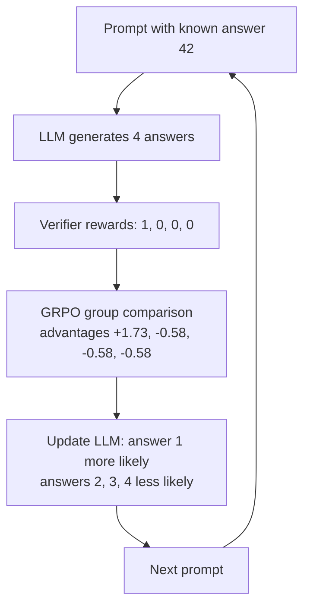
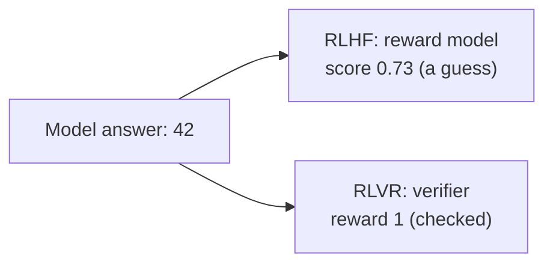

# What is Reinforcement Learning with Verifiable Rewards (RLVR)?

> **Step 7: Training, Fine-Tuning, and Alignment** · ⏱️ 15 min read · [Read original](https://outcomeschool.com/blog/reinforcement-learning-with-verifiable-rewards-rlvr)

## TL;DR
RLVR trains an LLM with reinforcement learning where a program (a verifier) checks the final answer against a known result and gives reward 1 if correct, 0 if wrong. No learned reward model is needed. Combined with GRPO it powered reasoning models like DeepSeek-R1, but it only works on checkable tasks.

## Key Concepts
- **Reward** — score the model gets; RL pushes it toward high-reward behavior.
- **Reward model** — neural net trained on human preferences that scores answers (used in RLHF).
- **RLVR** — RL where the reward comes from a program checking against a known correct result. Term popularized by AI2's Tulu 3 (math, precise instruction following).
- **Verifiable** — can be checked automatically and exactly.
- **Verifier** — the program that checks the answer and returns the reward.
- **Policy** — the LLM being trained (decides the next token).
- **GRPO** — Group Relative Policy Optimization; used by DeepSeek-R1.
- **Advantage** — score for an answer relative to its group; positive means better than average.
- **Sparse reward** — only a 1 or 0 at the end of a long answer.

## How It Works

### Problem with learned reward models
- Needed because humans cannot read millions of answers; works well for open-ended tasks (a polite email).
- **Can be fooled** — it only guesses what humans like; LLM finds longer, more confident or flattering answers that score high without being good (reward hacking).
- **Expensive** — lots of human preference data, a separate large model, run on every answer.
- For "12 + 30" the answer 42 can be checked with a few lines of code.

### What RLVR rewards
Tasks:
- **Math with a final answer** — compare number to the known one.
- **Code with tests** — run test cases; all pass means correct.
- **Format rules** — e.g. reasoning inside `<think>` tags, final answer on a line starting `Answer:`.

Reward is 1 or 0; some setups add a small format reward.

| RLHF | RLVR |
|---|---|
| Reward model guesses a score (0.73) | Program checks against 42, reward 1 |

### The verifier
```python
import re
def verify(model_output, correct_answer):
    match = re.search(r"Answer:\s*(-?\d+)", model_output)
    if match is None:
        return 0
    return 1 if int(match.group(1)) == correct_answer else 0
```
- "12 + 30 = 42. Answer: 42" gives 1; "...Answer: 32" gives 0; "I think it is around 40." gives 0 (no formatted final answer).
- It never reads the reasoning, only the final answer; model may think any way it likes. For code, it runs tests instead.

### Training loop (with GRPO)
1. Pick a prompt with a known answer ("What is 12 + 30?", 42).
2. Model generates several answers (e.g. 4); they differ because of sampling randomness.
3. Verifier gives each a reward of 1 or 0.
4. Compare each answer with the group: above average gets positive advantage, below gets negative.
5. Update parameters: raise token likelihood for positive advantage, lower for negative.
6. Repeat over many prompts. No human and no reward model in the loop.

### GRPO advantage worked example
$$
\text{advantage}_i = \frac{\text{reward}_i - \text{mean}(\text{rewards})}{\text{std}(\text{rewards})}
$$

Answers: 42 (reward 1), 32 (0), 43 (0), no final answer (0).
- Mean = (1+0+0+0)/4 = 0.25.
- Differences: 0.75, -0.25, -0.25, -0.25; squares 0.5625, 0.0625, 0.0625, 0.0625; average 0.75/4 = 0.1875; std = sqrt(0.1875) = 0.433.
- Advantages: answer 1 = 0.75/0.433 = +1.73; others = -0.25/0.433 = -0.58.

Notes:
- Correct answer pulled toward, wrong ones pushed away; advantages sum to zero.
- The group is the baseline, so no separate value model is needed; cheaper than PPO, which trains an extra value model.
- All 4 correct or all 4 wrong: every advantage is 0, so no learning. Learning needs a mix of correct and wrong.

### How RLVR led to reasoning models
- January 2025: DeepSeek-R1 released, plus DeepSeek-R1-Zero, trained by GRPO RL directly on the base model with no prior fine-tuning on example answers.
- Rewards were rule-based: **accuracy** (math final answer matches, code passes tests) and **format** (thinking between `<think>` and `</think>`).
- No neural reward model, since it can suffer reward hacking at scale and adds complexity.
- Verifier never taught how to think, yet the model on its own wrote longer reasoning, checked steps, and switched approach on mistakes; thinking longer yielded more correct (rewarded) answers.
- Final DeepSeek-R1 used more stages: fine-tune on small long-reasoning set, RL, fine-tune again, another RL round. R1-Zero showed rule-based RL alone can give strong reasoning.

## Diagram(s)

### RLVR training loop


### Source of reward


## Trade-offs & Pitfalls
- **Only checkable tasks** — poems, meeting summaries, advice have no single correct answer; still need human feedback or a reward model.
- **Verifier bugs can be gamed** — model optimizes reward 1, not correctness. If it only checks that code runs without crashing, model writes code that does nothing; if it only checks the number appears anywhere, model prints many numbers. Hacking is less common than with a learned reward model but possible; write verifiers carefully.
- **Sparse reward** — no signal about which reasoning step was right; if a problem is too hard and always 0, nothing is learned. Training problems need the right difficulty.

| Aspect | RLHF | RLVR |
|---|---|---|
| Reward source | Learned reward model on human data | Verifier program |
| Reward value | Score like 0.73 | Usually 1 or 0 |
| Best for | Open-ended: writing, chat | Checkable: math, code, format |
| Human data | Lots of preferences | Prompts with known answers or tests |
| Cost | High, separate large model | Low, small program |
| Risk of being fooled | Higher | Lower, but verifier bugs exploitable |

In practice both are used together: RLVR for math and code reasoning, RLHF for helpfulness and safety on open-ended tasks.

## FAQ
- Does the verifier check reasoning steps? → No, only the final answer; hence sparse reward.
- All answers in a group same reward? → All advantages 0, model learns nothing; needs a mix.
- Can reward hacking still happen? → Yes, via verifier gaps.
- RLVR and RLHF together? → Yes, often.

## Key Takeaways
- RLVR replaces the learned reward model with a program that checks the answer: 1 or 0.
- Works for math, code with tests, and format rules.
- GRPO normalizes rewards within a group: (reward - mean) / std, no value model needed.
- Groups with all-equal rewards give zero gradient signal; difficulty must be balanced.
- DeepSeek-R1-Zero showed rule-based RL alone produces long reasoning and self-checking.
- Limits: needs checkable answers, gameable verifiers, sparse reward.
- RLVR complements RLHF rather than replacing it.
