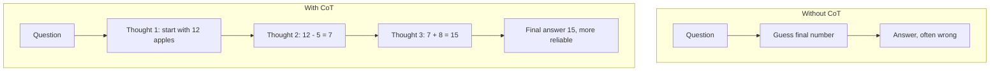
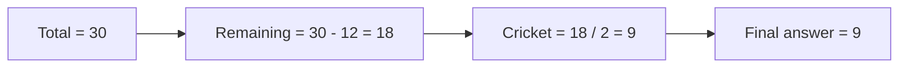
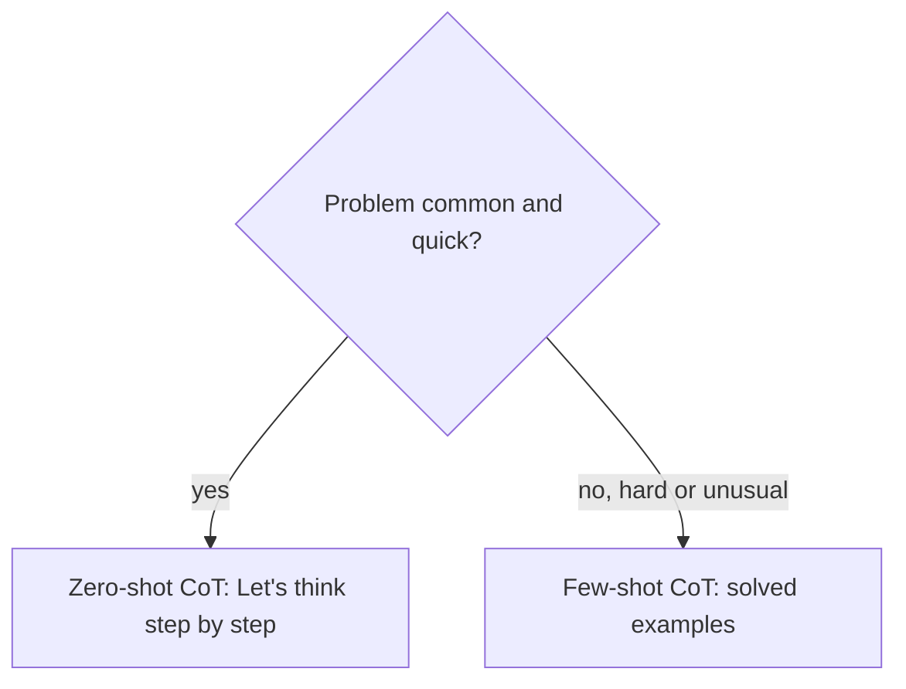

# How does Chain-of-Thought (CoT) Prompting work?

> **Step 8: Prompt Engineering and Context Engineering** · ⏱️ 14 min read · [Read original](https://outcomeschool.com/blog/how-does-chain-of-thought-prompting-work)

## TL;DR
Chain-of-Thought (CoT) prompting asks the model to write out its reasoning steps before the final answer. Because an LLM generates word by word and reads its own earlier output, visible steps give it a "scratchpad" and make multi-step answers more accurate. It can be triggered zero-shot ("Let's think step by step") or few-shot (solved examples).

## Key Concepts
- **Prompt** — the text instruction/question given to the model.
- **LLM** — model trained on lots of text to predict the next word, generating its answer one word at a time (autoregression).
- **Thought** — one small reasoning step. **Chain** — thoughts linked in sequence, each using the previous one.
- **Zero-shot CoT** — no examples, just a trigger line.
- **Few-shot CoT** — a few solved examples with full reasoning, then the real question.

## How It Works

### The problem
Apple problem: 12 apples, sell 5, buy 8; correct answer 15 (12-5=7, 7+8=15). Asking for the answer directly forces a one-shot guess. Easy problems may pass; harder ones often give a wrong number. Because generation is word by word, committing early to a final number leaves no chance to correct.

### CoT in action
Add "Let's think step by step." The model writes: start with 12; 12-5=7; 7+8=15; final answer 15. A prompt that says "give only the final number" removes thinking space.

### Zero-shot vs Few-shot

| Point | Zero-shot CoT | Few-shot CoT |
|---|---|---|
| Examples given | None | A few solved examples |
| Trigger | Line like "Let's think step by step" | Solved examples with steps |
| Prompt length | Short | Longer |
| Effort | Very little | More (write examples) |
| Best for | Quick, common problems | Harder or unusual problems |

Zero-shot example: train 60 km in 1 hour, how far in 3 hours? + trigger line. Few-shot example: box of 4 pens +3 = 7; jar 10 candies -6 = 4; then shelf 8 books +5, model answers "8 + 5 = 13".

### Walkthrough: 30 students, 12 play football, half of the remaining play cricket
1. Total = 30.
2. Remaining = 30 - 12 = 18.
3. Cricket = 18 / 2 = 9.
4. Answer: 9. Each step uses the previous step's result, hence "chain". One-shot guessing could slip.

### Why it works
- Reasoning words become part of the model's next input, so the final answer builds on correct visible steps rather than a guess (like writing steps on paper rather than mental math).
- Breaking a hard problem into easy steps suits the model's strength at small steps.
- The model is not smarter; it gets structured room to think.
- Newer reasoning models are trained to produce steps on their own (large reasoning models).

### Where it is useful
Math word problems; logic puzzles; multi-step questions; decision-making (weighing options); reading comprehension (connecting passage parts). When one wrong first step ruins everything, go further with Tree of Thoughts (try many paths, judge, backtrack).

## Diagram(s)

### Direct vs CoT

### Chain in the cricket example

### Choosing zero-shot or few-shot

## Trade-offs & Pitfalls
- Helps most on hard multi-step problems; unnecessary for single-fact questions ("capital of France?").
- Written reasoning is not always correct: steps can look right yet reach a wrong answer. Check important outputs.
- More generated text means a bit more time and cost; usually a fair trade.

## FAQ
- Makes model smarter? → No, gives structured room to think.
- Use for simple questions? → No.
- Trust the steps fully? → No.
- Adds time/cost? → Yes, slightly.
- Always need a special prompt? → No, newer reasoning models do it natively.

## Key Takeaways
- CoT = ask the model to reason in steps before answering.
- It works because LLMs are autoregressive and condition on their own written steps.
- Zero-shot: trigger phrase; few-shot: solved examples with reasoning.
- Best for math, logic, multi-step and decision tasks.
- Costs extra tokens and the steps can still be wrong.
- Tree of Thoughts extends it by exploring and backtracking over multiple paths.
