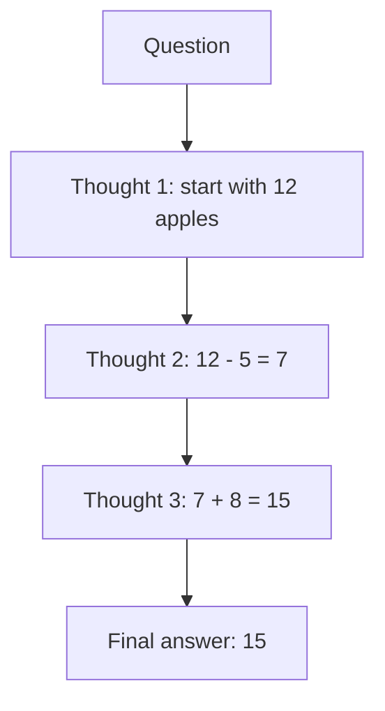

# How does Chain-of-Thought (CoT) Prompting work?

> **Step 8: Prompt Engineering and Context Engineering** · ⏱️ 14 min read · [Read original](https://outcomeschool.com/blog/how-does-chain-of-thought-prompting-work)

## TL;DR
Chain-of-Thought prompting asks an LLM to write out its reasoning steps before the final answer. Because an LLM generates word by word and reads its own output, visible intermediate steps make multi-step answers more reliable.

## Key Concepts
- **Prompt** — the text instruction or question given to the model.
- **Autoregression** — LLMs generate one token at a time, each depending on earlier ones; they cannot revise a committed answer.
- **Thought** — one small reasoning step; a **chain** is steps linked in sequence.
- **Zero-shot CoT** — add a trigger such as "Let's think step by step", no examples.
- **Few-shot CoT** — show a few solved examples with full reasoning, then ask the question.

## How It Works
### The problem
Asked for the answer directly, the model predicts the final number in one shot. For harder problems it often lands on a wrong number and has no chance to correct itself.

### The fix
Example: a shop has 12 apples, sells 5, buys 8.
- Thought 1: start with 12.
- Thought 2: 12 - 5 = 7.
- Thought 3: 7 + 8 = 15.
- Final answer: 15.

A longer chain: 30 students, 12 play football, half the remaining 18 play cricket, so 9. Each step uses the previous step's result, which is why it is a chain.

### Why it works
Reasoning words become part of the context the model reads next, so the final answer builds on visible correct steps rather than a guess (like writing a calculation on paper). Breaking a big problem into small easy steps also suits the model. The model is not smarter; it just has structured room to think. Newer reasoning models are trained to produce such steps on their own.

### Zero-shot vs few-shot
| Point | Zero-shot CoT | Few-shot CoT |
|---|---|---|
| Examples | None | A few solved examples |
| Trigger | "Let's think step by step" | Showing steps in examples |
| Prompt length | Short | Longer |
| Effort | Very little | More (write examples) |
| Best for | Quick, common problems | Harder or unusual problems |

### Where to use it
Math word problems, logic puzzles, multi-step questions, decision tasks, reading comprehension.

### Caveats
- Little value for single-fact questions.
- Written steps can look right but still reach a wrong answer; verify important cases.
- More output means more time and cost.
- For problems where one bad first step ruins everything, Tree of Thoughts explores multiple paths.

## Diagram

## Key Takeaways
- CoT = ask the model to reason step by step before answering.
- It works because LLMs generate token by token and condition on their own visible steps.
- Zero-shot uses a trigger phrase; few-shot teaches the pattern with examples.
- Best for multi-step problems; unnecessary for simple facts.
- Trade-offs: extra tokens and no guarantee the reasoning is correct.
