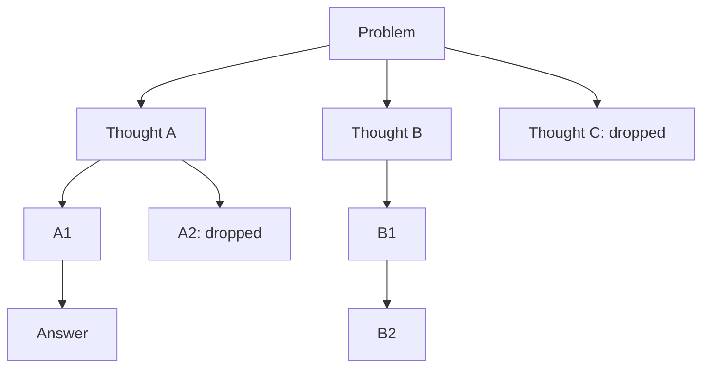
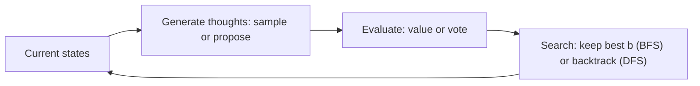
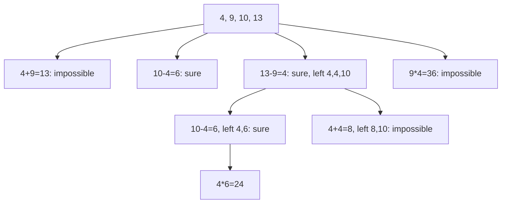

# How does Tree of Thoughts work?

> **Step 8: Prompt Engineering and Context Engineering** · ⏱️ 17 min read · [Read original](https://outcomeschool.com/blog/how-does-tree-of-thoughts-work)

## TL;DR
Tree of Thoughts (ToT; Yao et al., 2023, Princeton + Google DeepMind, "Deliberate Problem Solving with Large Language Models") makes an LLM explore many reasoning paths as a tree: generate several candidate thoughts, judge how promising each is, and use a search (BFS or DFS with backtracking) to keep good paths and drop bad ones. It beats single-chain CoT on hard problems, at much higher cost.

## Key Concepts
- **Token** — small piece of text; LLM writes left to right and never goes back, so an early wrong step spoils everything.
- **Chain of Thought (CoT)** — write reasoning step by step ("Let's think step by step"). Example: 23 apples, sell 20, buy 6: 23-20=3, 3+6=9.
- **Thought** — one meaningful middle step: bigger than a token, smaller than the whole answer (one equation in maths, one word in a crossword, a short story plan in writing).
- **State** — problem + all thoughts on the current path (each tree node).
- **Thought generator** — produces candidate next thoughts.
- **State evaluator** — judges states.
- **Search algorithm** — BFS or DFS over the tree.
- **Breadth limit $b$** — states kept per level in BFS.
- **Backtracking** — returning to the previous state after a dead end.

## How It Works

### The problem with CoT
CoT is one straight chain: pick step 1, 2, 3 and never look back. A bad step 1 poisons the rest and the LLM cannot say "go back". Humans exploring Sudoku or mazes try, hit dead ends, backtrack, and compare options. CoT does not explore.

### The four parts
1. **Break into thoughts** — choose thought size. Too small (one word): cannot be judged. Too big (whole answer): cannot generate varied options. Chosen by the system designer per use case.
2. **Generate many thoughts**
   - *Sample*: ask the same question several times independently; suits open-ended choices (creative writing).
   - *Propose*: ask once to list several distinct next thoughts; suits small limited choices (maths), avoids repeats.
3. **Judge thoughts** (same LLM; cf. LLM-as-a-judge)
   - *Value*: rate each state alone as sure / likely / impossible, mapped to scores. Example: "left: 4, 4, 10": 10-4=6, 6*4=24, sure. "left: 1, 1, 2": max (1+1)*2=4, impossible. Like a chess player judging a position without playing it out.
   - *Vote*: show all states, ask which is most promising; repeat and count.
   - Stabilize by repeating the rating and summing (sure big, likely small, impossible near zero). Judgement need only be good enough to guide search.
4. **Search**
   - **BFS** — level by level, keep best $b$ (e.g. 5), drop the rest (talent show rounds). Good when steps are few and fixed (Game of 24 needs exactly 3).
   - **DFS** — go deep on the most promising path; if hopeless, backtrack and try the next option (maze). Good for long paths; the paper used DFS for 5x5 crosswords (each thought fills a word; a word that breaks the grid triggers backtracking).

### Worked example: Game of 24 with 4, 9, 10, 13
Use each number once with + - * / to make 24. Each thought = an equation combining two numbers; 3 thoughts total.
- Level 1 proposals: (a) 4+9=13 (left 10,13,13) impossible; (b) 10-4=6 (6,9,13) sure; (c) 13-9=4 (4,4,10) sure; (d) 9*4=36 (10,13,36) impossible. BFS keeps (c) and (b).
- Level 2 from (c): 10-4=6 (left 4,6) sure since 4*6=24; 4+4=8 (8,10) impossible.
- Level 3: 4*6=24.
- Path: 13-9=4, 10-4=6, 4*6=24, i.e. $(10-(13-9))\times4=24$.
- Paper: GPT-4 with CoT solved 4%; with ToT (best 5 per level) 74%. With CoT a bad first equation like (a) kills the answer; ToT drops it early.

### Code sketch (BFS)
```python
def tree_of_thoughts(problem, steps=3, keep=5):
    states = [problem]
    for level in range(steps):
        candidates = [s + "\n" + t for s in states for t in llm_propose(s)]   # generate
        scored = sorted(((llm_judge(c), c) for c in candidates), reverse=True) # judge
        states = [c for _, c in scored[:keep]]                                 # keep best
    return states[0]
```

### CoT vs ToT

| Point | Chain of Thought | Tree of Thoughts |
|---|---|---|
| Shape | One chain | Tree with branches |
| Options per step | One | Many |
| Judges its steps | No | Yes |
| Go back after mistake | No | Yes (backtracking) |
| LLM calls | One | Many, often dozens or more |
| Cost and time | Low | High |
| Best for | Simple step-by-step problems | Hard problems needing try-and-check |

## Diagram(s)

### The tree with pruning


### Four-part loop


### Game of 24 path


## Trade-offs & Pitfalls
Advantages: solves problems where the first move matters (puzzles, planning, crosswords); recovers from bad steps; needs no new training (works with any LLM); tunable (breadth, thought size, search).
Disadvantages: expensive (many calls, money, time); a wrongly judged good path is dropped forever; thought size, prompts, and search must be designed per problem type; wasteful for easy questions where CoT suffices.
Note: newer reasoning models explore, check, and backtrack inside their own long reasoning, but ToT still gives explicit control over paths and judging when building agents.

## FAQ
- New model or training needed? → No.
- Who introduced it? → Yao et al., 2023, Princeton + DeepMind; tested on Game of 24 and 5x5 crosswords.
- More expensive than CoT? → Yes, dozens of calls.
- Wrong judgement? → Path dropped forever; repeat ratings and sum scores.
- Reasoning models make it obsolete? → No, still useful for control.

## Key Takeaways
- CoT is a single straight chain that cannot go back; ToT explores a tree.
- Four parts: thoughts, generation (sample/propose), evaluation (value/vote), search (BFS/DFS).
- BFS keeps the best $b$ states per level; DFS backtracks from dead ends.
- Game of 24: GPT-4 CoT 4% vs ToT 74%.
- Cost is the main drawback; judging errors can discard good paths.
- Use for hard problems with costly early mistakes, not easy ones.
