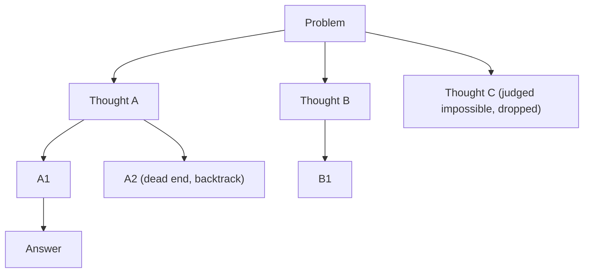

# How does Tree of Thoughts work?

> **Step 8: Prompt Engineering and Context Engineering** · ⏱️ 17 min read · [Read original](https://outcomeschool.com/blog/how-does-tree-of-thoughts-work)

## TL;DR
Tree of Thoughts (Yao et al., 2023, Princeton and Google DeepMind) lets an LLM explore many reasoning paths as a tree, judge how promising each one is, and use search to keep good paths and backtrack from failures. It beats single-chain reasoning on hard puzzles, at much higher cost.

## Key Concepts
- **Chain of Thought limit** — one straight chain; a bad early step poisons everything and there is no going back.
- **Thought** — one meaningful intermediate step (an equation, a crossword word, a story plan); bigger than a token, smaller than the answer.
- **State** — the problem plus all thoughts on the current path.
- **Thought generator** — Sample (ask repeatedly; good for open choices like writing) or Propose (list several in one call; good for limited choices like math).
- **State evaluator** — Value (rate each state: sure, likely, impossible) or Vote (pick the most promising among all).
- **Breadth limit b** — number of states kept per level in BFS.

## How It Works
Four parts:
1. **Break the problem into thoughts.** Too small and it cannot be judged; too big and it cannot produce varied options. Designer's choice.
2. **Generate** several candidate next thoughts per state.
3. **Judge** each state with the same LLM (can repeat the rating and sum scores for stability; it need not be perfect, only good enough to guide search).
4. **Search.**
   - **BFS:** level by level, keep best b states; suits short fixed-length problems.
   - **DFS:** go deep on the best path, backtrack on dead ends; suits long problems like 5x5 crosswords.

### Game of 24 (4, 9, 10, 13)
Level 1 proposals: (a) 4+9=13 leaves 10,13,13 (impossible); (b) 10-4=6 leaves 6,9,13 (sure); (c) 13-9=4 leaves 4,4,10 (sure); (d) 9*4=36 leaves 10,13,36 (impossible). Keep (b) and (c). From (c): 10-4=6 leaves 4,6 (sure), then 4*6=24. Path: 13-9=4, 10-4=6, 4*6=24, i.e. $(10-(13-9))\times4=24$. Paper result: GPT-4 with CoT solved 4%; with ToT (keep best 5) 74%.

### Code sketch (BFS)
```python
states = [problem]
for level in range(steps):
    cands = [s + "\n" + t for s in states for t in llm_propose(s)]
    scored = sorted(((llm_judge(c), c) for c in cands), reverse=True)
    states = [c for _, c in scored[:keep]]
return states[0]
```

### CoT vs ToT
| Point | Chain of Thought | Tree of Thoughts |
|---|---|---|
| Shape | One chain | Tree of branches |
| Options per step | One | Many |
| Judges own steps | No | Yes |
| Backtracking | No | Yes |
| LLM calls | One | Dozens or more |
| Cost and time | Low | High |
| Best for | Simple step-by-step | Hard, trial-and-check problems |

### Strengths and weaknesses
- **Pros:** handles problems where the first move matters (puzzles, planning, crosswords), recovers from bad steps, needs no training, tunable.
- **Cons:** expensive, wrong judgments permanently drop good paths, needs per-problem design, wasteful for easy questions.
- Newer reasoning models explore internally, but ToT still helps when building agents with explicit control.

## Diagram


## Key Takeaways
- ToT = generate many thoughts, evaluate them, search the tree, backtrack when needed.
- The same LLM both proposes and judges thoughts; no extra training.
- BFS for short fixed-depth tasks, DFS for long ones.
- Big gain on Game of 24 (4% to 74% for GPT-4) but many more LLM calls.
- Use CoT for easy problems; ToT when an early wrong step ruins the result.
