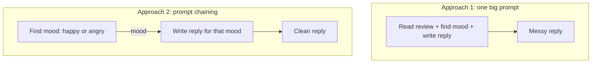
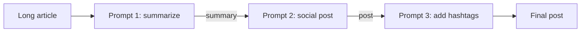
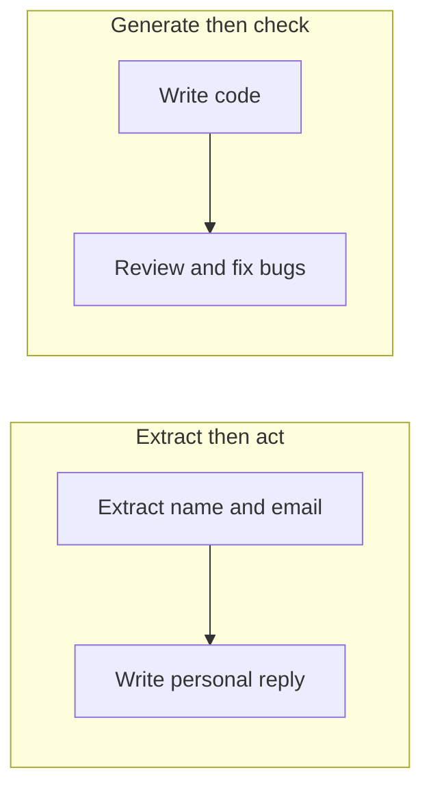

# How does Prompt Chaining work?

> **Step 8: Prompt Engineering and Context Engineering** · ⏱️ 16 min read · [Read original](https://outcomeschool.com/blog/how-does-prompt-chaining-work)

## TL;DR
Prompt Chaining breaks one big task into small prompts where each prompt's output becomes the next prompt's input. Each step does one simple job, so results are cleaner, easier to debug, and more controllable, at the cost of extra model calls and error propagation.

## Key Concepts
- **Prompt** — instruction/question given to the model; **response** — what comes back.
- **Prompt Chaining = Prompt + Chaining** — links of prompts, each depending on the previous answer.
- **Not Chain-of-Thought** — CoT: one model reasons step by step inside one prompt. Chaining: multiple separate prompts joined together.
- **Straight chain** — no branches or going back; branching/loops move into Graph Engineering.

## How It Works

### Why chain: one big prompt vs chain
Task: "Read this customer review, decide if the customer is happy or angry, then write a polite reply."
- Approach 1 (one prompt): the AI does everything at once; mood detection can be wrong, reply messy, mistakes hard to find/fix.
- Approach 2 (chain): Step 1 returns only the mood; Step 2 takes the mood and writes a matching reply. Each prompt does one job; if something fails you know which step to fix.

### Step-by-step flow
1. Prompt 1 gives Output 1.
2. Output 1 is put into Prompt 2, giving Output 2.
3. Output 2 is put into Prompt 3, giving the final answer.
Analogy: a factory line or team, each worker does one job and hands the result on.

| Prompt Chaining role | Real-world comparison |
|---|---|
| Full task | A project given to a team |
| Each small prompt | One member doing one job |
| Output passed forward | Hand-off to next member |
| Final answer | The finished project |

### Real example: article to social post
1. Summarize the article in 3 short sentences gives Output 1.
2. Turn the summary into a short catchy post (the AI sees only the summary, not the article) gives Output 2.
3. Add 3 relevant hashtags gives the final post.

### Code
```python
summary    = ask_ai("Summarize this article in 3 short sentences: " + article)
post       = ask_ai("Turn this summary into a catchy social media post: " + summary)
final_post = ask_ai("Add 3 relevant hashtags to this post: " + post)
```
Output of each step is passed in as the next input (summary, not the article). Frameworks like LangChain build chains without hand-wiring.

### Common patterns
1. **Straight chain** — step 1 to 2 to 3, no branches or going back.
2. **Extract, then act** — pull info (name, email) then use it (personal reply).
3. **Generate, then check** — write (code), then review and fix bugs; the basis of a Reflection Agent.

### Advantages
- Each step simple, so better answers.
- Easy to find where a mistake started.
- Reusable small prompts.
- Control: inspect or edit each step's output.
- Clear ordering of thought.
- Short prompts avoid important info getting buried mid-context (Lost in the Middle).

### When to use
Task is too big or has clear steps: read a document then answer questions; translate then make polite; extract data then save in clean format; draft, improve, then check. A giant multi-part instruction signals a chain. Simple small tasks need only a single prompt.

## Diagram(s)

### Single prompt vs chain


### Article to post chain


### Patterns


## Trade-offs & Pitfalls
- Each step is one more model call: 5 steps means 5 calls, so more time and cost. Keep the chain only as long as needed.
- Error spreading: a wrong Step 1 output corrupts all later steps. Verify early steps.
- Pass only what the next step needs (e.g. the summary, not the whole article) to keep prompts small, fast, focused.
- Skip chaining for simple, small tasks.

## FAQ
- Chaining vs CoT? → Many prompts joined vs reasoning inside one prompt.
- Costs more? → Yes, one call per step.
- Wrong output in a step? → Propagates; but separate steps make the source findable.
- Pass full original input each step? → No, only what is needed.
- Need LangChain? → No, plain code works.

## Key Takeaways
- Output of prompt $n$ becomes input of prompt $n+1$.
- Each prompt does one small job: cleaner answers and easy debugging.
- Patterns: straight chain, extract-then-act, generate-then-check.
- Costs: more calls and error propagation; keep chains short and check early steps.
- Distinct from CoT; branching/loops belong to graph-based approaches.
- Use for multi-part tasks; use a single prompt for simple ones.
