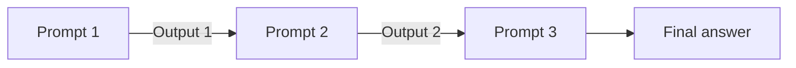

# How does Prompt Chaining work?

> **Step 8: Prompt Engineering and Context Engineering** · ⏱️ 16 min read · [Read original](https://outcomeschool.com/blog/how-does-prompt-chaining-work)

## TL;DR
Prompt Chaining breaks one big task into several small prompts, where the output of each prompt becomes the input of the next. Each prompt does one simple job, which makes results better and mistakes easier to find and fix.

## Key Concepts
- **Prompt** — the instruction or question given to an AI model; the answer is the response.
- **Prompt Chaining** — joining multiple separate prompts so each step feeds the next.
- **Chain-of-Thought (CoT)** — different thing: one model reasons step by step inside a single prompt.
- **Straight chain** — Step 1 feeds Step 2 feeds Step 3, no branches or loops (branching/looping is Graph Engineering).
- **Extract, then act** — pull info out of text first, then use it in the next prompt.
- **Generate, then check** — write something, then have the AI review and fix it (the idea behind a Reflection Agent).

## How It Works
**Why not one big prompt?** Asking for "find the mood of this review and write a polite reply" in one prompt makes the model do many jobs at once; mood detection may be wrong, the reply messy, and errors are hard to locate. Chained: Step 1 returns only the mood, Step 2 writes a reply for that mood.

**Flow:** Prompt 1 gives Output 1; Output 1 is placed inside Prompt 2 to give Output 2; Output 2 goes into Prompt 3 to give the final answer. Think of a factory line where each worker hands work to the next.

**Example: article to social post**
1. Summarize the article in 3 sentences (Output 1).
2. Turn that summary into a catchy post (the model never sees the full article again).
3. Add 3 hashtags to the post (final answer).

```python
summary    = ask_ai("Summarize this article in 3 short sentences: " + article)
post       = ask_ai("Turn this summary into a catchy social media post: " + summary)
final_post = ask_ai("Add 3 relevant hashtags to this post: " + post)
```

Frameworks like LangChain can wire such chains, but plain code is enough.

**Advantages:** each step is simple; easy to debug; prompts are reusable; you can inspect or edit outputs between steps; short prompts avoid important details getting lost in the middle of a long context.

**Watch out for:**
- Each step is another model call, so more time and cost.
- Errors propagate: a wrong Step 1 poisons everything after it.
- Pass only what the next step needs to keep prompts small and focused.

**When to use:** tasks that are big or have clearly separate parts (read document then answer, translate then polish, draft then improve then check). For simple small tasks, a single prompt is enough.

## Diagram


## Key Takeaways
- Prompt Chaining = small prompts where output of one is input of the next.
- It is not Chain-of-Thought: CoT is one prompt, chaining is many prompts.
- Benefits: simpler steps, easier debugging, reuse, and control between steps.
- Costs: more calls (time and money) and errors that travel down the chain.
- Pass only the needed information forward, and keep chains as short as possible.
