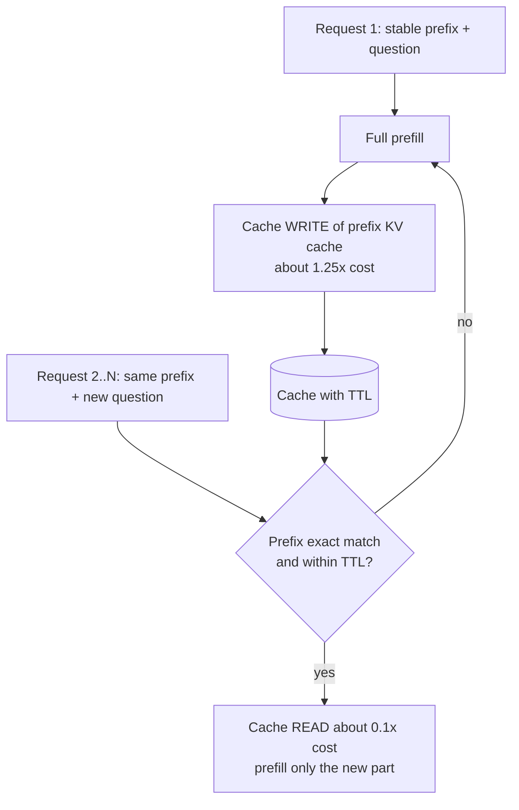

# How does Prompt Caching work?

> **Step 8: Prompt Engineering and Context Engineering** · ⏱️ 19 min read · [Read original](https://outcomeschool.com/blog/how-does-prompt-caching-work)

## TL;DR
Prompt Caching saves the model's internal work (the KV cache) for a fixed, repeated beginning of a prompt, so later requests reuse it instead of recomputing. The result is lower latency and lower cost with no change in answer quality, provided the stable part comes first and matches exactly.

## Key Concepts
- **Token** — small chunk of text (roughly a word or part of one) that the model actually reads.
- **Prefill** — the step where the model processes the entire prompt before writing any reply.
- **KV cache** — the per-token "notes" computed during prefill and reused during generation.
- **Prompt Caching** — save the KV cache for a repeated prompt prefix and load it next time.
- **Semantic caching** — different: reuses the final answer when a new question means the same thing.
- **Cache write / cache read** — first request stores the cache; later requests read it.
- **TTL** — time to live; how long the cache survives before expiring.

## How It Works
**The problem.** A support assistant sends the same ~5,000 tokens of instructions and policy document with every ~50-token question. The model redoes prefill on all 5,050 tokens each time: slow and costly.

**The idea.** Request 1 does full prefill and saves the KV cache of the marked 5,000-token part. Request 2 loads that saved cache and only processes the new 50 tokens.

**Exact-prefix rule.** The cached part must be the beginning of the prompt and match character for character. From the first differing token, everything after is recomputed. A changing item near the top (today's date, a random ID, a user name) quietly breaks the whole cache. Put the stable part first, the changing part last.

**Cost and TTL**

| | Roughly |
|---|---|
| Cache write | about 1.25x normal price for that part |
| Cache read | about 0.1x normal price (around 90% saving) |
| TTL | common default 5 minutes; longer option such as 1 hour (write costs a bit more) |

If no request arrives within the TTL, the cache expires and the next request writes again. Caching pays off when many requests share a prefix and arrive close together.

**What to cache (in order):** tool definitions, system instructions, large documents, few-shot examples; then the user question last.

**Where it shines:** RAG (fixed instructions and repeated text, and it makes Contextual Retrieval affordable) and agents (the same big prefix is resent every step). Providers such as Anthropic and OpenAI offer it built in; the response reports tokens written to and read from cache, which shows whether it works. Inference engines (vLLM, SGLang, TensorRT-LLM) share identical prefixes at serving time.

## Diagram

## Key Takeaways
- Prompt caching reuses KV-cache computation for a repeated prefix; quality is unchanged.
- Only an exact prefix match counts, so one early character change invalidates the rest.
- Order prompts as stable first (tools, system, docs, examples), changing user input last.
- First request costs a bit more (write); later reads are about a tenth of the price.
- TTL means it helps most when requests share a prefix and arrive close together.
- Different from semantic caching, which reuses final answers.
