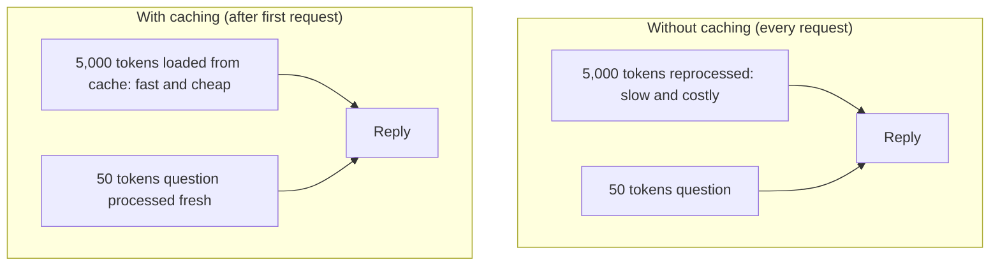
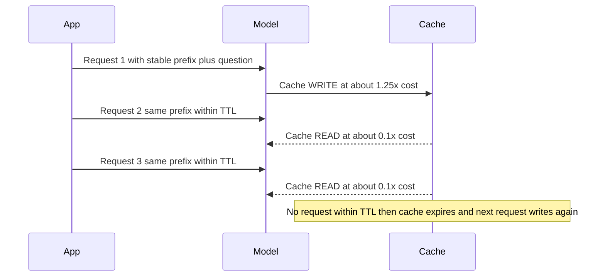
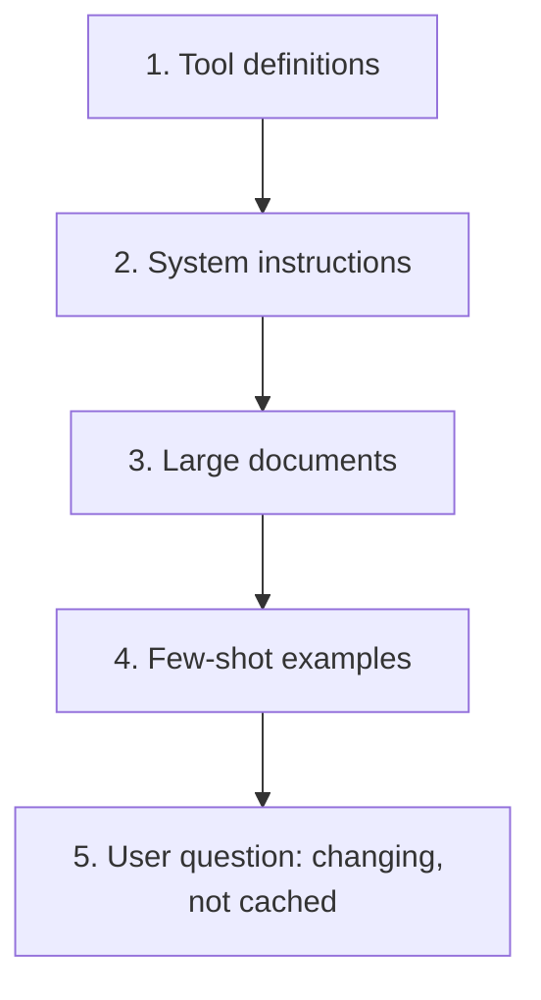

# How does Prompt Caching work?

> **Step 8: Prompt Engineering and Context Engineering** · ⏱️ 19 min read · [Read original](https://outcomeschool.com/blog/how-does-prompt-caching-work)

## TL;DR
Prompt Caching saves the model's internal work (the KV cache built during prefill) for a repeated, exactly matching beginning of a prompt, and reuses it on later requests. Put the stable content first and the changing content last. Result: lower latency and lower cost (cache reads about 0.1x price) with no change in answer quality.

## Key Concepts
- **Prompt** — all text sent to the LLM: instructions, documents, the user's question.
- **Token** — small chunk of text (about a word or part of one); see BPE.
- **Prefill** — model reads and processes every prompt token before writing any reply.
- **KV cache** — per-token "notes" computed during prefill and reused while generating each new word. Building it is heavy work that grows with prompt length.
- **Prompt Caching** — "do the hard work once, then reuse it": save the KV cache of a repeated prompt beginning.
- **Semantic caching** — different: reuses the final answer when a new question means the same thing.
- **Prefix** — the starting part of the prompt, the part before the user's question.
- **Cache write / read** — first-time compute-and-store / later reuse.
- **TTL** — time to live before the cache expires.

## How It Works

### The problem
Shoe-store support assistant: 5,000 tokens of instructions + return-policy doc (identical for every user) + 50-token question. Each request does prefill on 5,050 tokens though 5,000 are unchanged: slow (delay before reply) and costly (paying per token processed repeatedly). Gets worse with long system instructions, large docs, many examples sent every request.

### Core idea
1. Request 1: prefill all 5,050 tokens; save the KV cache for the first 5,000 (the part marked to cache).
2. Request 2 (new question, same 5,000-token start): load the saved KV cache, do fresh work only for the new 50 tokens.
Heavy work on the repeated part happens once.

### Exact-prefix rule
- Cached part must be the beginning of the prompt and match exactly, character for character.
- Example: "Return window is 30 days" vs "45 days": text before the difference is read from cache; from the first differing token onward everything is recomputed.
- One changed character early breaks the cache for everything after it. Common mistake: a daily date ("Today's date is ..."), random ID, or user name near the top silently kills caching.
- Rule: **stable part first, changing part last.**

### Cache write vs read, and TTL
- Write: about 1.25x normal price for that part (compute + store).
- Read: about 0.1x normal price (roughly 90% saving on the repeated part).
- First request pays a bit extra; later ones pay much less.
- TTL: common default 5 minutes; longer option such as 1 hour. Request with same prefix within TTL reads the cache; otherwise it expires and the next request does a fresh write. A longer TTL helps spread-out requests but its write costs a bit more.
- Best when many requests share the same beginning and arrive close in time.

### What to cache (order of a good prompt)
Stable, first: tool definitions, system instructions, large documents, few-shot examples. Changing, last: the user's question. (Prompt ordering is part of Context Engineering.)

### Benefits
Lower latency (skip reprocessing) and lower cost (cached tokens about 0.1x); same quality since the model still sees the full prompt.

### In the real world
- Providers such as Anthropic and OpenAI offer it built in: mark the stable part; responses report tokens written to and read from the cache, so you can verify it works.
- **RAG** — fixed instructions and repeated text are cached; makes Contextual Retrieval affordable (same full document sent once per chunk to write a context note); embeddings can also be cached (embedding cache).
- **Agents** — same instructions, tool definitions, and earlier text sent on every step over many turns, so the prefix is reused a huge number of times.
- Inference engines serve shared prefixes at scale: vLLM (shares identical prefixes), SGLang (radix tree for precise prefix matching), NVIDIA TensorRT-LLM (prefix reuse).

## Diagram(s)

### With and without caching

### Write then read lifecycle

### Prompt layout

## Trade-offs & Pitfalls
- Prefix must match exactly; anything dynamic (date, ID, name) early in the prompt breaks caching.
- First request costs more (about 1.25x write); pays off only with many requests within the TTL.
- Cache expires after TTL (default about 5 min); a longer TTL costs a bit more to write.
- Different from semantic caching (which reuses final answers).

## FAQ
- Prompt vs semantic caching? → Prompt: reuses KV cache for a repeated prefix, still writes fresh reply. Semantic: reuses the final answer for same-meaning questions.
- Changes answer quality? → No.
- No cache hits? → Something changing near the top of the prompt.
- Always cheaper? → Not for the first request (about 1.25x); savings come from reads (about 0.1x).
- How to confirm it works? → Response shows tokens written to and read from cache.

## Key Takeaways
- Prefill builds the KV cache; caching reuses it for a repeated prefix.
- Exact-prefix match is required: stable first, changing last.
- Write about 1.25x, read about 0.1x of normal price; TTL typically 5 min (or 1 hour).
- Cache tool definitions, system prompts, big documents, and few-shot examples.
- Big wins for RAG and multi-step agents; engines like vLLM, SGLang, TensorRT-LLM implement prefix reuse.
- Faster and cheaper with identical answer quality.
