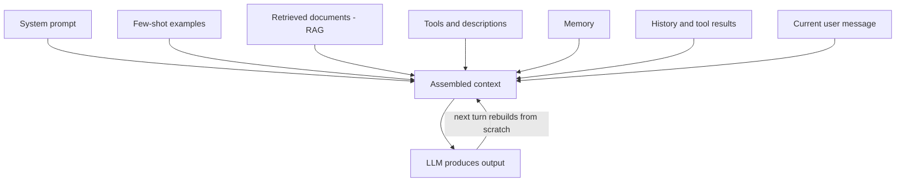

# What is Context Engineering?

> **Step 8: Prompt Engineering and Context Engineering** · ⏱️ 21 min read · [Read original](https://outcomeschool.com/blog/context-engineering)

## TL;DR
Context Engineering is designing, organizing, and managing everything that goes into an LLM's context window so it can do its task reliably. Since LLMs are stateless and their output depends entirely on the context, this has become the main lever for building dependable AI applications, with prompt wording only a small subset.

## Key Concepts
- **Context Engineering** — deciding what information to give the model, how to organize it, and when to include it.
- **Stateless LLM** — remembers nothing between calls; only what is in the context window counts.
- **Prompt Engineering** — wording of a single instruction; a subset of Context Engineering.
- **Context rot** — gradual drop in answer quality as context grows beyond what the task needs.
- **Lost in the middle** — models under-attend to information buried deep in a long context.
- **Context budget** — treating tokens as a limited resource split across system prompt, retrieval, history, and task.

## How It Works
**Analogy.** The LLM is a brilliant colleague with no memory; the context window is the one-page briefing (role, task, background, examples, tools, output format). Context Engineering writes that briefing well.

**Prompt vs Context Engineering**

| Aspect | Prompt Engineering | Context Engineering |
|---|---|---|
| Scope | One instruction | Full context window |
| Concerns | Wording and structure | System prompt, RAG, tools, examples, memory, history |
| Matters most | Simple one-shot tasks | RAG, agents, multi-step, production |
| Failure | Bad wording gives bad answer | Missing/wrong context gives hallucination or wrong tool use |

**Components of the context (all compete for the same window):**
1. System prompt (role, rules, format)
2. Few-shot examples (in-context learning)
3. Retrieved documents (RAG)
4. Tools and descriptions
5. Memory (long-term facts, preferences)
6. Conversation history
7. Tool results
8. Current user message

**Rebuilt every turn.** Context is not stored; each turn it is assembled from scratch from these sources, then the next turn rebuilds it with new tool results.

**Patterns:** RAG (retrieve only relevant chunks), few-shot examples (2-5 as a starting range), tool calling, memory injection (only relevant slices), history management (summaries, sliding windows), output formatting (schema/structured output APIs enforce what the prompt asks), context compression, and per-step context rebuilding for agents (keep only what is relevant now, do not endlessly append).

**Common mistakes:** stuffing everything in; not including enough; bad ordering; stale context; no structure; conflicting instructions.

**Best practices:** treat context as a budget; keep it focused on the current task; order from most stable to most fresh (also friendly to caching); use clear section markers; log and test the context when failures happen; version, diff, and eval it like software; compress carefully (it loses information); design for the worst case (long chats, big documents, repeated tool calls).

## Diagram

## Key Takeaways
- LLMs are stateless, so the output is decided by what is in the context.
- Prompt Engineering is a subset; Context Engineering covers the whole information environment.
- More context is not better: context rot and lost-in-the-middle hurt quality.
- Put rules at the start, the current task at the end; order stable to fresh.
- When an AI app misbehaves, first ask whether the context was right, not whether the model is wrong.
- A weak model with great context can beat a strong model with poor context.
