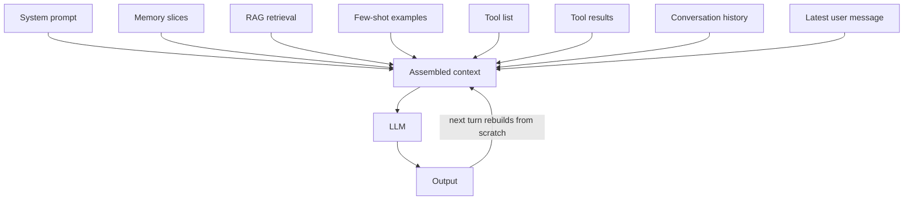
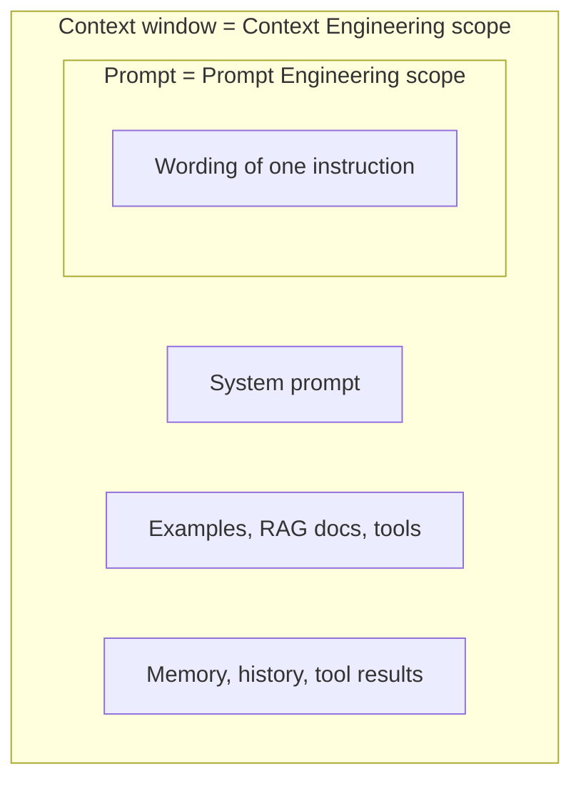

# What is Context Engineering?

> **Step 8: Prompt Engineering and Context Engineering** · ⏱️ 21 min read · [Read original](https://outcomeschool.com/blog/context-engineering)

## TL;DR
Context Engineering is designing, organizing and managing everything that goes into an LLM's context window so it can do its task reliably: what to give, how to organize it, and when to include it. LLMs are stateless, so output is decided entirely by the context. Prompt Engineering is just a subset of it.

## Key Concepts
- **Context Engineering** — deciding what information goes to the model, in what shape, at what time.
- **Stateless LLM** — remembers nothing between calls; the context window is all it knows.
- **Prompt Engineering** — wording of a single instruction.
- **Few-shot / in-context learning** — input-output examples in the context that show the pattern.
- **RAG** — retrieve only the relevant chunks and inject them.
- **Context rot / degradation** — answer quality decays as context grows beyond what the task needs.
- **Lost in the middle** — models under-attend to info buried mid-context; they favour start and end.
- **Structured output APIs / JSON schema** — enforce a format (the prompt only asks for it).
- **Analogy** — LLM = brilliant colleague with no memory; context window = the one-page briefing.

## How It Works

### Why it matters
- Output is decided entirely by input context.
- A weak model with great context can beat a strong model with poor context ("model is the engine, context is the fuel").
- With RAG, agents and multi-step workflows, application complexity is mostly about context, not the model. The real bottleneck is feeding the right info at the right time.

### Prompt vs Context Engineering
| Aspect | Prompt Engineering | Context Engineering |
|---|---|---|
| Scope | One instruction | Full context window |
| Concerns | Wording, phrasing, structure of one prompt | System prompt, RAG, tools, examples, memory, history |
| Matters most | Simple one-shot tasks | RAG, agents, multi-step, production |
| Failure mode | Bad wording, bad answer | Missing/wrong context: wrong answers, hallucination, wrong tool use |
| Example fix | Rewrite a sentence | Add a retrieved doc, adjust memory, reorder system prompt |

### The 8 components of the context
1. **System prompt** — role, rules, persona, output format, boundaries.
2. **Examples (few-shot)** — even one good example helps a lot.
3. **Retrieved documents (RAG)** — external knowledge chunks.
4. **Tools and descriptions** — names, descriptions, parameter schemas; tells the agent what it can do.
5. **Memory** — long-term facts, user preferences.
6. **Conversation history** — previous turns; gives continuity.
7. **Tool results** — outputs returned after the runtime executes a recommended tool.
8. **Current user message**.

All compete for one finite window; the job is deciding what goes in, in what order, at what size.

### Common patterns
The context is not stored; it is **rebuilt from scratch every turn** from these sources.
1. **RAG** — inject only the most relevant pieces; pair with chunking, embedding search, re-ranking.
2. **Few-shot** — 2-5 example pairs is a good start (varies by task); cheap quality lift.
3. **Tool calling** — model recommends a tool, runtime executes; definitions and results live in context. Foundation of agents; overlaps Harness Engineering and Loop Engineering (turn budget, what carries forward, when to stop).
4. **Memory injection** — only relevant slices, never the whole memory.
5. **History management** — summarization, sliding windows, selective inclusion.
6. **Output formatting** — JSON/schema/table in context; schema constraints enforce it.
7. **Context compression** — summarization, key-fact extraction, structured rewriting.
8. **Per-step rebuilding for agents** — each loop step is a fresh call; include only the current sub-task, latest tool result, relevant memory; don't append endlessly.

### Diagram: per-turn context assembly

### Diagram: scope

## Trade-offs & Pitfalls
Most LLM app failures are context failures.
1. **Stuffing everything** — distracts, slows, costs more, worse answers (context rot). Fix: include only what this turn needs.
2. **Not enough** — model can't guess (e.g. refund policy). Ask "what would I need to know?" Knowledge often lives in heads/wikis; OKF (Open Knowledge Format) writes it as markdown files agents can read.
3. **Bad ordering** — lost in the middle. Rules at start, current task at end.
4. **Stale context** — old history/tool results/docs clutter; prune.
5. **No structure** — wall of text; use headers, separators, labels.
6. **Confusing/contradicting instructions** — design for one clear answer to "what should the model do now".

### Best practices
1. Treat context as a **budget** (split among system, retrieval, history, task).
2. Keep it **focused** on the current task (Agent Skills: only a one-line description loaded, full steps read when matched).
3. Order **most stable to most fresh**: system, examples, retrieved knowledge, memory, history, current message; stable parts can be cached.
4. Use clear **section markers** (### SYSTEM, ### EXAMPLES, ### RETRIEVED DOCUMENTS, ### CONVERSATION, ### CURRENT TASK).
5. **Test the context**; log full context on failures; the bug is usually there.
6. **Iterate like software**: version, diff, A/B test, evals.
7. **Compress carefully** — it loses information.
8. **Build for the worst case** (long chats, big docs, repeated tool calls).

## Key Takeaways
- Context Engineering = briefing the LLM with the right info, in the right shape, at the right time.
- LLMs are stateless; context is rebuilt every turn.
- Prompt Engineering is a subset of Context Engineering.
- Eight components compete for a finite window; bigger is not better (context rot).
- Put instructions first and the task last to avoid lost-in-the-middle.
- Prompt asks for a format, schema enforces it.
- When debugging, ask "is the context right?" before "is the model wrong?"
