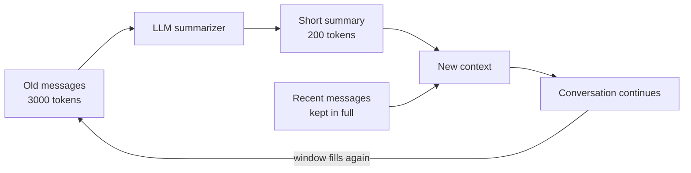

# How does Context Compaction work?

> **Step 8: Prompt Engineering and Context Engineering** · ⏱️ 17 min read · [Read original](https://outcomeschool.com/blog/how-does-context-compaction-work)

## TL;DR
Context compaction shrinks old conversation history into a short summary so the important facts survive while the fixed-size context window gets free space again. It lets chatbots and agents run for hours without overflowing or forgetting.

## Key Concepts
- **Context window** — maximum number of tokens the model can hold at once; the model's short-term memory.
- **Context** — all text sent to the model in one go (system instructions, past messages, new question).
- **Sliding window** — naive fix that drops the oldest messages when the window is full.
- **Context compaction** — replace old messages with a compact summary that keeps key facts.
- **Summarization** — the engine of compaction: the LLM itself writes the short note.

## How It Works
**The problem.** Conversations grow without bound but the window is fixed. When full, the model errors or truncates, gets slower and costlier (more tokens per turn), and can get confused by old text. Models also read the start and end of long contexts better than the middle.

**Why a sliding window fails.** Dropping old messages also drops facts hidden in them, for example "I am building an Android app in Kotlin" said in message 1; later asked "what language am I using?" the model cannot answer.

**Compaction.** Summarize instead of delete. Example: 3000 tokens of old messages become a 200-token note holding name, project, language, and decisions. This can repeat: next time, summarize the new old messages plus the previous summary.

**Walkthrough (window 1000 tokens, compact above 800):**
1. Old messages 700 + recent 150 = 850, over the line.
2. Model summarizes the 700 into about 120 tokens.
3. Rebuild context: summary 120 + recent 150 = 270, freeing 580 tokens.
4. Conversation continues; compaction reruns when full again.

```python
def compact_context(messages, recent_count, summarize):
    old, recent = messages[:-recent_count], messages[-recent_count:]
    return [summarize(old)] + recent
```

In practice, compact only when a threshold is crossed (for example 80 percent of the window) to keep cost low.

**In agents.** Coding assistants working for hours summarize old steps ("Goal: fix login bug. Changed auth.py and login.py. Tests passing") and keep going. Good compaction keeps the original system instructions, the user's main goal, and the latest messages in full, and compresses only the messy middle.

**Compaction vs sliding window**

| | Sliding window | Compaction |
|---|---|---|
| Old messages | Deleted | Summarized |
| Hidden facts | Lost | Kept in summary |

## Diagram


## Key Takeaways
- The window is fixed-size, so long chats need a way to free space without forgetting.
- Sliding windows forget facts; compaction keeps them via summarization.
- The same LLM does both answering and summarizing.
- Trigger compaction at a threshold, not after every message.
- Never summarize away system instructions, the main goal, or the latest messages.
- Benefits: long-running agents, preserved facts, lower cost and latency.
