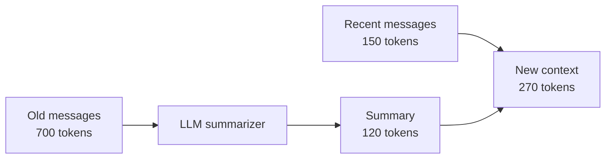
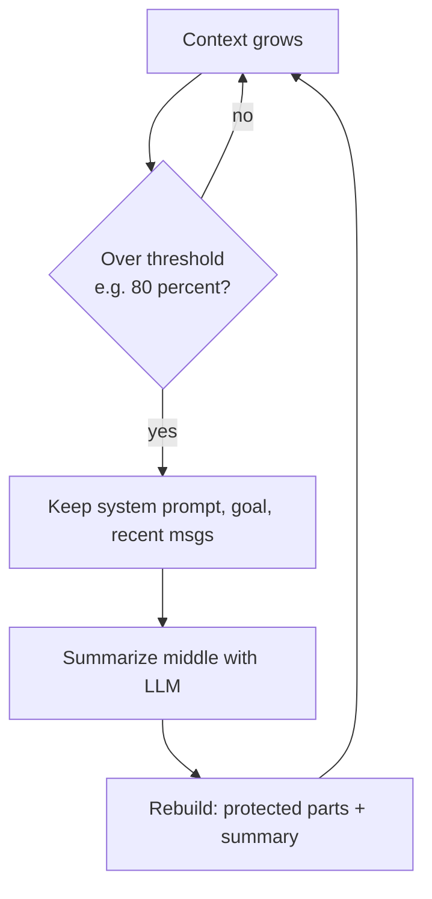

# How does Context Compaction work?

> **Step 8: Prompt Engineering and Context Engineering** · ⏱️ 17 min read · [Read original](https://outcomeschool.com/blog/how-does-context-compaction-work)

## TL;DR
Context compaction shrinks the old part of a long conversation into a short LLM-written summary, so key facts survive while the fixed-size context window gets free space. It replaces the sliding window, which deletes old messages and the facts hidden in them. Compaction triggers at a threshold and protects system instructions, the main goal and recent messages.

## Key Concepts
- **LLM** — reads text, predicts next token; works on tokens (pieces of words).
- **Context window** — max tokens the model can hold at once; fixed-size short-term memory (whiteboard).
- **Context** — everything sent in one go: system instructions, past messages, new question. Window is the box, context is the contents.
- **Sliding window** — keep only the latest N messages, drop the oldest.
- **Context compaction** — summarize old messages into a short note, keep recent ones in full.
- **Summarization** — the engine: the same LLM compresses old messages.

## How It Works

### The problem
- Chat keeps growing; window is fixed, so it eventually fills.
- Overflow causes: (1) new message won't fit, error or truncation; (2) slower and costlier since more tokens read per turn; (3) model confused by too much old text.
- Even before full, models read start and end better than the middle (lost in the middle). Dropping the first tokens is also risky inside the model (attention sinks).

### Naive fix: sliding window
Box holds 4 messages; msg1..msg6: msg5 arrives, drop msg1; msg6 arrives, drop msg2. Problem: msg1 may be "My name is Amit, building an Android app in Kotlin"; later "What language am I using?" is unanswerable. We lose memory, not just words.

### Compaction
Instead of deleting, squeeze. Suitcase analogy: fold clothes, don't throw them away.

| Suitcase | Compaction |
|---|---|
| Suitcase | Context window |
| Clothes | Conversation history |
| Overflowing | Context full |
| Vacuum-packing | Summarizing old messages |
| Packed suitcase | Compacted context |
| Trash dropped | Filler dropped, facts kept |

Example: 3000 old tokens become a 200-token summary (name, project, language, decisions); frees 2800 tokens. Repeatable: next time summarize the new old messages plus the previous summary into a fresh shorter one.

### Walkthrough (window 1000, compact above 800)
1. Old 700 + recent 150 = 850 tokens > 800, so compact.
2. Model summarizes the 700 into 120 tokens.
3. Rebuild: summary 120 + recent 150 = 270 (freed 580). Recent messages stay untouched.
4. Conversation continues; model still knows name and project. Repeat when full again.



### Code
```python
def compact_context(messages, recent_count, summarize):
    old = messages[:-recent_count]
    recent = messages[-recent_count:]
    summary = summarize(old)
    return [summary] + recent
```
Naive version is `messages[-max_messages:]` (forgets). In practice compact only past a threshold (e.g. 80% of window) to keep cost low.

### In real agents
- Agents take many steps (read files, run commands); context grows huge. Deciding when to compact is Loop Engineering.
- Example note: "Goal: fix the login bug. Changed auth.py and login.py. Tests passing."
- **Never summarize away**: original system instructions, user's main goal, very latest messages. Only the messy middle is compressed. Compaction is a planned feature.



## Trade-offs & Pitfalls
- Compaction loses tiny details (not key facts); sliding window loses everything dropped.
- Compacting after every message is wasteful; use a threshold.
- Summaries must preserve instructions and goal, so protect those.

## Key Takeaways
- Fixed window + growing chat = overflow; overflow hurts correctness, speed and cost.
- Sliding window deletes facts; compaction summarizes them.
- The LLM itself is the summarizer; compaction can repeat on top of earlier summaries.
- Trigger at a threshold (e.g. 80%), not every message.
- Keep system instructions, main goal and latest messages in full.
- Turns a hard memory limit into a smooth long conversation with lower cost.
