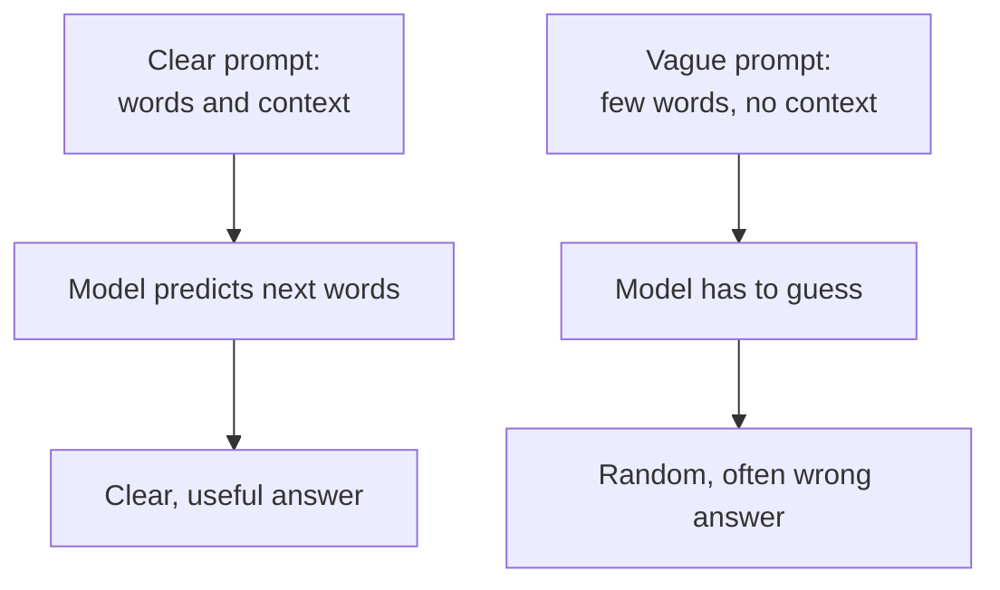
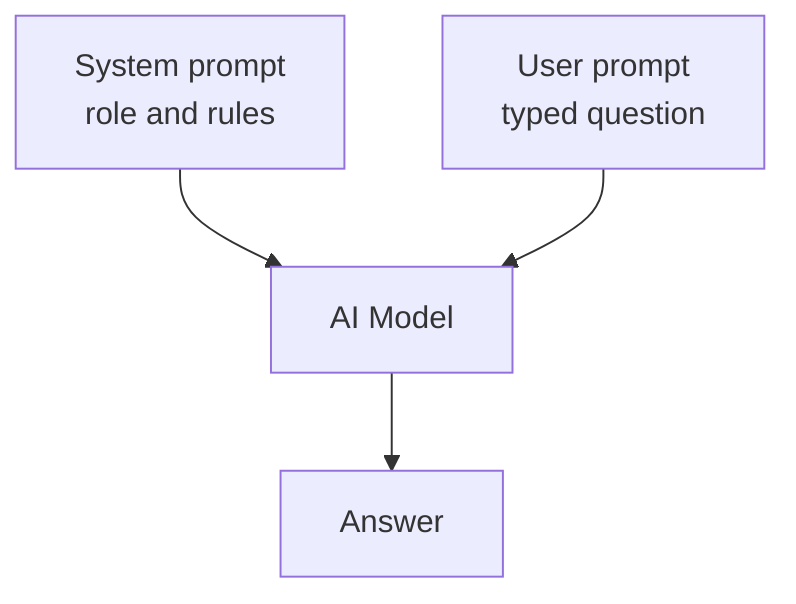

# How does Prompt Engineering work?

> **Step 8: Prompt Engineering and Context Engineering** · ⏱️ 13 min read · [Read original](https://outcomeschool.com/blog/prompt-engineering)

## TL;DR
Prompt Engineering is writing clear, well-structured instructions so an AI model gives the exact output we want. The model only predicts likely next words continuing the pattern we start, so clear context, instructions and examples give strong patterns and good answers. Vague prompts force guessing.

## Key Concepts
- **Prompt** — the instructions we give the model.
- **Prompt Engineering** — skill of writing clear prompts. Analogy: "Help me" vs "Help me fix the flat tire on my bicycle, I have a pump but no patch kit".
- **Instruction / Context / Input data / Output format** — building blocks of a prompt.
- **Zero-shot** — task with no examples.
- **Few-shot** — a few examples inside the prompt.
- **Chain-of-Thought (CoT)** — ask for step-by-step reasoning before the final answer.
- **System prompt** — usually hidden instruction setting role and rules.
- **User prompt** — the message the user types.

## How It Works

### Why we need it
- The model reads only our words, not our mind; vague input means guessing, often wrong.
- "Tell me about apple" (fruit? company?) vs "Tell me about the apple fruit and its health benefits".
- Removes guessing and back-and-forth.

### How a prompt shapes the answer
- Model does not think like a human; trained on massive text, it predicts the most likely next words and continues the pattern we start.
- Clear detailed start gives clear detailed output; messy start gives messy output.
- Prompt Engineering shapes the starting pattern on purpose with context, clear instructions, sometimes examples.

### Building blocks
- **Instruction** — what to do ("Summarize this paragraph").
- **Context** — background ("The reader is a 10-year-old child").
- **Input data** — the content to work on.
- **Output format** — how the answer looks ("three bullet points").

Not all are always needed, but with all four no guessing remains. Example:
```
Instruction: Summarize the text below.
Context: The reader is a beginner with no technical background.
Input data: "A database is a place where applications store and organize their data so it can be found quickly later."
Output format: Answer in one short sentence.
```

### Zero-shot
- No examples; model uses training knowledge. Example: classify "The food was cold and the service was very slow." gives Negative.
- Good for simple, common tasks; tricky or unusual tasks may fail.

### Few-shot
- Give a few examples in the prompt; model follows the pattern, with no extra training.
- Example: "I loved the warm and tasty pizza." -> Positive; "The room was dirty and smelled bad." -> Negative; "The staff was friendly and helpful." -> model answers Positive.
- Use for unusual tasks or specific formats.

### Chain-of-Thought
- Add "Let's think step by step" so the model shows its working; jumping to the answer causes mistakes on multi-step problems.
- Example: shop has 12 apples, sells 5 then 3. Steps: 12 - 5 = 7, 7 - 3 = 4. Final: 4 apples.
- Small steps are each simple, so accuracy improves on reasoning tasks.

### System prompt and user prompt
- System prompt: set once, defines role and rules; user prompt changes every message. Model reads both together.
- Example system prompt: "You are a polite customer support assistant for a shoe store. Always answer in a friendly tone. Never discuss other topics."
- Real products use it to control tone and focus. (Prompt injection is how attackers try to break these rules.)

### Step-by-step improvement example
1. Weak: "Write about dogs." Too open (length, audience, purpose unknown).
2. Add instruction and audience: "Write a short paragraph about dogs for a 7-year-old child."
3. Add format and tone: "Write a short and cheerful paragraph about dogs for a 7-year-old child. Use simple words. Keep it under four sentences."

Start simple, keep adding clarity until the prompt fully describes what we want.

## Diagram(s)

### Clear vs vague prompt


### System and user prompt


## Trade-offs & Pitfalls
- Zero-shot weak on tricky or unusual tasks; few-shot fixes with examples.
- Common mistake: long but unclear prompts. Length is not needed; clarity is.
- Direct jumping to answers in multi-step reasoning is error-prone without CoT.

### Best practices
- Be specific (task, audience, format).
- Give context.
- Show examples for tricky tasks (few-shot).
- Ask for steps on reasoning and math (CoT).
- Set the format (bullets, table, one sentence).
- Iterate: refine and retry; small improvements cycle.
- Beyond one prompt's wording lies Context Engineering (everything the model sees).

## FAQ
- Longer prompt better? → No, clearer is better.
- Few-shot vs zero-shot? → Few-shot for tricky, unusual or format-specific tasks; zero-shot for simple common ones.
- Does few-shot train the model? → No, examples are only in the prompt.
- Can user see the system prompt? → Usually not.
- Answer not good? → Refine and retry, adding audience, tone, format.

## Key Takeaways
- Models continue the pattern we start; clear prompt means clear answer.
- Good prompt = instruction + context + input data + output format.
- Zero-shot for simple tasks; few-shot to demonstrate pattern with no training.
- CoT ("Let's think step by step") raises accuracy on reasoning tasks.
- System prompt sets role and rules; user prompt drives each turn.
- Iterate from weak to specific prompts; clarity beats length.
