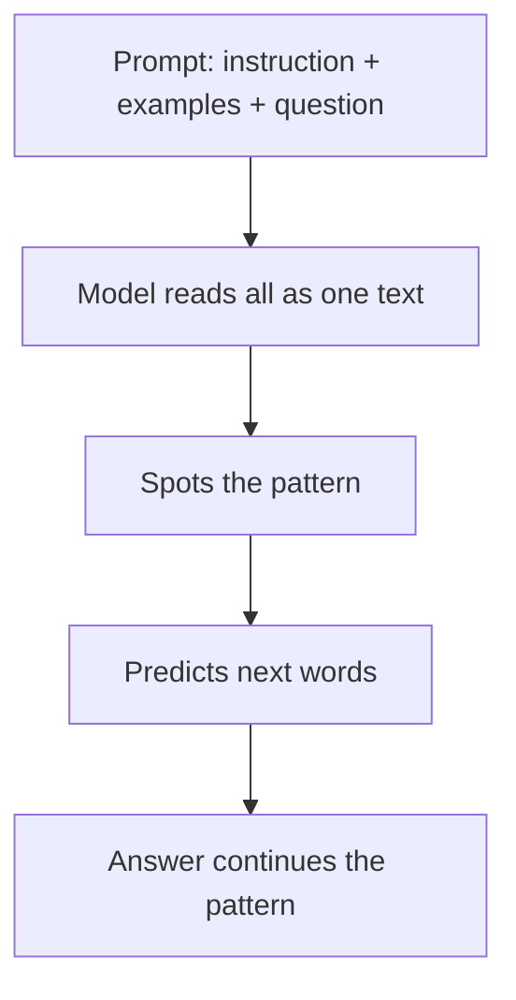

# How does In-Context Learning work?

> **Step 8: Prompt Engineering and Context Engineering** · ⏱️ 12 min read · [Read original](https://outcomeschool.com/blog/in-context-learning)

## TL;DR
In-Context Learning (ICL) lets an LLM learn a new task from instructions and examples placed in the prompt, with no change to the model. Because an LLM just predicts the next word from all text so far, the examples set a pattern the model continues. It is limited by the context window and forgotten when the chat ends.

## Key Concepts
- **In-Context Learning** — model picks up a task from the examples/instructions in the prompt, without changing the model.
- **Context** — the text we provide in the prompt.
- **Shot** — one example; number of shots = number of examples.
- **Context window** — maximum text the model reads at once (instruction, examples, question, and the model's own answer).
- **Fine-tuning** — further training on our examples so internal settings change permanently.

## How It Works

### Why we need it
- Traditionally a new task (e.g. sorting reviews as Happy/Unhappy) means collecting thousands of labeled examples and training: slow, costly, needs powerful machines.
- ICL: write a few examples in the prompt; the model does the task immediately, no training.

### Mechanism
- An LLM only predicts the next word repeatedly from all text so far ("The sky is" gives "blue").
- Examples in the prompt become part of that text and act as a strong hint for the next word.
- Example prompt: `cat -> chat`, `dog -> chien`, `house -> ` gives **maison**. The model reads it as one text, spots the English-to-French pattern, and continues it.
- Model internals never change; knowledge is identical before and after.

### Zero-shot, one-shot, few-shot
| Style | Examples | Notes |
|---|---|---|
| Zero-shot | 0, instruction only | Uses existing knowledge; fine for common, easy tasks |
| One-shot | 1 | One example shows the exact format wanted |
| Few-shot | 2 or more (e.g. cat, dog, bird) | More examples make the pattern clearer and the model more reliable |

- Simple task: zero-shot is enough. Tricky or special-format task: few-shot.

### Worked example: sentiment classification
Few-shot prompt: instruction "Classify the message as Happy or Unhappy", then examples: "food was amazing" Happy; "waited two hours, order never came" Unhappy; "Best purchase this year" Happy; final "The product broke on the very first day." with blank Sentiment.
1. Reads the instruction: label as Happy/Unhappy.
2. First example: positive maps to Happy.
3. Second example: negative maps to Unhappy; pattern clearer.
4. Third example: positive maps to Happy; pattern strong.
5. Final message sounds negative, so it predicts **Unhappy**.

### Role of the context window
- Instruction, examples, question and answer all share one fixed space.
- Too many examples: request fails or text is cut and the model can't see it.
- So keep examples short and relevant (see Context Engineering).
- ICL lives entirely in the window; when the conversation ends the model forgets, as the model never changed.

### ICL vs fine-tuning
| In-Context Learning | Fine-tuning |
|---|---|
| Examples inside the prompt | Train model on examples |
| Model does not change | Model changes permanently |
| No training cost, instant | Needs time, data, compute |
| Forgets after chat ends | Keeps new behavior |
| Limited by context window | Not limited by it |
| Quick tasks, experiments | Large, repeated, specialized tasks |

- Use ICL: quick result, few examples, no training spend, fast idea testing.
- Use fine-tuning: many examples, business-specific task, repeated millions of times.

### Best practices
- Give clear instructions up front.
- Use a consistent format across examples (same labels such as "Message:" / "Sentiment:").
- Pick examples covering the cases expected (show both happy and unhappy).
- Keep it short; only examples that help.
- Order matters: the last example can influence the answer more than the first, so put a strong, clear one near the end.

## Diagram(s)

### ICL flow

## Trade-offs & Pitfalls
- Bounded by context window; too many examples cause failure or truncation.
- Nothing persists after the conversation.
- Example order and format inconsistency can skew results.
- For large, repeated, specialized work, fine-tuning fits better.

## Key Takeaways
- ICL = learning a task from prompt examples, with no weight changes.
- Works because LLMs predict the next word and continue the pattern shown.
- Zero-shot = 0 examples, one-shot = 1, few-shot = 2 or more.
- Context window caps instruction, examples, question and answer combined.
- ICL forgets after the chat; fine-tuning persists.
- Use consistent format, clear instructions, short relevant examples, strong example last.
