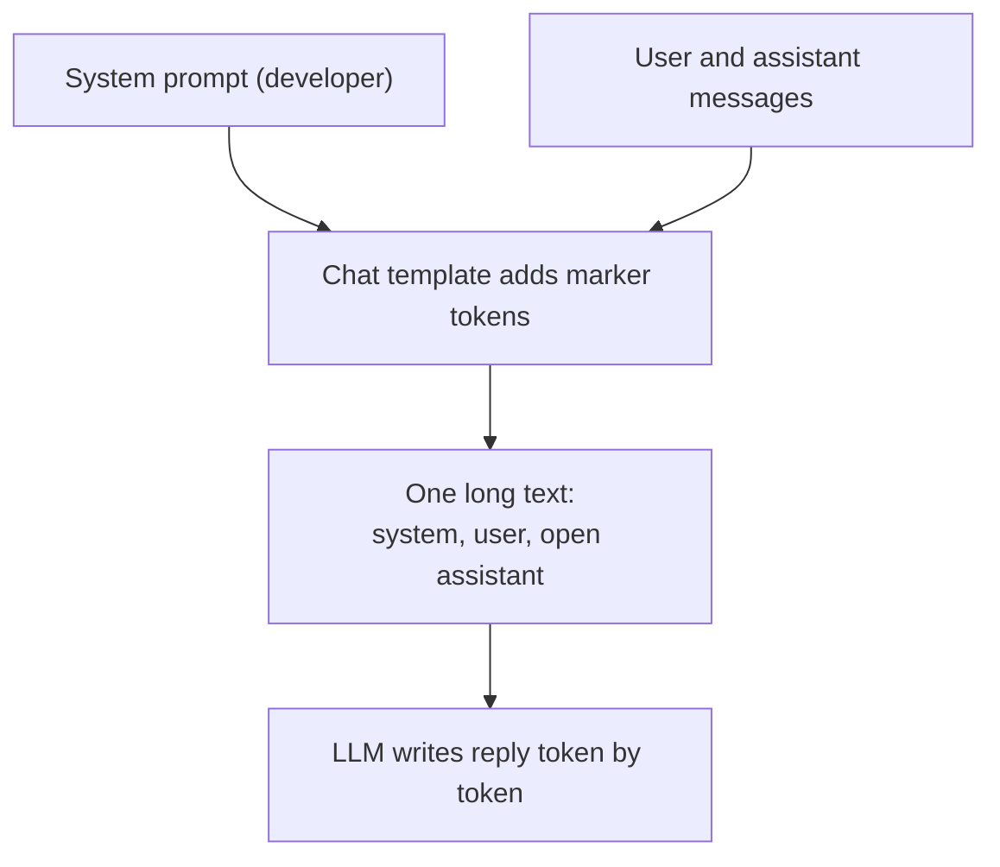
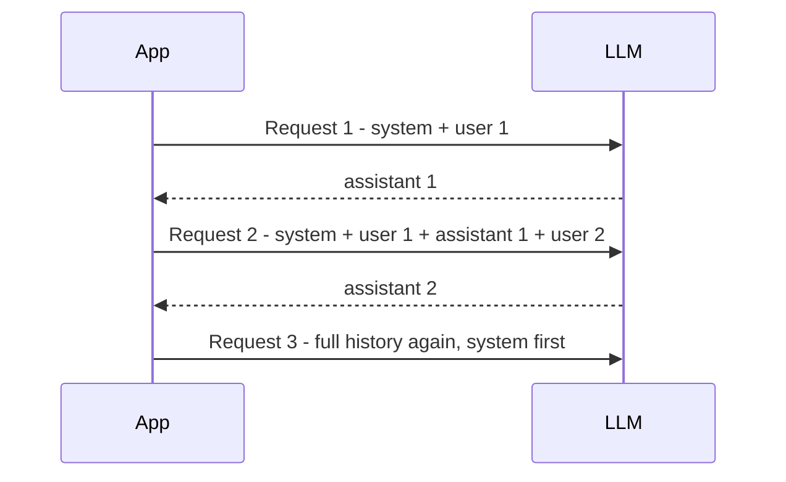

# How does the System Prompt work?

> **Step 8: Prompt Engineering and Context Engineering** · ⏱️ 15 min read · [Read original](https://outcomeschool.com/blog/system-prompt)

## TL;DR
The System Prompt is a developer-written, usually hidden set of instructions placed at the start of the text an LLM reads, defining its role, rules, tone, and format. The LLM favors it because of training, and it must be resent on every request since the LLM has no memory. It is not a security guarantee.

## Key Concepts
- **System prompt** — instructions given to the LLM at the very start that shape behavior for the whole conversation. Analogy: a manager briefs a receptionist (system prompt), visitors ask questions (user prompts), receptionist is the LLM.
- **Roles** — `system` (developer instructions), `user` (person chatting), `assistant` (LLM replies). A conversation is a list of these messages.
- **Chat template** — format that joins all messages into one long text with special marker tokens for message boundaries and roles.
- **Instruction hierarchy** — trust order: system, then user, then outside text (web pages, documents).
- **Prompt caching** — reuse work already done on the repeated prompt start.
- **Prompt injection** — user tricks the LLM, e.g. "Ignore all previous instructions and...".
- **Context window** — maximum text the LLM can read at once.

## How It Works

### Same question, different system prompts
Question "What is the sun?": with "You are a helpful assistant." the reply is a detailed explanation. With "You are a teacher for 5-year-old kids. Answer in one short sentence using very simple words." the reply is "The sun is a big, hot, bright star that gives us light and keeps us warm." Only the system prompt changed, and style, words, and length changed. One LLM can become a math tutor, support bot, coding helper, or kids' teacher by swapping it.

### Behind the scenes
The LLM does not understand messages or roles, it reads one long text. Messages are joined by a chat template using marker tokens, e.g. `<|start|>system ... <|end|>`, then user, then an open `<|start|>assistant` section as the cue to write the reply. The system prompt sits first, and since each new token is generated by looking at all earlier text, it affects every token of the reply. Markers differ per model family (e.g. `<|im_start|>`, `<|im_end|>`), idea is the same.

### Why the LLM follows it
Training. After learning language from huge text, the model is trained further on example conversations with system messages and rewarded for following them (like a child trained to follow the teacher's class rule even if a classmate asks otherwise). It learns that system text sets rules, rules apply to the whole conversation, and system rules usually win over conflicting user messages. Some companies train an explicit instruction hierarchy. This is learned behavior, not a hard lock.

### Sent every time
The LLM has no memory between requests, so the app resends the full conversation including the system prompt:
- Request 1: system + user 1
- Request 2: system + user 1 + assistant 1 + user 2
- Request 3: grows further, system always first.

Effects: **cost** (system prompt tokens billed in every request) and **space** (uses context window). Prompt caching reduces cost and speeds requests since the start is identical.

### In code
- OpenAI-style: system prompt is first message with `"role": "system"` in `messages` passed to `client.chat.completions.create`. Some newer OpenAI APIs use role `developer` for the same purpose.
- Anthropic API: separate `system=` field, `messages` holds only user and assistant turns (`max_tokens` sets reply length).
Both end up at the start of the text the LLM reads.

### What goes inside
| Part | Example |
|---|---|
| Role | "You are a customer support assistant for an online shoe store." |
| Task | "Help customers with orders, returns, and sizes." |
| Rules | "Never promise a refund. Ask for the order number first." |
| Tone and style | "Be polite and short. Use simple English." |
| Output format | "Reply in plain text, under 100 words." |
| Background knowledge | "Our return window is 30 days." |

Full example (StepUp shoe store): role, task, rules (ask order number first, 30-day return window, never promise refund and say team will review, politely refuse off-topic), then tone and length.

Tips:
- Be clear and direct, like instructions for a new employee who knows nothing.
- Explain reasons when helpful ("short, because users read on a phone").
- Avoid conflicting rules ("very detailed" vs "under 50 words").
- Test with many questions, including tricky ones, and iterate.

### System vs User prompt
| Point | System Prompt | User Prompt |
|---|---|---|
| Written by | App developer | Person chatting |
| Set | Before chat starts | During chat |
| Visible to user | Usually no | Yes |
| Role name | system | user |
| Position | Very start | After system prompt |
| Applies | Whole conversation | Mostly one turn |
| Priority | Higher | Lower if conflicting |
| Purpose | Identity, rules, tone, format | Question or task |

Both are just text, differing in role, position, and training treatment.

## Diagram(s)

### From chat to LLM input

### Request growth

## Trade-offs & Pitfalls
- **Not a security guarantee** — prompt injection can get past it (well-trained models resist many tricks, not all). Enforce important rules (e.g. who sees which data) in your own code too, plus LLM guardrails.
- **Can leak** — users can ask the LLM to repeat it. Never put passwords, keys, or private data in it.
- **Long prompts weaken** — with very long prompt and conversation, the LLM can lose track of some rules.
- **No new knowledge** — "always be correct" does not help, supply needed facts in the prompt.
- Costs tokens and context space on every request.

## FAQ
- Can users see it? → Usually no, but it can leak via requests to repeat it.
- Longer is better? → Not always: cost, context space, lost rules, conflicts.
- Makes LLM always correct? → No, it adds no knowledge, include facts as background knowledge.
- developer role same as system? → Same idea. Anthropic uses a separate field. All end up at the start of the text.

## Key Takeaways
- System prompt = developer instructions at the start that set role, rules, tone, format.
- The LLM only sees one long text built by a chat template, so system text conditions every reply token.
- It outranks user messages because of training (instruction hierarchy), not a hard lock.
- It is resent every request, costing tokens and context space, prompt caching helps.
- APIs differ: `system` message, `developer` role, or separate `system` field.
- Good prompts: role, task, rules, tone, format, background facts, no conflicts, tested.
- Never store secrets in it and never rely on it alone for security.
