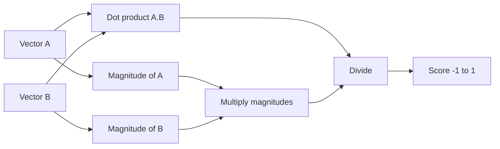
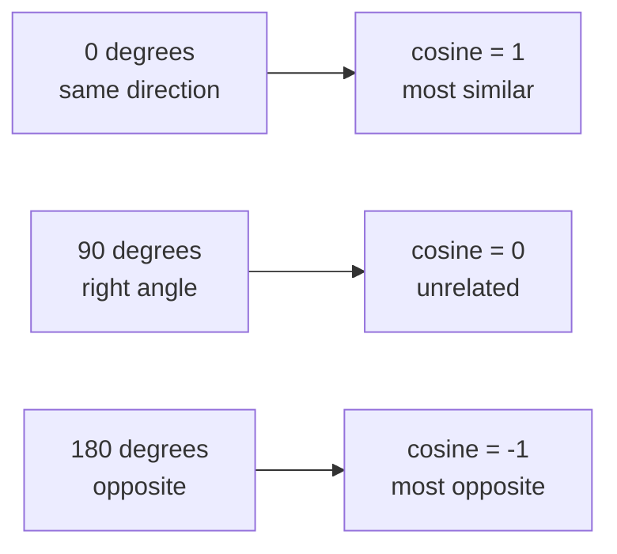

# How does Cosine Similarity work?

> **Step 9: Vector Search and Retrieval-Augmented Generation (RAG)** · ⏱️ 14 min read · [Read original](https://outcomeschool.com/blog/cosine-similarity)

## TL;DR
Cosine Similarity measures how similar two vectors are by the cosine of the angle between them, giving a score from -1 to 1. It divides the dot product by the product of vector lengths, so it ignores size and keeps only direction. That is why it suits text and embeddings.

## Key Concepts
- **Vector** — list of numbers (features). Apple [8, 9] = sweetness 8, roundness 9; lemon [3, 8]. Real vectors have hundreds or thousands of numbers.
- **Direction / angle** — each vector is an arrow from the origin; the gap between arrows is the angle.
- **Cosine** — maps angle to a score: 0 degrees gives 1, 90 degrees gives 0, 180 degrees gives -1.
- **Dot product** — multiply matching entries and sum.
- **Magnitude** — length of the arrow.
- **Euclidean Distance** — straight-line distance between tips.

## How It Works

### Meaning of the score
| Score | Meaning |
|---|---|
| near 1 | very similar (same direction) |
| near 0 | unrelated (right angle) |
| near -1 | opposite |

### Formula

$$
\cos(\theta)=\frac{A\cdot B}{\lVert A\rVert\,\lVert B\rVert}
$$

- $A\cdot B=a_1b_1+a_2b_2+\dots$ (dot product, top part).
- $\lVert A\rVert=\sqrt{a_1^2+a_2^2+\dots}$ (magnitude, bottom part).
- Dividing by lengths removes size and keeps only direction.

### Worked example: A=[8,9], B=[3,8]
1. Dot: 8x3 + 9x8 = 24 + 72 = 96.
2. $\lVert A\rVert=\sqrt{64+81}=\sqrt{145}=12.04$.
3. $\lVert B\rVert=\sqrt{9+64}=\sqrt{73}=8.54$.
4. 96 / (12.04 x 8.54) = 96 / 102.82 = 0.93, so apple and lemon are quite similar.

### Code
```python
import math
def cosine_similarity(a, b):
    dot = sum(x*y for x, y in zip(a, b))
    return dot / (math.sqrt(sum(x*x for x in a)) * math.sqrt(sum(y*y for y in b)))
# cosine_similarity([8,9],[3,8]) -> 0.9330948702273482
```

### Why angle, not distance
Doc A "car" 1x, "engine" 1x = [1,1]; Doc B "car" 10x, "engine" 10x = [10,10]. Same topic, same proportion, only length differs. Plain distance is large (looks different, wrong); both arrows lie on the same line, angle 0, cosine 1. Hence cosine works for text where long and short documents share a topic.

### Where used
- Search engines (match documents to query).
- Recommendation systems.
- Chatbots/assistants (most relevant answer).
- Plagiarism checkers.
- Embedding search in LLM apps: embeddings compared by cosine to find closest meaning (see Semantic Search).

### Cosine vs Euclidean
| Point | Cosine Similarity | Euclidean Distance |
|---|---|---|
| Measures | Angle between vectors | Straight-line distance |
| Cares about size | No | Yes |
| Range | -1 to 1 | 0 to large |
| Higher means | More similar | Further apart (less similar) |
| Best for | Text, high-dimensional data | When actual size/distance matters |

Use cosine when only direction matters; Euclidean when actual distance matters. (Vector DB blog compares cosine, dot product, Euclidean.)

### Diagram: computation pipeline


### Diagram: angle to score


## Trade-offs & Pitfalls
- Ignores magnitude entirely; if vector size carries meaning, use Euclidean.
- Score can be negative (opposite directions), not just 0 to 1.
- Formula is unchanged for thousands of dimensions.

## Key Takeaways
- Cosine Similarity = dot product / product of magnitudes, range -1 to 1.
- 1 similar, 0 unrelated, -1 opposite.
- It compares direction, not length, so short and long docs on one topic score 1.
- Dot product is just the numerator; dividing by lengths normalizes it.
- Example: [8,9] vs [3,8] gives 0.93.
- Foundation of embedding search in RAG and vector databases.
