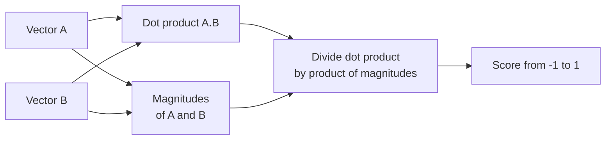

# How does Cosine Similarity work?

> **Step 9: Vector Search and Retrieval-Augmented Generation (RAG)** · ⏱️ 14 min read · [Read original](https://outcomeschool.com/blog/cosine-similarity)

## TL;DR
Cosine Similarity measures how similar two vectors are by the angle between them, producing a score from -1 to 1. Because it ignores vector length and looks only at direction, it is the standard way to compare text embeddings.

## Key Concepts
- **Vector** — a list of numbers describing a thing, for example apple = [8, 9] (sweetness, roundness).
- **Dot product** — multiply matching numbers of two vectors, then add.
- **Magnitude** — the length of the vector's arrow: square each number, add, take the square root.
- **Cosine of angle** — turns an angle into a score: 0 degrees gives 1, 90 degrees gives 0, 180 degrees gives -1.
- **Euclidean Distance** — straight-line distance between two points; sensitive to size.

## How It Works
**Meaning of the score**
- Near 1: very similar (same direction)
- Near 0: unrelated (right angle)
- Near -1: opposite

**Formula**

$$\text{cos\_sim}(A,B)=\frac{A\cdot B}{\|A\|\,\|B\|}, \quad A\cdot B=\sum_i a_i b_i, \quad \|A\|=\sqrt{\sum_i a_i^2}$$

Dividing by the two lengths removes the effect of size and keeps only direction.

**Worked example** with A = [8, 9], B = [3, 8]:
1. Dot product: 8x3 + 9x8 = 24 + 72 = 96
2. |A| = sqrt(64 + 81) = sqrt(145) = 12.04
3. |B| = sqrt(9 + 64) = sqrt(73) = 8.54
4. Similarity = 96 / (12.04 x 8.54) = 96 / 102.82 = 0.93, so apple and lemon are quite similar.

```python
def cosine_similarity(a, b):
    dot = sum(x * y for x, y in zip(a, b))
    return dot / (math.sqrt(sum(x*x for x in a)) * math.sqrt(sum(y*y for y in b)))
```

**Why angle, not distance.** A short note with "car" once and "engine" once is [1, 1]; a long article with each ten times is [10, 10]. Same topic, different length. Plain distance says they are far apart; the angle is 0 so cosine says 1. This is why it suits text, where document length varies.

**Where used:** search engines, recommendation systems, chatbots finding relevant answers, plagiarism checkers, and embedding search in LLM apps.

**Cosine vs Euclidean**

| | Cosine Similarity | Euclidean Distance |
|---|---|---|
| Measures | Angle | Straight-line distance |
| Cares about size | No | Yes |
| Range | -1 to 1 | 0 to large |
| Higher means | More similar | Farther apart |
| Best for | Text, high-dimensional data | When actual size and distance matter |

## Diagram


## Key Takeaways
- Cosine Similarity = dot product divided by the product of the vector lengths.
- Output ranges from -1 (opposite) through 0 (unrelated) to 1 (same direction).
- It ignores magnitude, so a short and a long document on the same topic score 1.
- Use it for text and embeddings; use Euclidean distance when size matters.
- Real-world vectors have hundreds or thousands of dimensions; the math is the same.
