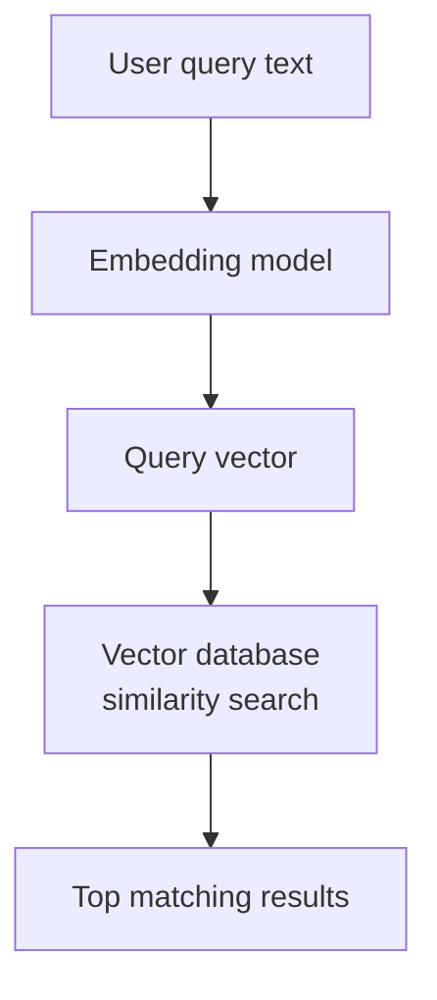
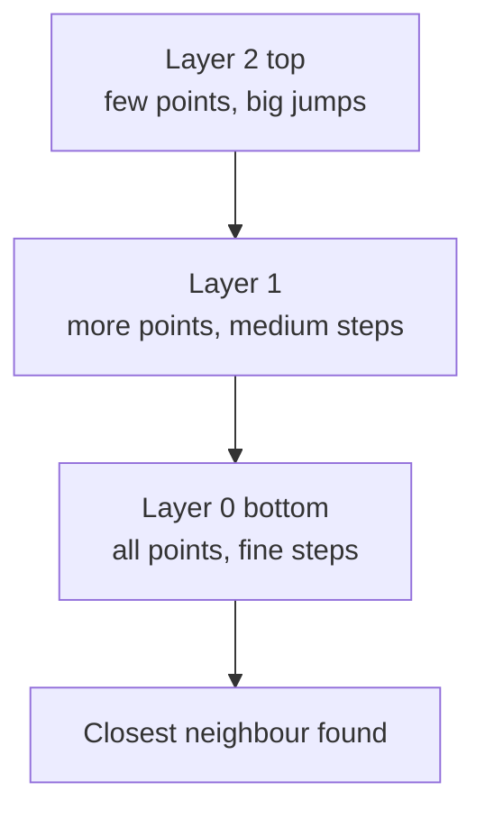
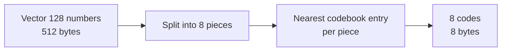

# How does a Vector Database work?

> **Step 9: Vector Search and Retrieval-Augmented Generation (RAG)** · ⏱️ 31 min read · [Read original](https://outcomeschool.com/blog/how-does-a-vector-database-work)

## TL;DR
A vector database stores embeddings (lists of numbers) plus original data and metadata, and finds items closest in meaning to a query vector using a similarity metric. Brute-force comparison is too slow at scale, so it uses Approximate Nearest Neighbour (ANN) indexes (HNSW, IVF) and compression (PQ), trading a little accuracy for large speed and memory gains. It powers semantic search, RAG, recommendations and more.

## Key Concepts
- **Vector** — list of numbers, e.g. [0.21, 0.87, 0.13].
- **Embedding** — vector representing meaning of a word/sentence/image/song; similar meaning gives similar numbers (king [0.91,0.12,0.55] ~ queen [0.89,0.15,0.58], banana far). Embedding cache avoids recomputing; contrastive learning trains models to place meanings close.
- **Nearest neighbour problem** — given a query vector, find closest stored vectors.
- **ANN** — approximate nearest neighbour; skips most vectors.
- **Recall** — fraction of true closest vectors found (9 of true top 10 = 90%).
- **Index** — structure organizing vectors in advance to jump to promising areas.
- **Normalized vectors** — scaled to the same length.
- **Pre-filtering / post-filtering** — apply metadata filter before / after similarity search.

## How It Works

### Why normal databases fall short
MySQL/PostgreSQL match exact words. Query "healthy fruit advice from a doctor" misses "An apple a day keeps the doctor away." since no exact phrase. Vector DBs match meaning. Databases can add vector search via extensions (PostgreSQL pgvector) using the same ideas; the real question is whether a database can search by meaning at all.

### What is stored per item
1. **Vector** (meaning), 2. **Original data** (to show back), 3. **Metadata** (category, year, author, price; for filtering).
Pre-filtering (filter then search) is usually better than post-filtering (search then drop) since it does not waste search on discarded items.

### Similarity metrics
| Metric | Measures | Similar means | Common use |
|---|---|---|---|
| Cosine | Angle | Close to 1 | Text, semantic search |
| Dot product | Direction and size | Larger value | Normalized vectors |
| Euclidean | Straight-line gap | Smaller distance | Image, spatial data |

- **Cosine**: $\frac{A\cdot B}{\lVert A\rVert\lVert B\rVert}$, range -1..1 (1 same direction, 0 unrelated, -1 opposite). Example A=[2,3], B=[4,6]: dot 26, $\lVert A\rVert=\sqrt{13}\approx3.61$, $\lVert B\rVert=\sqrt{52}\approx7.21$, result about 1.0. With normalized embeddings values usually 0..1 in practice.
- **Dot product**: $A\cdot B=\sum a_ib_i$. A=[1,2,3], B=[4,5,6] gives 32; with C=[0,0,1] gives 3. Affected by vector size, so use when normalized (then agrees with cosine).
- **Euclidean**: $\sqrt{\sum (a_i-b_i)^2}$. A=[1,2], B=[4,6]: sqrt(9+16)=5; C=[1,3] is distance 1 from A. Smaller = more similar.

### Search journey


### Why brute force fails
Compare query to every vector. 100M vectors x 1000 dims = 100 billion calculations per search; users expect milliseconds.

### ANN and indexing
Trade tiny accuracy for huge speed: jump to the promising area and check a few thousand vectors. Analogy: find a friend by city, street, house instead of knocking on every door in the country. Recall measures quality; 9/10 in ms beats 10/10 in seconds. HNSW and IVF choose which vectors to check; PQ shrinks vectors.

### HNSW (Hierarchical Navigable Small World)
Layered graph; similar vectors linked like friends in a network. Top layer: few far-apart points (big jumps, "big cities"); middle: more points (towns); bottom: all points (streets).
1. Enter at top, move to closest point to query.
2. Drop to middle, move to an even closer neighbour.
3. Drop to bottom, fine steps to nearest.
Most widely used index in modern vector DBs; fast and accurate.



### IVF (Inverted File Index)
Cluster vectors in advance; each cluster has a center (average). Search: compare query with centers only, pick nearest few clusters, search only inside them. Example: 100M vectors in 100 clusters of 1M; searching 3 clusters = 3M checks instead of 100M. Trade-off: true neighbour may sit in a skipped cluster; search more clusters for accuracy at slightly higher time.

### PQ (Product Quantization)
Compresses vectors. 128 numbers x 4 bytes = 512 bytes; 1B vectors is about 512 GB.
1. Split vector into pieces (128 into 8 pieces of 16).
2. Prepare a codebook per piece (e.g. 256 sample pieces).
3. Store the index (0..255, 1 byte) of the closest sample for each piece.
Result: 8 bytes vs 512 (64x saving); search uses codes. Lossy (approximation). Often combined as **IVF-PQ** for billions of vectors. Simpler: scalar quantization and binary quantization (shrink each number; easier, popular in production).



### Code (FAISS)
```python
index = faiss.IndexFlatL2(4)      # brute force, euclidean
index.add(vectors)                # 3 stored vectors
distances, ids = index.search(query, 2)
# ids [[0 2]], distances [[0.0004 0.0013]]
```
IndexFlatL2 returns squared distance (skips sqrt; order unchanged). It is brute force; for millions use HNSW/IVF indexes, search code almost the same.

### Applications
- **Semantic search** ("cheap flights to the beach").
- **RAG**: documents chunked, embedded, stored; query retrieves relevant chunks; LLM answers from them (Agentic RAG goes deeper).
- **Recommendations**: products and taste as vectors.
- **Image search**: image to vector.
- **Duplicate/fraud detection**: near matches.
- **Semantic caching**: reuse past answers for same-meaning questions.

### Next steps
Hybrid search (vector + keyword); DiskANN, ScaNN for very large data; HyDE (search with a hypothetical answer); Reranker reorders shortlist by true relevance; Vectorless RAG retrieves by document structure (vector DB not always needed).

## Trade-offs & Pitfalls
- ANN may miss the exact closest; tune with recall.
- IVF may skip the right cluster; PQ loses precision.
- Dot product misleads for non-normalized vectors.
- Post-filtering wastes search.

## Key Takeaways
- Vector DB = embeddings + data + metadata, searched by meaning.
- Cosine for text, dot product for normalized, Euclidean for spatial.
- Brute force is O(all vectors), so use ANN.
- HNSW = layered graph navigation; IVF = cluster pruning; PQ = compression (IVF-PQ for billions).
- Judge ANN by recall vs latency.
- Pre-filter on metadata.
- pgvector shows the capability matters more than the product category.
