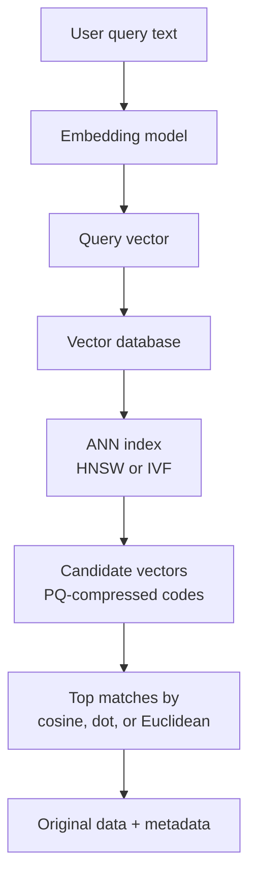

# How does a Vector Database work?

> **Step 9: Vector Search and Retrieval-Augmented Generation (RAG)** · ⏱️ 31 min read · [Read original](https://outcomeschool.com/blog/how-does-a-vector-database-work)

## TL;DR
A vector database stores data as embeddings and finds items close in meaning rather than exact matches. To do this fast at scale, it uses similarity metrics plus Approximate Nearest Neighbour (ANN) indexes such as HNSW and IVF, and compression such as PQ.

## Key Concepts
- **Embedding / vector** — list of numbers representing meaning; similar meaning gives similar numbers.
- **Stored per item** — the vector, the original data, and metadata (category, year, etc.) for filtering.
- **Pre-filtering vs post-filtering** — filter by metadata first then search, or search then drop non-matches; pre-filtering usually better.
- **Nearest neighbour problem** — given a query vector, find the closest stored vectors.
- **ANN** — trade a little accuracy for a big speed gain; quality measured by **recall** (for example 9 of true top 10 means 90 percent).
- **Index** — structure built in advance so search can jump to promising areas.

## How It Works
**Why not a normal database.** SQL-style exact matching misses "healthy fruit advice from a doctor" because no row contains those words. Some databases add vector search via extensions (for example pgvector), using the same ideas.

**Similarity metrics**

| Metric | Measures | Similar means | Common use |
|---|---|---|---|
| Cosine similarity | Angle: $\frac{A\cdot B}{\|A\|\|B\|}$ | Close to 1 | Text and semantic search |
| Dot product | $\sum a_i b_i$, direction plus size | Larger | Normalized vectors (then agrees with cosine) |
| Euclidean distance | $\sqrt{\sum (a_i-b_i)^2}$ | Smaller | Image and spatial data |

Examples: A=[2,3], B=[4,6] gives cosine 1.0; A=[1,2,3]·B=[4,5,6] = 32; A=[1,2], B=[4,6] gives distance 5.

**Brute force is too slow.** 100M vectors x 1000 numbers means about 100 billion calculations per search, but users expect milliseconds.

**Indexing techniques**
- **HNSW (Hierarchical Navigable Small World)** — layered graph. Top layer has few points and big jumps; each lower layer has more points and finer steps; bottom layer has all points. Search drops down layer by layer. Most widely used index.
- **IVF (Inverted File Index)** — cluster vectors in advance with a center per cluster. Compare query to centers only, pick the nearest few clusters, search inside them. E.g. 100M vectors in 100 clusters, search 3 clusters = 3M checks. Risk: the true neighbour may sit in a skipped cluster; search more clusters to improve accuracy.
- **PQ (Product Quantization)** — shrinks vectors, not the search set. Split a 128-number vector (512 bytes) into 8 pieces; each piece is replaced by the id of its closest sample in a 256-entry codebook, so 8 codes = 8 bytes (64x smaller), at some accuracy cost. IVF-PQ combines both. Scalar and binary quantization are simpler compression options.

**Code (FAISS)**: `IndexFlatL2` does brute-force search with squared Euclidean distance (ordering unchanged); use HNSW/IVF indexes for large data.

**Applications:** semantic search, RAG (chunks embedded then retrieved for the LLM), recommendations, image search, duplicate/fraud detection, semantic caching. Related next steps: hybrid search, HyDE, rerankers, DiskANN/ScaNN.

## Diagram

## Key Takeaways
- Vector DBs search by meaning: embeddings in, nearest neighbours out.
- Cosine for text, dot product when normalized, Euclidean for spatial data.
- Brute force does not scale; ANN trades slight recall for large speedups.
- HNSW navigates layers, IVF narrows to clusters, PQ compresses memory; IVF-PQ is common at billion scale.
- Metadata filtering (preferably pre-filtering) combines meaning with structured constraints.
