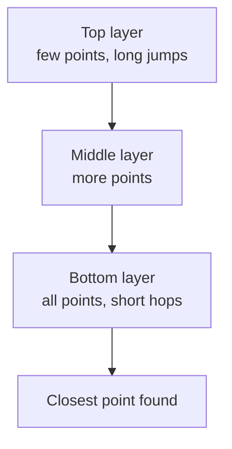
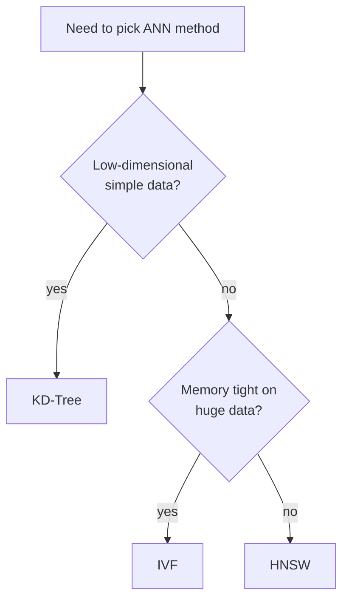

# How does Approximate Nearest Neighbor (ANN) Search work?

> **Step 9: Vector Search and Retrieval-Augmented Generation (RAG)** · ⏱️ 22 min read · [Read original](https://outcomeschool.com/blog/how-does-approximate-nearest-neighbor-ann-search-work)

## TL;DR
ANN search finds an item very close to the true nearest neighbor, much faster than brute force, by organizing data in advance (trees, hash buckets, clusters or graphs) and searching only the right neighborhood. It trades a tiny bit of accuracy (recall) for massive speed. HNSW is the usual default in vector databases.

## Key Concepts
- **Nearest neighbor search** — find the most similar item to a given one (similar songs, photos, answers, videos).
- **Vector / embedding model** — a vector is a numeric fingerprint (e.g. person [25,170]); embedding models produce vectors where similar items get similar vectors (contrastive learning).
- **Euclidean distance** — straight-line distance; smaller = more similar. Cosine similarity (angle) is the popular alternative for text.
- **Brute force / exact search** — compare to every item; perfect but slow.
- **Recall** — % of times the approximate answer equals the true nearest neighbor.
- **Curse of dimensionality** — in high dimensions, space cuts stop helping.

## How It Works

### Distance example
A=[1,2], B=[4,6]: diffs 3 and 4, distance $\sqrt{3^2+4^2}=\sqrt{25}=5$.

### Why brute force fails
1 billion vectors x 1000 numbers = a thousand billion operations per query, with thousands of queries per second. Does not scale.

### ANN idea
Approximate + Nearest Neighbor. Library analogy: walk straight to the "Food and Cooking" section instead of reading every title; probably not the single best cookbook, but an excellent one in seconds. Precompute structure, jump to the right neighborhood at search time.

### Speed vs accuracy
| | Brute force | ANN high accuracy | ANN high speed |
|---|---|---|---|
| Recall | 100% | ~99% | ~90% |
| Speed | slow | fast | very fast |

Being off usually means returning the 2nd or 3rd closest, fine for most apps. Every method has a knob to tune this.

### Approach 1: Trees (KD-Tree)
K-dimensional tree repeatedly cuts space in half (vertical line, then horizontal, and so on); query follows cuts to a small region and compares only those points. Works for few dimensions; with hundreds of numbers cuts stop helping (curse of dimensionality), so almost everything is checked.

### Approach 2: Hashing (LSH)
Locality Sensitive Hashing deliberately gives similar items the same code so they share a bucket (marbles sorted by color into boxes). Hash the query, compare only with its bucket. Fast, simple fixed rules; but a true neighbor may land in another bucket, uneven accuracy. Fix: multiple hash tables, costing more memory.

### Approach 3: Clustering (IVF)
Inverted File Index. Analogy: people sorted by city.
1. Build (once): group vectors into clusters (often k-means), each with a center.
2. Search: compare query to centers only, pick nearest clusters, compare only against vectors inside.
Knob **nprobe** = clusters opened: more = more accurate but slower. Scales to billions.

### Approach 4: Graphs (HNSW)
Hierarchical Navigable Small World. Vectors are points linked to near neighbors; hop greedily closer to the query (Navigable). Layers: sparse top with long links, denser below (Hierarchical). Travel analogy: highway, main roads, local streets. Enter at top, big jumps, descend layer by layer to the dense bottom. Very fast, high accuracy; default in most vector DBs. Cons: more memory, slower to build.



### Code (FAISS IVF)
```python
quantizer = faiss.IndexFlatL2(128)
index = faiss.IndexIVFFlat(quantizer, 128, 100)  # 100 clusters
index.train(data)      # learn cluster centers
index.add(data)        # place vectors in nearest cluster
index.nprobe = 10      # open 10 nearest clusters
distances, neighbors = index.search(query, 5)
```
Same kind of index powers RAG and AI assistant long-term memory.

### Where used
Semantic search, recommendations, image search, face recognition, RAG (fetching facts; vector DBs like FAISS, Qdrant), semantic caching, duplicate detection. In pipelines ANN gives a rough shortlist and a reranker reorders it. Vectorless RAG skips numeric search by reading document structure.

### Picking the method
| Method | Core idea | Strength | Weakness |
|---|---|---|---|
| KD-Tree | Split space into regions | Simple, exact for few numbers | Fails for many numbers |
| LSH | Similar items to same bucket | Fast, simple | Needs extra memory for accuracy |
| IVF | Cluster, search nearest clusters | Scales to billions, balanced | Cluster tuning |
| HNSW | Hop layered graph | Best speed + accuracy | More memory to build |

HNSW for best speed/accuracy with enough memory; IVF for huge data when saving memory; trees for simple low-dimensional data.



## Trade-offs & Pitfalls
- ANN not guaranteed exact; may return 2nd/3rd closest.
- KD-Tree breaks in high dimensions; LSH needs memory for accuracy; IVF may miss neighbors in unopened clusters; HNSW memory and build time.

## Key Takeaways
- Items become vectors; similarity becomes distance.
- Brute force is exact but O(N) per query, not scalable.
- ANN trades small recall loss for large speed.
- Four families: trees, hashing, clustering, graphs.
- nprobe tunes IVF accuracy vs speed.
- HNSW is the default in modern vector databases.
- Rerankers often refine ANN's shortlist.
