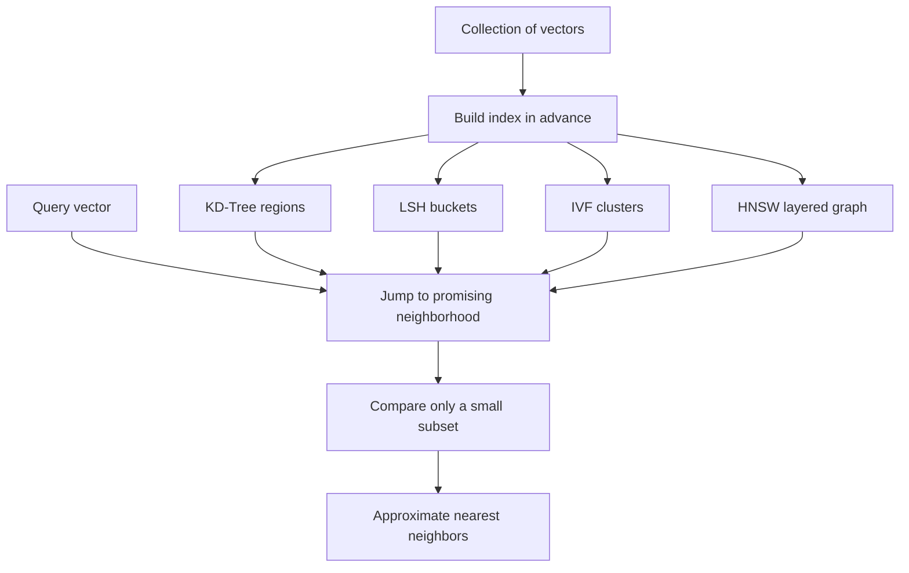

# How does Approximate Nearest Neighbor (ANN) Search work?

> **Step 9: Vector Search and Retrieval-Augmented Generation (RAG)** · ⏱️ 22 min read · [Read original](https://outcomeschool.com/blog/how-does-approximate-nearest-neighbor-ann-search-work)

## TL;DR
ANN search finds an item very close to the true nearest neighbor much faster than checking everything, by accepting a tiny chance of inexactness. It works by pre-organizing vectors (trees, hash buckets, clusters, or graphs) so a query only inspects the right neighborhood.

## Key Concepts
- **Nearest neighbor search** — find the most similar item to a query.
- **Vector** — list of numbers describing an item (a fingerprint); an embedding model produces it.
- **Euclidean distance** — straight-line distance; smaller means more similar. Cosine similarity is the angle-based alternative, common for text.
- **Brute force (exact search)** — compare the query to every item; perfect but does not scale.
- **Recall** — percentage of times the approximate answer matches the true nearest neighbor.
- **nprobe** — in IVF, how many clusters to open at query time.

## How It Works
**Why brute force fails.** With one billion vectors of 1000 numbers, one query needs a billion distance computations, each touching 1000 numbers, and apps serve thousands of queries per second.

**Speed vs accuracy.** ANN tunes a knob: higher recall means slower, higher speed means slightly lower recall (illustratively about 99 percent for high accuracy settings, about 90 percent for high speed). When wrong, it usually returns the second or third closest item, fine for most apps. Library analogy: walk to the cooking section instead of reading every title in the building.

**Four families**
1. **KD-Tree (trees)** — repeatedly cut space in half; follow cuts to the query's region. Works for few dimensions; with hundreds of numbers the cuts stop helping (curse of dimensionality).
2. **LSH (hashing)** — locality sensitive hashing deliberately puts similar vectors in the same bucket; search only the query's bucket. Fast and simple, but a true neighbor may land elsewhere; fix with several hash tables at the cost of memory.
3. **IVF (clustering)** — build clusters once (often with k-means), each with a center. At query time compare to centers, pick nearest clusters, search only their members. Scales to billions. Larger `nprobe` means more accuracy but slower.
4. **HNSW (graphs)** — hierarchical layered graph; start at a sparse top layer with long links (highway), descend through denser layers (main roads) to the full bottom layer (local streets), greedily hopping toward the query. Excellent speed and accuracy; uses more memory and is slower to build. Default in most vector databases.

**Choosing a method**

| Method | Core idea | Strength | Weakness |
|---|---|---|---|
| KD-Tree | Split space into regions | Simple, exact for few numbers | Fails for many numbers |
| LSH | Similar items into buckets | Fast, simple | Extra memory for accuracy |
| IVF | Search nearest clusters | Scales to billions | Needs tuning |
| HNSW | Hop through layered graph | Best speed plus accuracy | More memory to build |

**FAISS snippet (IVF):** `IndexIVFFlat(quantizer, dim, 100)`, then `index.train(data)`, `index.add(data)`, set `index.nprobe = 10`, `index.search(query, 5)`.

**Used in:** semantic search, recommendations, image search, face recognition, RAG, AI assistant memory.

## Diagram

## Key Takeaways
- ANN trades a little accuracy (recall) for a very large speed gain.
- Brute force is exact but too slow at billion scale.
- KD-Trees break in high dimensions; LSH, IVF, and HNSW handle large embeddings.
- HNSW is the usual top choice with enough memory; IVF suits huge data or tight memory.
- `nprobe` (IVF) is the speed versus accuracy knob.
