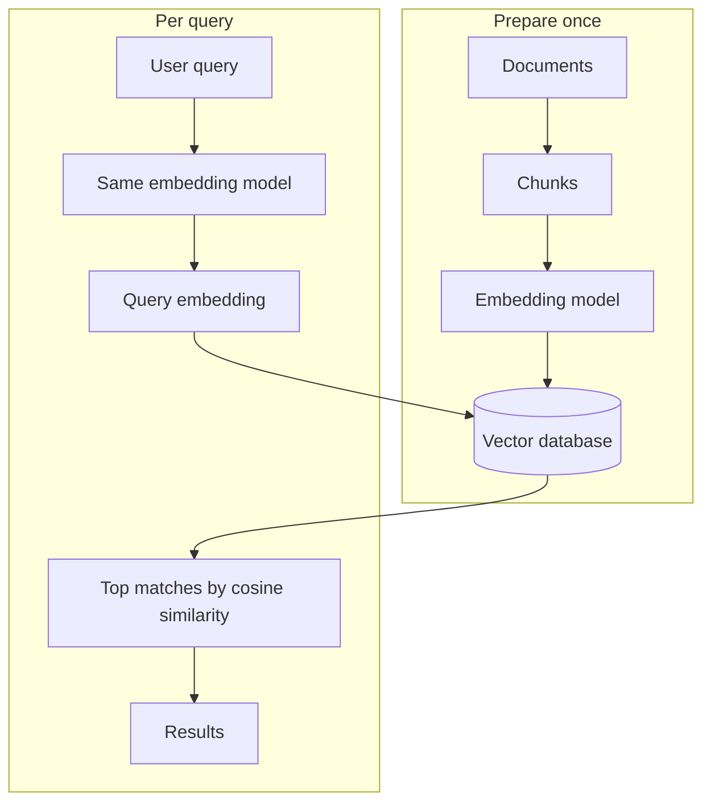

# How does Semantic Search work?

> **Step 9: Vector Search and Retrieval-Augmented Generation (RAG)** · ⏱️ 21 min read · [Read original](https://outcomeschool.com/blog/how-does-semantic-search-work)

## TL;DR
Semantic Search finds documents by meaning instead of exact words. It converts documents and queries into embeddings, then finds the nearest document embeddings in a vector database, so "fixing my automobile" can match "How to repair your car at home".

## Key Concepts
- **Keyword search** — matches exact words between query and documents; fast and simple but blind to meaning.
- **Semantic Search** — search based on meaning ("semantic" = related to meaning).
- **Embedding** — a vector (list of numbers) representing the meaning of text, produced by an embedding model.
- **Meaning space** — embeddings of similar meaning sit close together (car, automobile, vehicle), unrelated ones far apart.
- **Cosine similarity** — score of how alike two embeddings are: near 1 similar, near 0 unrelated, near -1 opposite.
- **Vector database** — stores embeddings and quickly finds those nearest to a query embedding.
- **ANN** — approximate nearest neighbor, fast search without checking every embedding.

## How It Works
**Why keyword search fails.** Document "How to repair your car at home" vs query "fixing my automobile": same meaning, zero matching words, so keyword search returns nothing. It matches spelling, not meaning.

**The embedding idea.** An embedding model, trained on lots of text, maps text to numbers so similar meanings get similar numbers. The computer does not need to understand language; it only checks how close two points are. Example scores: car vs automobile 0.95, car vs vehicle 0.88, car vs banana 0.04.

**Two phases**
1. *Prepare once (offline):* chunk documents (so each piece has one clear meaning), embed each chunk, store embeddings (plus original text) in the vector database.
2. *Search per query:*
   1. User types a query.
   2. Embed it with the same embedding model used for documents (different models would live in different spaces, making scores meaningless).
   3. Vector database compares the query embedding to stored embeddings by cosine similarity.
   4. Return the highest-scoring documents (nearest neighbors).
   5. Show results; often a reranker reorders the top matches first.

**ANN for scale.** Exact search compares against every embedding, too slow for millions or billions of documents. ANN uses a clever structure to jump near the right area and check only a small candidate set, giving up a sliver of accuracy for a huge speed gain.

**Real world:** in-app and website search (natural-language queries), often combined with keyword search as Hybrid Search; and RAG, where Semantic Search is the retrieval step that fetches relevant documents for the LLM.

| | Keyword search | Semantic search |
|---|---|---|
| Matches | Exact words | Meaning |
| Synonyms | Missed | Handled |
| Needs | Text index | Embedding model + vector DB |

## Diagram

## Key Takeaways
- Keyword search matches spelling; semantic search matches meaning.
- Embeddings place similar meanings near each other; closeness is measured with cosine similarity.
- Embed documents once ahead of time; embed only the query at search time.
- Always use the same embedding model for documents and queries.
- ANN makes it fast at scale by trading a tiny bit of accuracy.
- Semantic Search is the retrieval engine behind RAG and is often paired with keyword search.
