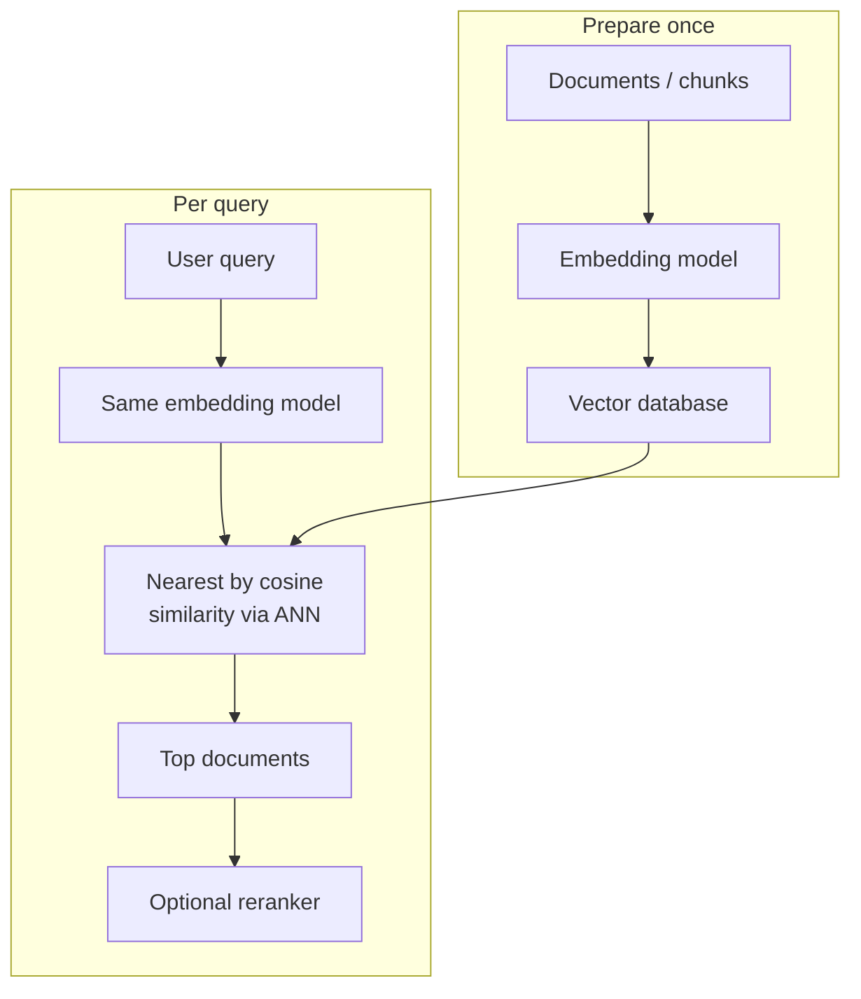

# How does Semantic Search work?

> **Step 9: Vector Search and Retrieval-Augmented Generation (RAG)** · ⏱️ 21 min read · [Read original](https://outcomeschool.com/blog/how-does-semantic-search-work) 

## TL;DR
Semantic Search matches by meaning, not exact words. Documents are embedded once and stored in a vector database; at query time the query is embedded with the same model, and the nearest embeddings (by cosine similarity, found quickly via ANN) are returned.

## Key Concepts
- **Search / query** — a collection of documents plus the user's text query; return the few that match.
- **Keyword search** — matches the exact same words; fast, simple, no understanding of meaning.
- **Semantic Search** — "semantic" = related to meaning.
- **Embedding** — list of numbers (vector) representing the meaning of text; hundreds/thousands of numbers; produced by an embedding model trained on huge text.
- **Cosine similarity** — score of how alike two embeddings are (1 similar, 0 unrelated, -1 opposite).
- **Vector database** — stores embeddings and quickly finds those nearest to a given one.
- **Nearest neighbors** — stored points closest to the query point in meaning space.
- **ANN** — approximate nearest neighbor; fast, almost always right.

## How It Works

### Where keyword search fails
Docs: "How to get a refund for your order" etc. Query "refund" matches only Doc 1 (same word). But doc "How to repair your car at home" vs query "fixing my automobile": fixing/repair and automobile/car mean the same but no exact word matches, so zero results. Humans search by meaning; keyword search matches by spelling.

### Embeddings: similar meaning close together
Embedding model gives similar texts similar numbers. Picture 2-number embeddings as points: car, automobile, vehicle cluster together; cat, dog cluster together; the groups are far apart. Comparing meaning = checking closeness of points.

Cosine similarity examples: car/automobile 0.95, car/vehicle 0.88, car/banana 0.04.

### Two phases
**Prepare once**: each document (usually chunked first, see Chunking Strategies) goes through the embedding model; store embeddings (plus original text) in the vector DB. Never redone per search.

**Search per query**:
1. User types query ("fixing my automobile").
2. Embed it with the **same** embedding model as documents (else different meaning spaces, scores meaningless).
3. Ask the vector DB for nearest stored embeddings by cosine similarity.
4. Get highest-scoring documents (nearest neighbors), e.g. "How to repair your car at home" 0.93, "Car maintenance basics" 0.81, "Replacing a flat tyre" 0.67.
5. Show results (often a reranker reorders the top matches).

### ANN for scale
Exact search compares against all embeddings: fine for hundreds, too slow for millions/billions. ANN uses a clever structure to jump near the right area and check a small subset. Almost always true neighbors; tiny accuracy loss for massive speed (99% accurate in milliseconds beats perfect in seconds).

| | Exact | ANN |
|---|---|---|
| Compares | all embeddings | small subset |
| Accuracy | perfect | almost perfect |
| Speed at scale | slow | fast |

### Real world
- **Search** in apps/help centers/websites; often combined with keyword search in **Hybrid Search** and merged into one list.
- **RAG**: semantic search does retrieval; embed question, fetch nearest document embeddings, give to LLM (accurate answers over private docs). Vectorless RAG is an alternative that reads document structure.
- **Recommendations**: embed items, find nearest to the current item (products, songs, videos).

## Trade-offs & Pitfalls
- Must use the same embedding model for docs and queries.
- ANN is not guaranteed exact.
- Keyword search still has value; real systems combine both.

## Key Takeaways
- Keyword search matches spelling; semantic search matches meaning.
- Embeddings place similar meanings near each other.
- Cosine similarity scores closeness (-1 to 1).
- Embed documents once, store in a vector DB; embed only the query at search time.
- Same model for both sides.
- ANN keeps search fast at scale.
- Retrieval step of RAG and recommendations use the same idea.
