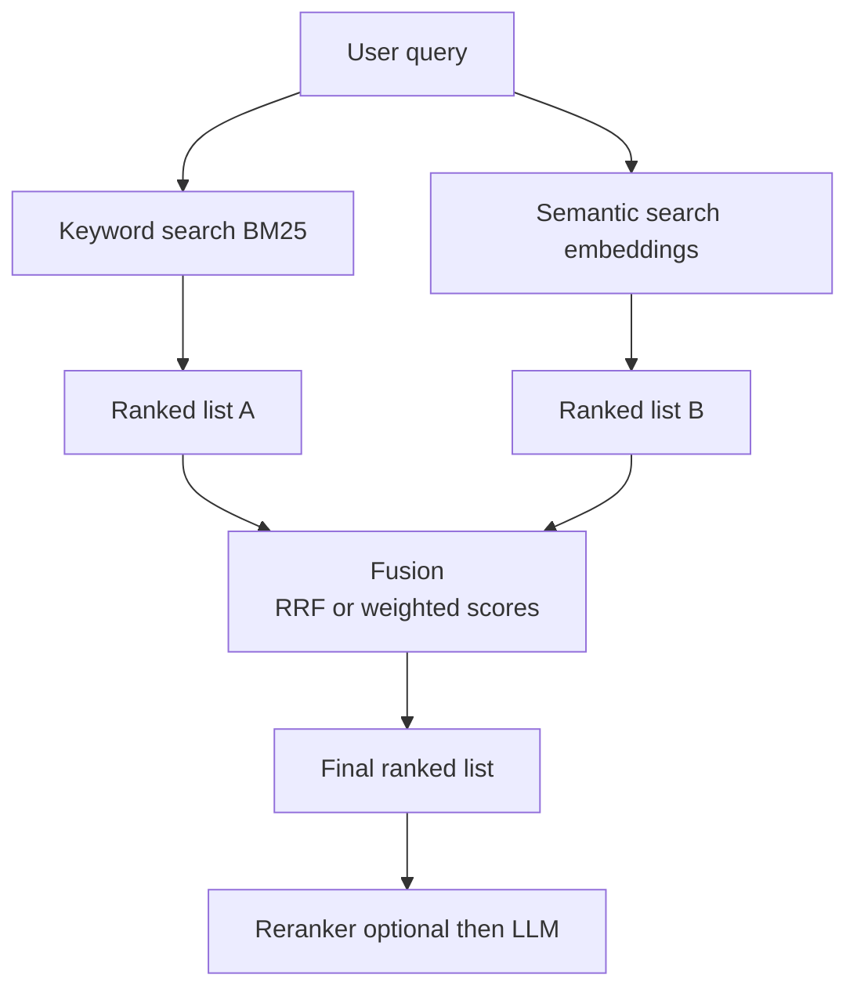

# How does Hybrid Search work?

> **Step 9: Vector Search and Retrieval-Augmented Generation (RAG)** · ⏱️ 20 min read · [Read original](https://outcomeschool.com/blog/how-does-hybrid-search-work)

## TL;DR
Hybrid Search runs keyword search (BM25) and semantic (vector) search on the same query and fuses the two ranked lists into one. Each method is strong where the other is weak, so combining them makes retrieval, especially in RAG, much less likely to miss the right document.

## Key Concepts
- **Keyword (lexical) search** — exact word matching; BM25 scores by how often query words appear and how rare they are.
- **Synonym problem** — keyword search treats "return" and "send back" as unrelated.
- **Semantic (vector) search** — embeds query and documents, returns nearest vectors by meaning.
- **Fusion** — merging the keyword list and semantic list into one final ranking.
- **RRF (Reciprocal Rank Fusion)** — fuses using ranks instead of raw scores.
- **Normalization** — rescaling scores to a common range (usually 0 to 1).

## How It Works
**Complementary weaknesses**
- Keyword: great at exact terms such as "SKU-48217" or "ERR_500", blind to meaning.
- Semantic: great at paraphrase ("send shoes back" matches "return your shoes"), but can miss exact codes, names, and rare terms because they carry no real "meaning".

**Pipeline**
1. User query, for example "how to send shoes back".
2. BM25 lexical search returns ranked list A with BM25 scores.
3. Vector search (embed query, nearest document vectors) returns ranked list B with closeness scores.
4. Fuse A and B into one final list.

**The scale problem.** BM25 scores are unbounded (2, 6, 40) while semantic scores sit around 0 to 1, so adding raw scores lets keyword dominate.

**Method 1: RRF.** Ignore scores, use rank. Each document earns about $\frac{1}{\text{rank}}$ per list and the points are summed (the real formula adds a small constant to the rank). Example: Doc-7 is rank 1 in keyword and rank 2 in semantic, so $1 + 0.5 = 1.5$; Doc-3 only rank 1 semantic = 1.0; Doc-2 only rank 2 keyword = 0.5. Documents both searches like float to the top. Also reused in Multi-Query Retrieval.

**Method 2: Weighted score combination.** Normalize, then blend:

$$\text{final} = w_{kw}\cdot s_{kw}^{norm} + w_{sem}\cdot s_{sem}^{norm}$$

Raise the keyword weight (for example 0.7/0.3) for code- and name-heavy data; raise semantic when meaning matters.

| | RRF | Weighted combination |
|---|---|---|
| Uses | Ranks | Normalized scores |
| Normalization | Not needed | Required |
| Control | Less | More via weights |
| Effort | Works well by default | More tuning |

**In RAG.** Hybrid Search is the retrieval step feeding the LLM; bad retrieval means wrong answers regardless of model quality. Often followed by a reranker, and sharpened by HyDE or Contextual Retrieval.

## Diagram

## Key Takeaways
- Keyword search nails exact terms; semantic search nails meaning; hybrid gets both.
- Raw BM25 and vector scores are on different scales, so do not add them naively.
- RRF fuses by rank and is the simple, reliable default.
- Weighted combination needs normalization but gives tunable control.
- A document appearing high in both lists rises to the top.
