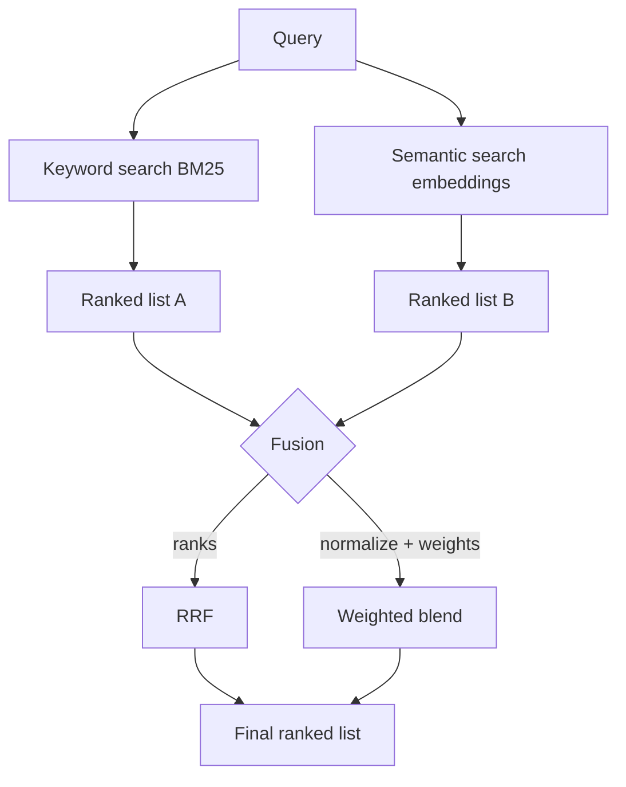
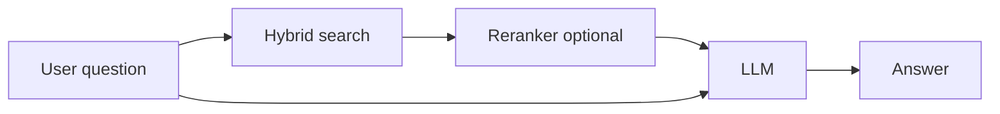

# How does Hybrid Search work?

> **Step 9: Vector Search and Retrieval-Augmented Generation (RAG)** · ⏱️ 20 min read · [Read original](https://outcomeschool.com/blog/how-does-hybrid-search-work)

## TL;DR
Hybrid Search runs keyword search (BM25) and semantic search (embeddings) on the same query, then fuses the two ranked lists into one. Keyword search catches exact terms and codes; semantic search catches synonyms and rephrasing. Fusion uses Reciprocal Rank Fusion (ranks) or weighted normalized scores.

## Key Concepts
- **Keyword / lexical search** — matches the same words ("lexical" = relating to words).
- **BM25** — scores docs by how often query words appear and how rare they are (rare "refund" > common "the"); sort gives a ranked list.
- **Synonym problem** — "return your shoes" vs "send shoes back"; "car"/"automobile"; keyword search misses it.
- **Semantic search / vector search** — matches meaning using embeddings (vectors from an embedding model; similar meaning = close vectors); scored by closeness. Finding closest vectors fast uses ANN.
- **Fusion** — merging two ranked lists into one.
- **RRF** — Reciprocal Rank Fusion, rank-based.
- **Normalization** — rescale scores to a common range (usually 0..1).
- **Weights** — importance given to each search.

## How It Works

### Strengths and weaknesses
| | Keyword (BM25) | Semantic |
|---|---|---|
| Good at | Exact words, codes (SKU-48217, ERR_500), names, rare terms | Meaning, synonyms, rephrasing |
| Weak at | Meaning (blind to synonyms) | Exact strings; may return "related" docs lacking the exact code |

Analogy: two helpers, one spots exact words, one understands meaning; ask both and combine.

### Run both
1. User query ("how to send shoes back").
2. Lexical search (BM25) gives ranked list A with BM25 scores (Doc-7 9.1, Doc-2 6.4, Doc-9 4.2).
3. Vector search gives ranked list B with closeness scores (Doc-3 0.95, Doc-7 0.88, Doc-5 0.81).
Doc-7 in both lists is a strong signal.

### Fusion and the scale problem
BM25 scores have no fixed top (2, 6, 40...); semantic scores are usually 0..1. Adding directly lets BM25 swamp semantic. Two fixes:

**RRF**: use rank only (scale-free). Points = reciprocal of rank (1/rank), summed across lists; highest total wins.
- Doc-7: 1/1 + 1/2 = 1.50
- Doc-3: 0 + 1/1 = 1.00
- Doc-2: 1/2 + 0 = 0.50
Doc-7 wins since both agree. Real formula adds a small constant to the rank so the top ranks aren't too far ahead. RRF is also used in Multi-Query Retrieval to merge lists from multiple query versions.

**Weighted score combination**: normalize, then blend:

$$
\text{final}=w_k\cdot s_k^{norm}+w_s\cdot s_s^{norm}
$$

$w_k,w_s$ are weights for keyword and semantic. 0.5/0.5 equal trust; for code/product-name heavy corpora, 0.7 keyword / 0.3 semantic; reverse if meaning matters more.

| Point | RRF | Weighted |
|---|---|---|
| Uses | Rank | Normalized scores |
| Normalization | Not needed | Required |
| Control | Less | More via weights |
| Ease | Simple, good default | Needs tuning |

### In the real world: RAG
Retrieval quality decides RAG quality (wrong docs = wrong answer). Hybrid Search catches both error codes (keyword) and rephrasings (semantic). Related retrieval sharpeners: HyDE (search with a hypothetical answer), Contextual Retrieval (add a short note about the source document to each chunk before indexing). Often a reranker follows to reorder by true relevance. Vectorless RAG: cheap search narrows to a few docs, then the model reads their structure.

## Trade-offs & Pitfalls
- Never add raw BM25 and semantic scores directly.
- Weighted needs normalization and tuning; RRF gives less balance control.
- Pure semantic misses exact codes; pure keyword misses synonyms.

## Key Takeaways
- Hybrid = keyword + semantic, merged into one ranked list.
- BM25 rewards term frequency and rarity.
- Embeddings place similar meanings close together.
- RRF fuses by rank: 1/rank summed; no normalization.
- Weighted fusion: normalize then weight; tune weights by use case.
- Docs both searches rank highly rise to the top.
- Retrieval step of RAG benefits most; reranker often follows.
