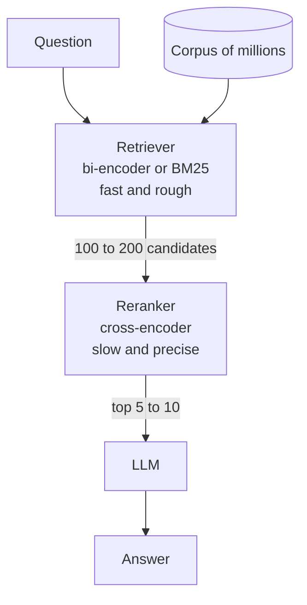

# How does a Reranker work?

> **Step 9: Vector Search and Retrieval-Augmented Generation (RAG)** · ⏱️ 23 min read · [Read original](https://outcomeschool.com/blog/how-does-a-reranker-work)

## TL;DR
A Reranker is a model that reorders a shortlist of retrieved documents so the most relevant ones come first. It uses a slower, more precise cross-encoder on only a small candidate set, giving accuracy that fast first-stage retrieval cannot achieve alone.

## Key Concepts
- **Reranker** — a "smart sorter" that reorders documents already gathered; it never finds new ones.
- **Two-stage retrieval** — Stage 1 fast retriever shortlists (about 100 to 200); Stage 2 reranker picks the top 5 or 10.
- **Bi-encoder** — encodes question and document separately into embeddings, then compares; fast, can precompute, loses fine detail.
- **Cross-encoder** — reads question and document together and outputs one relevance score; precise, slow, cannot precompute.
- **Late interaction (ColBERT)** — keeps per-word document embeddings precomputed, compares word by word at query time; middle ground.
- **top-k** — how many reranked documents are kept.

## How It Works
**Analogy.** A junior helper grabs 50 books by cover words (retriever); a senior librarian actually reads pages and reorders them (reranker).

**Why first stage is imprecise.** BM25 only matches exact words ("nutritious recipes" vs "healthy cooking"). Vector search compresses each document into one embedding before seeing the question, losing detail, so a broadly related document can outrank the one that answers precisely. The first stage reaches the right neighborhood, not the right house.

| | Bi-encoder | Cross-encoder |
|---|---|---|
| Reads | Question and document separately | Together |
| Output | One embedding per text | One relevance score per pair |
| Speed | Very fast | Slow |
| Precision | Good, loses detail | High |
| Precompute | Yes | No |
| Use | First-stage retrieval | Reranking a shortlist |

**Scoring example.** Question: "What is the capital of France?" Four candidates get scores 0.34 (France is in Europe), 0.97 (Paris is the capital), 0.55 (Eiffel Tower in Paris), 0.21 (Berlin is capital of Germany). Pair question with each document, score with the cross-encoder, sort descending, keep top-k. The Germany document, ranked high by shared word "capital", sinks.

**Cost trade-off.** Each pair needs a full model pass, so reranking a million documents is impractical. Retrieve about 100 to 200, rerank to 5 or 10. More candidates means higher accuracy but more latency and cost; fewer is faster but risks missing a good document. A short final prompt also avoids the lost-in-the-middle problem.

**ColBERT placement**
- *Option A:* ColBERT as reranker only after a normal retriever; easy to add, smaller index if shortlist encoded on the fly.
- *Option B:* ColBERT as retriever and reranker together; better recall because it searches the whole corpus at word level, but needs a much larger index. A plain cross-encoder cannot do this.

Standard ColBERT pre-encodes all documents (low latency, larger index); alternatively encode the shortlist on the fly (less storage).

## Diagram

## Key Takeaways
- A Reranker only reorders a shortlist; it does not search the corpus.
- Two stages combine speed (bi-encoder) with precision (cross-encoder).
- Cross-encoders see question and document together, so they catch fine detail but cannot precompute.
- The number of candidates reranked is a tunable accuracy versus latency and cost knob.
- ColBERT is a late-interaction middle ground and can serve as reranker or as full retriever.
