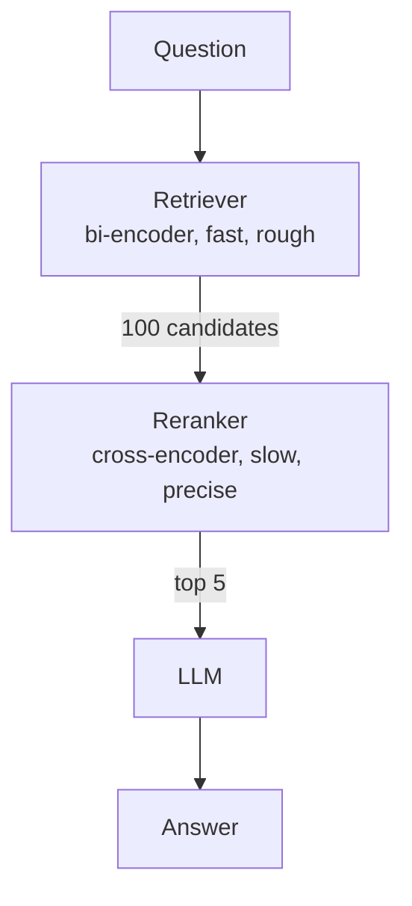
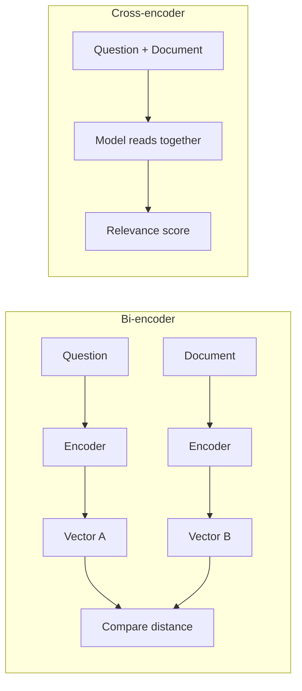

# How does a Reranker work?

> **Step 9: Vector Search and Retrieval-Augmented Generation (RAG)** · ⏱️ 23 min read · [Read original](https://outcomeschool.com/blog/how-does-a-reranker-work)

## TL;DR
A Reranker is a cross-encoder model that reads the question together with each shortlisted document, scores relevance, and reorders so the best documents are on top. It sits between a fast first-stage retriever and the LLM in RAG. It only reorders a shortlist (100-200 candidates down to top 5-10) because cross-encoders are accurate but slow and costly.

## Key Concepts
- **Reranker** — smart sorter that reorders a shortlist; cannot find new documents. Analogy: junior helper fetches 50 books; senior librarian reads and reorders.
- **Pipeline / RAG** — Retrieval-Augmented Generation: fetch docs first, give to LLM to answer from facts.
- **Corpus** — the whole document collection.
- **BM25** — keyword scoring; exact words only (misses "nutritious recipes" vs "healthy cooking").
- **Vector search** — embeddings (meaning as a point in space); nearest embeddings to the question embedding. Hybrid Search combines both.
- **Bi-encoder** — encodes question and document separately, compares embeddings.
- **Cross-encoder** — takes question + document together, outputs a relevance score.
- **Late interaction (ColBERT)** — per-word document embeddings, fine-grained comparison at query time.
- **Latency** — how long the user waits.
- **top-k** — how many docs kept after reranking.

## How It Works

### Two-stage retrieval
Reading every doc carefully for each question is too slow. So:
1. **Retrieval**: fast retriever scans corpus (1,000,000 docs), returns about 100-200 rough candidates (allowed to be sloppy).
2. **Reranking**: reranker reads each candidate carefully, reorders, keep top 5-10.
Stage 1 trades precision for speed; stage 2 trades speed for precision.

### Why first stage is imprecise
Vector search embeds question and docs separately, ahead of time, compressing a whole doc into one fixed vector, losing fine detail. Query "Which medicine should I avoid if I have high blood pressure?" may rank a general blood-pressure/medicine doc high though it never names the medicine. Good rough shortlist, but "kind of related" can outrank "exactly right" (right neighborhood, wrong house). Improve stage 1 with HyDE (hypothetical answer as query) or Multi-Query Retrieval (LLM writes multiple question versions, merge results).

### Bi-encoder vs Cross-encoder
| Point | Bi-encoder | Cross-encoder |
|---|---|---|
| Reads | Question and doc separately | Together |
| Output | Embedding per text | Relevance score per pair |
| Speed | Very fast | Slow |
| Precision | Good, loses detail | High |
| Precompute | Yes | No (question new each time) |
| Use | First-stage retrieval (ANN makes it fast) | Rerank small shortlist |

### Scoring step by step
Question "What is the capital of France?" with 4 candidates:
1. Pair question with each doc (4 pairs).
2. Cross-encoder scores: Doc1 "France is a country in Europe..." 0.34; Doc2 "Paris is the capital and largest city of France." 0.97; Doc3 "Eiffel Tower is in Paris..." 0.55; Doc4 "Berlin is the capital of Germany." 0.21.
3. Sort descending: Doc2, Doc3, Doc1, Doc4.
4. Keep top-k (top-2 = Doc2, Doc3) and give to the LLM.
First stage had Doc4 high (shares "capital"); the reranker fixed it by understanding meaning. Exact scores don't matter, only order.

### Accuracy vs latency/cost
Every pair needs a full model pass. 100 pairs is fine; 1M per question is too slow and costly. Typical: retrieve 100-200, rerank to top 5-10 (also keeps prompt short, so relevant docs don't get lost in the middle). Candidates count is a knob: more = higher accuracy, slower, costlier; fewer = faster but risk missing a doc ranked low in stage 1.

### Late interaction: ColBERT
Contextualized Late Interaction over BERT. Keeps a small embedding per word in each document (precomputed, fast like bi-encoder); at query time compares query words with document words and sums best matches (word-level, "late"). More precise than bi-encoder, faster than cross-encoder.

Placements:
- **Option A**: ColBERT as reranker only (Retriever, ColBERT, LLM). Easy to add to existing systems; if shortlist encoded on the fly, index stays small.
- **Option B**: ColBERT as retriever and reranker in one step. Better recall (searches whole corpus at word level) but much larger index (embedding per word of every doc). Plain cross-encoders can never do this.

| Document-side approach | Storage | Query latency |
|---|---|---|
| Pre-encode and store (standard) | High | Low |
| Encode on the fly | Low | High |

Embedding Cache helps reuse stored embeddings. Summary: bi-encoder fast and rough, cross-encoder slow and precise, ColBERT the middle.

### Real examples
- **BGE reranker**: open-source cross-encoder, self-hostable, popular for control/privacy.
- **ColBERT**: used as retriever and reranker.
Hosted or self-hosted, the working is the same: score pairs, reorder.

### Why it matters for RAG
Mediocre top documents cause weak or wrong answers. Example: "How do I get a refund?" fed a shipping doc without a reranker; with one the refund policy rises to the top. Small step, lifts the whole system.

## Trade-offs & Pitfalls
- Cannot recover documents the retriever missed; too few candidates risks that.
- Cross-encoder cost scales linearly with candidates; never run on whole corpus.
- ColBERT Option B: big index. Pre-encode: storage vs latency.

## Key Takeaways
- Reranker = cross-encoder scoring (question, doc) pairs and sorting.
- Two-stage: fast bi-encoder recall, then precise rerank of shortlist.
- Bi-encoder can precompute; cross-encoder cannot.
- Tune number of candidates (100-200 in, 5-10 out) for accuracy vs latency/cost.
- ColBERT is a middle ground and can serve as retriever and reranker.
- Scores matter only for ordering.
- Better docs into the LLM means better answers.
