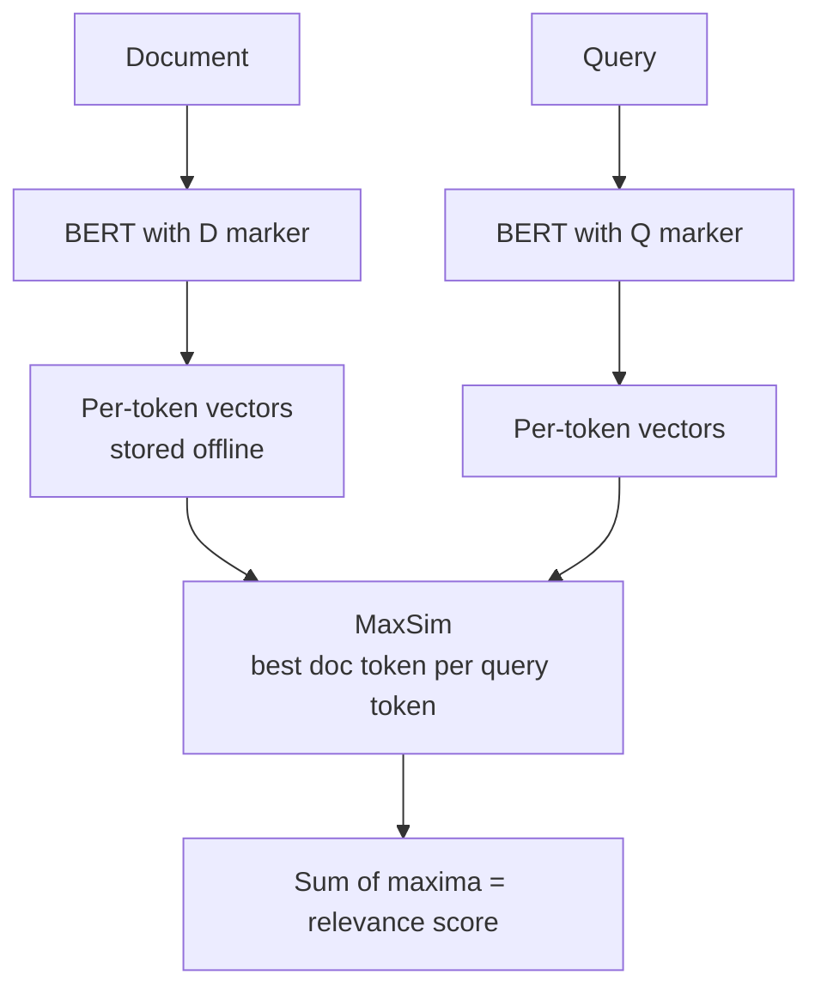

# What is ColBERT? Late Interaction Retrieval Explained

> **Step 9: Vector Search and Retrieval-Augmented Generation (RAG)** · ⏱️ 19 min read · [Read original](https://outcomeschool.com/blog/decoding-colbert)

## TL;DR
ColBERT (Stanford, 2020, Khattab and Zaharia) encodes the query and each document into bags of per-token vectors separately, so documents can be precomputed, then scores relevance with a cheap MaxSim operation. It keeps nearly the word-level quality of a BERT cross-encoder while being fast enough to search millions of passages.

## Key Concepts
- **Late interaction** — word-level matching happens after encoding, via a cheap operation outside BERT.
- **Per-token vectors** — each token gets a 128-number unit-length vector, so a document is a matrix, not one vector. Unit length makes cosine equal to dot product.
- **[Q] / [D] markers** — a shared BERT is told query vs document by marker tokens; queries are padded with [MASK] (a learned query expansion).
- **MaxSim** — the relevance score.
- **Triples** — training data of (query, positive passage, negative passage).

## How It Works
**Two old extremes**
- *Cross-encoder:* query and document go into BERT together; accurate but nothing precomputable (one BERT reranker took over 10 seconds per query).
- *Single-vector dual encoder (DPR style):* one vector per side, one dot product; fast but blunt, loses word-level detail.
- *ColBERT:* separate encoding (precomputable) but per-token vectors (detail kept).

**MaxSim**

$$S(q,d)=\sum_i \max_j \; E_{q_i}\cdot E_{d_j}$$

For each query token, take its best-matching document token, then sum. Example: q1 best match 0.96 (d1), q2 best 0.80 (d2), score = 1.76. A document B scores 0.60 + 0.48 = 1.08, so A ranks higher.

**Why max, not average.** Max rewards a strong match (0.96); average over [0.96, 0.00, 0.60] gives 0.52 and keeps shrinking as unrelated tokens are added.

**Training.** For each triple, compute MaxSim for d+ and d-; make the positive win. Loss is pairwise softmax cross-entropy: with scores 1.76 and 1.08, $p = \frac{e^{1.76}}{e^{1.76}+e^{1.08}} = 0.664$, loss $=-\ln p = 0.41$; after training (2.5 vs 0.5) loss falls to 0.13. Only the gap matters, which teaches the vectors where to point (the core of contrastive learning).

**Use modes.** Reranking top candidates, or end-to-end retrieval: each query token looks up nearest document tokens in a vector index (ANN filter, then exact MaxSim). A cross-encoder cannot do this.

**Cost: bigger index.** A 100-token passage needs 100 x 128 = 12,800 numbers vs 128 for single-vector, about 100x more. MS MARCO (8.8M passages) is around 154 GB.

**Results (MS MARCO)**

| Method | MRR@10 | Latency |
|---|---|---|
| BERT reranker | 34.7 | ~10,700 ms |
| ColBERT (rerank) | 34.9 | ~61 ms |

About 170x faster at similar quality.

**Legacy:** ColBERTv2 (residual compression, index down to roughly 16 to 25 GB), PLAID (centroid pruning, tens of ms), ColPali (late interaction over page-image patches), and a common first stage in RAG.

## Diagram

## Key Takeaways
- ColBERT = per-token vectors plus MaxSim: cross-encoder-like accuracy with dual-encoder-like precomputation.
- Score = for each query token take its max similarity over document tokens, then sum.
- Max (not average) keeps strong matches from being diluted.
- Trained with triples so the positive outscores the negative.
- Price is a much larger index; ColBERTv2 and PLAID address storage and latency.
