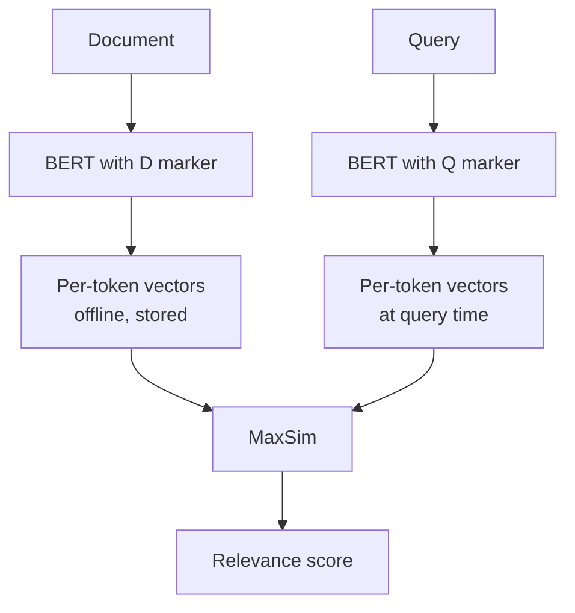
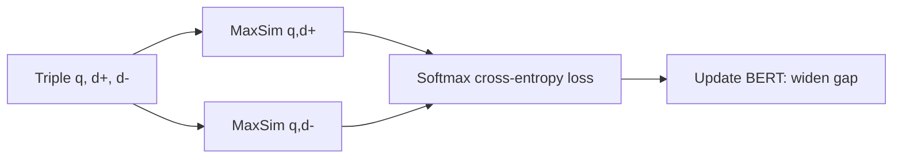

# What is ColBERT? Late Interaction Retrieval Explained

> **Step 9: Vector Search and Retrieval-Augmented Generation (RAG)** · ⏱️ 19 min read · [Read original](https://outcomeschool.com/blog/decoding-colbert)

## TL;DR
ColBERT (Khattab and Zaharia, Stanford, 2020; "Contextualized Late Interaction over BERT") encodes query and documents separately into bags of per-token vectors, so documents are precomputed offline, then scores with a cheap MaxSim operation. It keeps the word-level accuracy of a BERT cross-encoder at about 170x the speed, at the price of a ~100x larger index.

## Key Concepts
- **Token / embedding** — word-piece / vector for its meaning.
- **Cosine similarity** — -1..1; for unit vectors equals the dot product.
- **Reranker** — re-scores a small candidate set.
- **Offline / online** — ahead of time vs at query time.
- **BERT** — encoder-only transformer reading both directions.
- **Cross-encoder** — query+doc together in BERT; accurate, nothing precomputable (paper: one BERT reranker over 10 s per query).
- **Single-vector dual encoder (DPR style)** — one vector per query, one per doc, one dot product; fast but loses word detail.
- **Late interaction** — per-token vectors encoded separately; token-level matching happens after, via a cheap op.
- **MaxSim** — ColBERT's scoring.
- **Triple** — (query, positive passage d+, negative passage d-).

## How It Works

### Three designs compared
| Design | Encoding | Scoring | Verdict |
|---|---|---|---|
| Cross-encoder | query+doc together | BERT per pair | accurate, slow, no precompute |
| Single-vector | 1 vector each | 1 dot product | fast, blunt |
| ColBERT | 1 vector per token each, separate | MaxSim | accurate and fast |

### Encoding
Shared BERT with markers: [Q] for queries (short queries padded with [MASK] up to fixed length; BERT fills them with useful extra terms = learned query expansion); [D] for docs (punctuation tokens dropped). Each token vector projected to 128 numbers and made unit-length, so cosine = dot product. Check: q1=[0.6,0.8,0], d1=[0.8,0.6,0] gives 0.48+0.48=0.96.

### MaxSim
$$S(q,d)=\sum_i \max_j \; E_{q_i}\cdot E_{d_j}$$
$E_{q_i}$ = i-th query token vector, $E_{d_j}$ = j-th doc token vector; for each query token take its best doc token, sum.

Worked example: q1=[0.6,0.8,0], q2=[0,0.6,0.8]; d1=[0.8,0.6,0], d2=[0,0,1], d3=[1,0,0].
| | d1 | d2 | d3 |
|---|---|---|---|
| q1 | 0.96 | 0.00 | 0.60 |
| q2 | 0.36 | 0.80 | 0.00 |
Row max: 0.96 + 0.80 = **1.76**. Real ColBERT: 128-dim vectors, query padded to 32 tokens, passages a few hundred tokens (32 x 300 grid); same steps.

**Why max not average**: a doc is relevant if it has a good match for a query word even if other words are unrelated. q1 row: max 0.96 vs average (0.96+0+0.60)/3 = 0.52 diluted; with 200 more unrelated tokens average heads to 0, max stays 0.96.

**Ranking**: Doc B with b1=[1,0,0], b2=[0.8,0,0.6]: q1 max(0.60,0.48)=0.60; q2 max(0,0.48)=0.48; total 1.08. A (1.76) beats B (1.08) since B has no strong home for q2.

### Training
Triples <q, d+, d->. Run MaxSim for both; goal: score(d+) > score(d-). Never told what individual vectors should be; only which doc wins. Contrastive learning idea (pull positive closer, push negative away).

**Loss** (pairwise softmax cross-entropy): with scores 1.76 (A, positive) and 1.08 (B): $e^{1.76}=5.812$, $e^{1.08}=2.945$, sum 8.757, $p=5.812/8.757=0.664$, loss $=-\ln p=0.41$. After training (2.5 vs 0.5): $p=12.182/13.831=0.881$, loss 0.13. Loss falls only as the gap grows.

### Fast retrieval at scale
MaxSim is pruning-friendly: each query token looks up nearest doc tokens in a vector index. Two modes:
- **Reranking**: re-score top candidates from a cheap first stage.
- **End-to-end retrieval**: index all doc token vectors; ANN filter first, then exact MaxSim on survivors. A cross-encoder can't do this (doc representation depends on the query).

### Cost
100-token passage: single-vector 128 numbers vs ColBERT 12,800 (100x). MS MARCO (8.8M passages): ~154 GB vs a few GB.

### Results (MS MARCO passage)
| Method | MRR@10 | Rerank latency |
|---|---|---|
| BERT reranker | 34.7 | ~10,700 ms |
| ColBERT (rerank) | 34.9 | ~61 ms |
~170x faster, same quality, far fewer computations. End-to-end over 8.8M passages: well under a second with very high recall, beating keyword and single-vector methods.

### Legacy
- Late interaction (multi-vector) is a third main style beside dense (DPR), learned sparse (SPLADE), keyword.
- **ColBERTv2**: residual compression (centroid + tiny correction); index 154 GB to about 16-25 GB (6-10x), better quality.
- **PLAID**: prune via centroids before touching full vectors; tens of ms latency.
- **ColPali**: MaxSim over patches of page images vs query tokens; visual document retrieval (charts, tables, scans) without reading text.
- Common first stage in RAG.

## Trade-offs & Pitfalls
- Index ~100x bigger than single-vector (one vector per token).
- Accuracy bought with disk space; v2 compression and PLAID mitigate.

## Key Takeaways
- ColBERT = per-token vectors encoded separately + MaxSim scoring.
- Late interaction defers word-level matching to a cheap step so documents precompute offline.
- MaxSim = sum over query tokens of best doc-token match; max beats average.
- Trained on (q, d+, d-) triples with pairwise softmax cross-entropy.
- Matches BERT reranker quality (34.9 vs 34.7 MRR@10) at ~170x speed.
- Cost: ~100x storage (154 GB on MS MARCO); ColBERTv2 shrinks to 16-25 GB.
- Works as reranker or end-to-end retriever; extended to images via ColPali.
