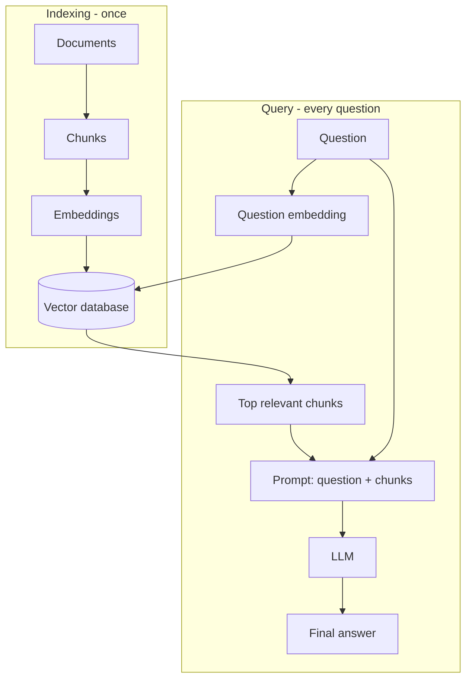

# How does RAG work?

> **Step 9: Vector Search and Retrieval-Augmented Generation (RAG)** · ⏱️ 14 min read · [Read original](https://outcomeschool.com/blog/retrieval-augmented-generation-rag)

## TL;DR
RAG (Retrieval-Augmented Generation) first finds relevant information from your own knowledge base and then hands it to the LLM along with the question, so the model answers from real facts. It fixes the LLM's frozen knowledge, lack of private data, and hallucinations without retraining.

## Key Concepts
- **Hallucination** — a confident but wrong or made-up LLM answer.
- **RAG = Retrieval + Augmented + Generation** — fetch info, add it to the prompt, generate the answer. Analogy: turning a closed-book exam into an open-book one.
- **Chunk** — a small piece of a document (paragraph or a few sentences).
- **Embedding** — list of numbers representing meaning; similar meaning gives nearby points.
- **Vector database** — stores embeddings and finds the most similar ones fast.
- **Semantic search** — finds results by meaning, not exact words.

## How It Works
**The problem.** An LLM only knows its training data (frozen), does not know recent events, and has never seen your private documents.

**Phase 1: Indexing (once, or when documents change)**
1. Collect documents.
2. Split into chunks (a 500-page handbook cannot be sent whole: slow and costly).
3. Convert each chunk to an embedding with the same method later used for questions.
4. Store embeddings in a vector database.

**Phase 2: Query (every question)**
1. *Retrieval:* embed the question, search the vector database, take the top few closest chunks (a few, because the answer may span several). "I cannot log in" still finds the "reset my password" chunk. Many systems add a reranker here.
2. *Generation:* build a prompt of instructions ("answer using only the information below") plus the retrieved chunks plus the question. This is the "augmented" part. The LLM writes the answer from those facts.

**Why it works well**

| Benefit | Reason |
|---|---|
| Fresh answers | Update chunks, not the model |
| Private data | Your documents go in the vector database |
| Fewer hallucinations | Real facts are in the prompt |
| Source citing | You know which chunks were used |
| Cheaper and faster | No retraining |

For multi-search or multi-source questions, Agentic RAG lets an agent drive retrieval in a loop.

## Diagram

## Key Takeaways
- LLM knowledge is frozen and lacks private data; RAG supplies facts at query time.
- Two phases: index once, then retrieve and generate per question.
- Retrieval is semantic search over chunk embeddings in a vector database.
- Augmentation means putting the retrieved chunks into the prompt.
- Updating data means updating the vector database, never retraining the LLM.
