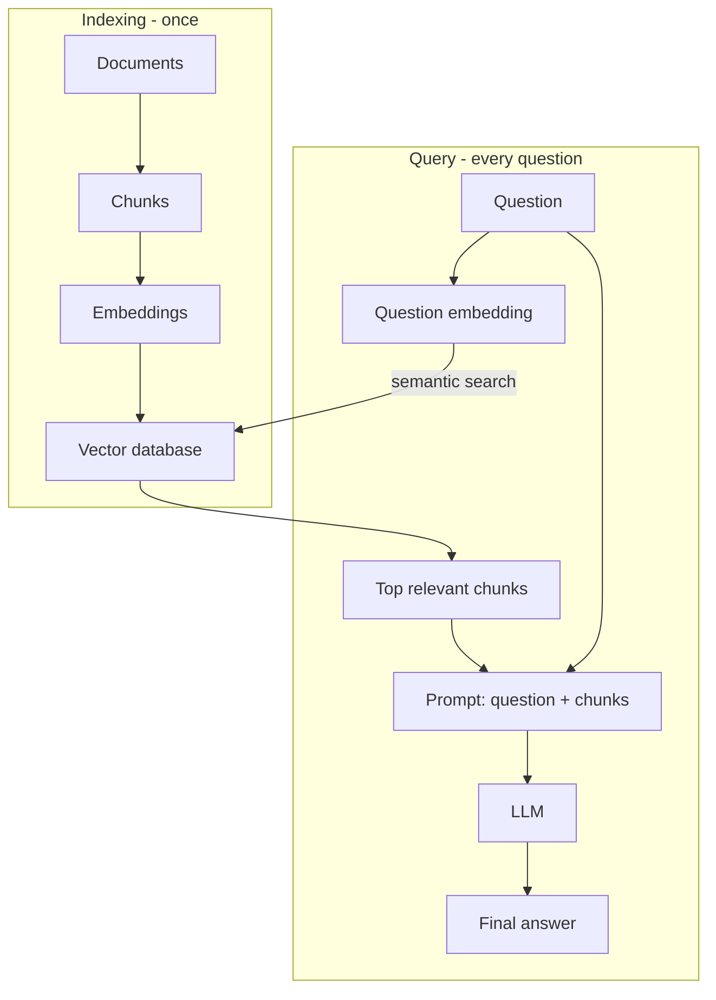
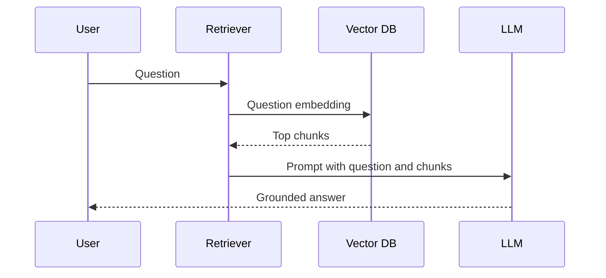

# How does RAG work?

> **Step 9: Vector Search and Retrieval-Augmented Generation (RAG)** · ⏱️ 14 min read · [Read original](https://outcomeschool.com/blog/retrieval-augmented-generation-rag)

## TL;DR
RAG (Retrieval-Augmented Generation) first retrieves the right information for a question from an indexed knowledge base, then adds it to the prompt so the LLM writes an accurate, grounded answer. It fixes the frozen-knowledge and private-data limits of plain LLMs without retraining. Turns a closed-book exam into an open-book one.

## Key Concepts
- **Hallucination** — confident but wrong, made-up answer.
- **RAG = Retrieval + Augmented + Generation** — fetch info; add it to the prompt; LLM writes the answer.
- **Chunk** — small piece of a document (paragraph or few sentences).
- **Embedding** — list of numbers representing meaning; similar meaning = close points on a "meaning map".
- **Vector database** — stores embeddings (vectors) and finds most similar ones fast.
- **Semantic search** — search by meaning, not exact words ("I cannot log in" finds "reset my password").
- **Prompt** — full input text given to the LLM.
- **Reranker** — optional step to reorder retrieved chunks.

## How It Works

### Problem with a plain LLM
- Knowledge frozen at training time; unaware of recent events, so wrong answers or hallucination.
- Does not know private/company data (manuals, internal docs, customer records).

### Two phases
**Indexing (once, or when docs change)**
1. Collect documents.
2. Break into chunks (500-page handbook can't go to the LLM per question: slow, costly; we want only the piece that answers).
3. Convert each chunk to an embedding.
4. Store in the vector database.

Embedding example: "How do I reset my password?" and "I forgot my login details and want to change them." are close; "What is the price of the premium plan?" is far.

**Query (every question)**
1. Retrieval: embed the question with the same method; search the vector DB; take top few closest chunks (e.g. top 3, since the answer may span several). Many systems add a reranker.
2. Generation: build a prompt = instruction ("answer using only the information below") + retrieved info + question. This is the "Augmented" step. The LLM writes a clear answer from the real facts (e.g. Settings, Security, Reset Password, email link) without making things up.

### Why RAG works
- **Fresh answers** — update chunks in the vector DB instead of retraining the LLM.
- **Private data** — feed company documents.
- **Fewer hallucinations** — LLM is handed real facts.
- **Source citation** — we know which chunks were used, building trust.
- **Cheaper and faster** than retraining.
- For multi-search or multi-source questions, Agentic RAG lets an agent drive retrieval in a loop.

## Trade-offs & Pitfalls
- Answer quality depends on retrieving the right chunks (hence chunking, reranking).
- Retrieve several chunks, not one, since answers can span chunks.

## Key Takeaways
- RAG = retrieve relevant facts, augment the prompt, generate the answer.
- Indexing is one-time; retrieval and generation happen per question.
- Chunks to embeddings to vector DB; semantic search finds meaning matches.
- No retraining needed; update the vector DB when data changes.
- Reduces hallucinations and enables source citation.
- Works over private and up-to-date data.
