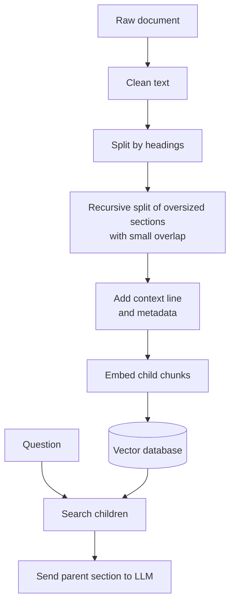

# How to Chunk Documents for RAG? Chunking Strategies Explained

> **Step 9: Vector Search and Retrieval-Augmented Generation (RAG)** · ⏱️ 31 min read · [Read original](https://outcomeschool.com/blog/chunking-strategies-for-rag)

## TL;DR
Chunking cuts documents into small pieces before embedding them for RAG, and it decides what can ever be retrieved. The rule: one chunk holds one complete idea and makes sense read alone. Strategies range from naive fixed-size cuts to model-driven agentic chunking, and the best practical setup combines several.

## Key Concepts
- **Chunk** — a small piece cut from a bigger document (one square of a chocolate bar).
- **Context window / token** — model input limit; a token is roughly three-fourths of a word.
- **Embedding / vector database** — each chunk becomes a "meaning address"; the database finds the closest ones to the question.
- **Chunk overlap** — repeating the tail of one chunk at the head of the next.
- **Parent / child chunks** — big section vs the small pieces inside it (small-to-big).

## How It Works
**Why chunk:** (1) limited context window, (2) cost and speed, (3) accuracy (a useful line buried in a mountain of text gets lost), (4) search needs one clear meaning per chunk; a giant chunk averages many meanings and matches nothing.

**Bad chunking example.** A blind cut splits "submit the request at least | 7 days in advance." The fragment "7 days in advance" lacks the words leave, apply, or request, so it is never retrieved and the model guesses or gives up.

**Strategies**

| Strategy | How it cuts | Cost | Quality | Best for |
|---|---|---|---|---|
| Fixed-size | After N characters/tokens | Very low | Low | Prototypes, messy text |
| Sentence | At full stops, group N sentences | Very low | Low to medium | Short clean text |
| Recursive | Paragraph, then line, sentence, space | Low | Good | Default for most projects |
| Document structure | Headings/sections, keep heading path | Low | Very good | Markdown, HTML, structured PDFs |
| Semantic | Where sentence-embedding similarity drops | High | Very good | Transcripts, no headings |
| Contextual | Prepend a context line to any chunk | Medium to high | Very good | Chunks with pronouns/references |
| Small-to-big | Search small children, send parent | Medium | Very good | Long documents |
| Agentic | LLM decides cuts and titles | Very high | Excellent | Few critical messy documents |

**Notes on each**
- Fixed-size cuts mid-idea; sentence chunking still groups blindly across topics.
- Recursive tries the biggest boundary first and falls to smaller ones only when forced.
- Structure chunking needs a size-based split inside very large sections; combine with recursive.
- Semantic needs per-sentence embeddings and a tuned drop threshold (too sensitive gives tiny chunks).
- Contextual: cheap way uses metadata (file name, heading path); costly way asks an LLM per chunk (the idea of Contextual Retrieval). A chunk saying only "the limit was raised to 18 days" never matches "sick leave limit" without context.
- Small-to-big: store child embeddings with a pointer to the parent; dedupe parents; larger prompts.
- Agentic: not repeatable, does not scale to millions of documents.

**Overlap.** Protects answers sitting on a cut. About 10 to 20 percent of chunk size (50 to 100 tokens for 500). It is not free: more storage and repeated retrieval.

**Choosing size.** Match one complete answer: short factual 200 to 300 tokens; explanations and procedures 500 to 800 (safe default); long reasoning 1000 to 1500 (small-to-big helps). Test about 20 real questions at sizes like 300, 500, 1000. Stay within the embedding model's input limit or extra text is silently dropped.

**Recommended stack:** split by headings, recursively split oversized sections with small overlap, add a context line, use small-to-big for long sections; add semantic or agentic only where needed.

**Common mistakes:** chunking raw files (page headers/footers pollute), breaking tables/code, no metadata, one size for all documents, never measuring, forgetting to re-index after changing size, overlap, or embedding model.

## Diagram

## Key Takeaways
- Retrieval quality is capped by chunking; a missing chunk cannot be rescued by prompts or bigger models.
- One chunk equals one complete idea that stands alone.
- Start with recursive chunking, respect headings, add context lines, keep small overlap.
- Small-to-big gives sharp search and rich answers together.
- Pick chunk size by measuring real questions, and re-index whenever settings change.
