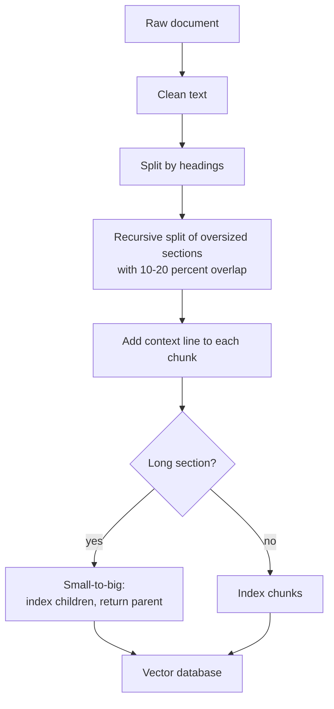
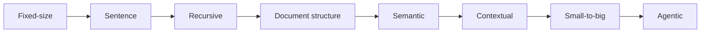

# How to Chunk Documents for RAG? Chunking Strategies Explained

> **Step 9: Vector Search and Retrieval-Augmented Generation (RAG)** · ⏱️ 31 min read · [Read original](https://outcomeschool.com/blog/chunking-strategies-for-rag)

## TL;DR
Chunking cuts a big document into small pieces so RAG can retrieve the right piece and answer correctly. One chunk should hold one complete idea and make sense alone. Strategies range from fixed-size to agentic; a strong practical default is heading split + recursive split with small overlap + context line per chunk + small-to-big, measured with real questions.

## Key Concepts
- **RAG** — Retrieval + Augmented + Generation: find useful info, add it to the question, model answers (open-book exam, no retraining).
- **Chunk** — small self-contained piece of a document (a square of a chocolate bar).
- **Context window / token** — model read limit; token is about 3/4 of a word (100 tokens ~ 75 words).
- **Embedding / vector DB / indexing** — chunk to list of numbers ("address of meaning"); stored in vector DB; one-time cut + embed + store = indexing.
- **Chunk overlap** — repeat last lines of one chunk at the start of the next.
- **Metadata** — file name, heading path, page, date.
- **Reranker** — reorders top retrieved chunks by true relevance.

## How It Works

### Why chunk
1. Limited context window (a 500-page handbook = millions of tokens).
2. Cost and speed (pay per token).
3. Accuracy: less and correct beats more and noisy (lost in the middle).
4. Search needs small pieces: a small chunk has one clear meaning; a giant one has blurry mixed meaning.

### Retrieval recap
1. Embed each chunk. 2. Store in vector DB. 3. Embed the question with the same model. 4. Return closest top 3-5 (optionally rerank). 5. Send chunks + question to the model. System rests on: each chunk carries one clear meaning.

### Bad chunking
Blind cut: Chunk 1 "...submit the request at least", Chunk 2 "7 days in advance." Query "How early do I need to apply for leave?": chunk 2 holds the answer but lacks the words leave/apply/request so it's never retrieved; chunk 1 stops before the answer; model says unknown or guesses. Goal: cut where a complete idea ends.

### Strategies
**1. Fixed-size** — cut every N chars/tokens (e.g. 500).
- Pros: simple, fast, predictable size, works on any text. Cons: cuts mid-word/sentence/idea.

**2. Sentence** — split at . ! ? then group (e.g. 5 sentences).
- Pros: no broken sentences, simple. Cons: uneven sizes; groups blindly across topic changes; ignores paragraphs/sections.

**3. Recursive** — try strongest boundary first (blank line, newline, full stop, space); recurse on pieces still too big. (Real implementations merge tiny pieces back.)
- Pros: chunks match paragraphs, never exceeds size, works on nearly anything; most common default. Cons: follows text shape not meaning.

**4. Document structure** — cut at headings/sections/tables (Markdown #, HTML h1/h2, PDF chapters, code functions/classes). Carry heading path into each chunk, e.g. "Leave Policy > Sick Leave".
- Pros: writer-defined boundaries, clear identity. Cons: needs structure; uneven sections. Combine: headings first, then recursive on oversized sections.

**5. Semantic** — embed every sentence, compare neighbours, cut where similarity drops. Example: leave sentences 1-2 similar, sentence 3 (cafeteria hours) drops sharply, cut.
- Pros: topic-based, works without headings (transcripts, chat logs). Cons: slow/costly (embedding per sentence); threshold tuning (too sensitive = tiny chunks, too lax = huge); no cut points in one long flowing topic.

**6. Contextual** — prepend a short context line. Problem: chunk "The limit was raised to 18 days from April..." never says sick leave, so the query "current sick leave limit" misses it. Fixed: "From the Employee Handbook, Leave Policy section, about sick leave: ...".
- Cheap way: build from metadata (file name, heading path). Costly way: LLM writes the line given the full document (one call per chunk; idea behind Contextual Retrieval).
- Pros: big accuracy gain, esp. pronouns ("it", "this"); layers on any strategy. Cons: per-chunk LLM cost; uses chunk space. Cheap way should not be skipped.

**7. Small-to-big** — small chunks search well but answer thinly; big chunks answer well but search poorly. Cut into big parents, then small children; embed and store children only, each pointing to its parent; search children, send the parent. Example: child "A doctor note is needed after 3 days." matches, send whole Sick Leave section (12 sentences: days, doctor note, April update).
- Pros: precise retrieval + full context; removes the one-size hunt. Cons: two chunk levels, complex indexing; bigger prompts/cost; dedupe parents when several children match.

**8. Agentic** — an LLM decides cuts ("split where each piece covers exactly one complete idea, don't break tables/lists, give a one-line title").
- Pros: handles tables across pages, numbered lists, legal clauses; title acts as free context. Cons: slowest/priciest, not repeatable, doesn't scale to millions. Use for small high-value messy sets (contracts, medical notes, financial filings). Retrieval-side analogue: Agentic RAG.

### Overlap
Answer may straddle a cut. Without overlap chunk 2 "Emergency leave is an exception to this rule" loses "this rule" (7 days in advance, in chunk 1). With overlap, repeat the last sentence at the start of chunk 2. Typical 10-20% of chunk size (500 tokens: 50-100). Not free: more storage/embeddings, duplicate retrieval wastes prompt space.

### Choosing chunk size
Match the size of one complete answer.
| Data | Answer size | Chunk size |
|---|---|---|
| FAQ, catalogue, definitions | 1-2 lines | 200-300 tokens |
| Technical docs, policies, tutorials | paragraph or two | 500-800 (safe default) |
| Papers, contracts, transcripts | long reasoning | 1000-1500 (small-to-big helps) |

Tune: take ~20 real questions; try 500/overlap 50, then 300 and 1000; pick the best top-result hit rate. Measure, don't guess. Keep chunks within the embedding model's token limit (extra text silently dropped).

### Comparison
| Strategy | How it cuts | Cost | Quality | Best for |
|---|---|---|---|---|
| Fixed-size | After N chars | Very low | Low | Prototypes, messy text |
| Sentence | Full stops | Very low | Low-medium | Short clean text |
| Recursive | Paragraphs then smaller | Low | Good | Default |
| Document structure | Headings/sections | Low | Very good | Markdown, HTML, PDFs with headings |
| Semantic | Topic change | High | Very good | Transcripts, no headings |
| Contextual | Adds context | Medium-high | Very good | Pronoun-heavy docs |
| Small-to-big | Search small, send big | Medium | Very good | Long docs |
| Agentic | Model decides | Very high | Excellent | Small critical messy sets |

Contextual and small-to-big layer on top of others.

## Trade-offs & Pitfalls (common mistakes)
1. Chunking raw files directly (PDF headers/footers/page numbers pollute meaning): clean first.
2. Breaking tables, code blocks, lists: keep as one unit even if over size.
3. No metadata: store source, section, page, date for filtering and citations.
4. One chunk size for all doc types.
5. Never measuring.
6. Not re-indexing after changing chunk size, overlap or embedding model (embeddings go stale).

## Key Takeaways
- Chunking decides what can ever be retrieved; no prompting or bigger model fixes missing chunks.
- One chunk = one complete idea, understandable alone.
- Start with recursive + document headings; add a context line, small overlap (10-20%), and small-to-big for long sections.
- Semantic and agentic chunking only for special cases (cost).
- Size should match one complete answer; validate with ~20 real questions.
- Keep within the embedding model's limit; re-index after any change.
- Vectorless RAG skips chunks and vector DB entirely by walking document structure.
