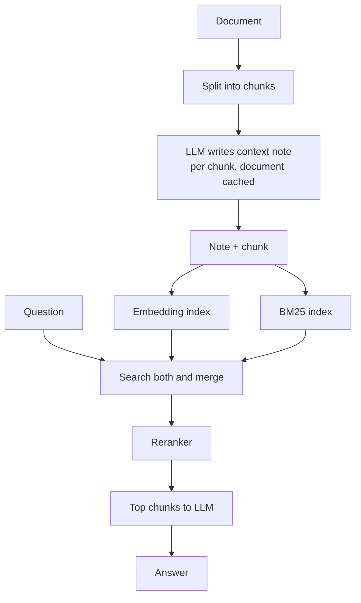

# How does Contextual Retrieval work?

> **Step 9: Vector Search and Retrieval-Augmented Generation (RAG)** · ⏱️ 16 min read · [Read original](https://outcomeschool.com/blog/how-does-contextual-retrieval-work)

## TL;DR
Contextual Retrieval (introduced by Anthropic in 2024) fixes the problem that chunks lose their surrounding context. Before indexing, an LLM writes a short note placing each chunk in its document, and the note is prepended to the chunk, so both embedding and keyword search can find it.

## Key Concepts
- **Chunk** — small piece of a long document used for retrieval in RAG.
- **Context loss** — a chunk like "The company's revenue grew by 3% over the previous quarter" no longer says which company or quarter.
- **Contextualized chunk** — LLM-written context note plus the original chunk.
- **Contextual Embeddings / Contextual BM25** — embedding index and keyword index built from contextualized chunks.
- **Prompt caching** — keeps the repeated full document cheap across many chunk calls.

## How It Works
**Why normal retrieval misses.** Embeddings capture meaning but are weak at exact matches (an error code like TS-999 looks like "some error code"). BM25 matches exact words but "ACME" and "Q2 2023" never appear in the chunk (they were on page 1). With reports of many companies, identical-sounding chunks cannot be told apart.

**Steps**
1. Split the document into chunks (as in normal RAG).
2. For each chunk, prompt an LLM with the full document and the chunk: "give a short succinct context to situate this chunk within the overall document for improving search retrieval". Result is roughly 50 to 100 tokens.
3. Prepend the note: "This chunk is from an SEC filing on ACME Corp's performance in Q2 2023; ..." followed by the chunk.
4. Index the contextualized chunk in both the embedding index and the BM25 index.
5. Answer as usual. The notes are generated once at indexing, so there is no extra LLM call or slowdown at question time.

**Combine and rerank.** Merge top results from contextual embeddings and contextual BM25 (hybrid search, dedupe), then rerank, for example 150 candidates down to the best 20 for the LLM. Reranking is slow, so it only runs on a shortlist.

**Results (failure rate = correct chunk missing from top 20; lower is better)**

| Setup | Failure rate | Reduction |
|---|---|---|
| Normal embeddings | 5.7% | baseline |
| Contextual Embeddings | 3.7% | 35% |
| + Contextual BM25 | 2.9% | 49% |
| + Reranking | 1.9% | 67% |

**Cost control.** The same document is sent for every chunk, so prompt caching loads it once. Anthropic estimated about $1.02 per million document tokens with Claude 3 Haiku (a small model suffices) plus caching, paid once; only changed documents need redoing.

**When to use:** chunks with references like "the company", "it"; many similar documents; users searching names, codes, dates.
**Limits:** one LLM call per chunk at indexing; a wrong note can mislead; little gain if chunks are already self-contained (like FAQs); if the knowledge base is under about 200,000 tokens (roughly 500 pages), just put it all in the prompt.

## Diagram

## Key Takeaways
- Chunks lose context when cut from a document; Contextual Retrieval adds it back with an LLM note.
- It improves both semantic and keyword search, since names, dates, and codes are restored into the text.
- Cost is at indexing only; question time is unchanged.
- Embeddings plus BM25 plus reranking cut retrieval failures by 67% in Anthropic's tests.
- Prompt caching and a small model keep indexing affordable.
