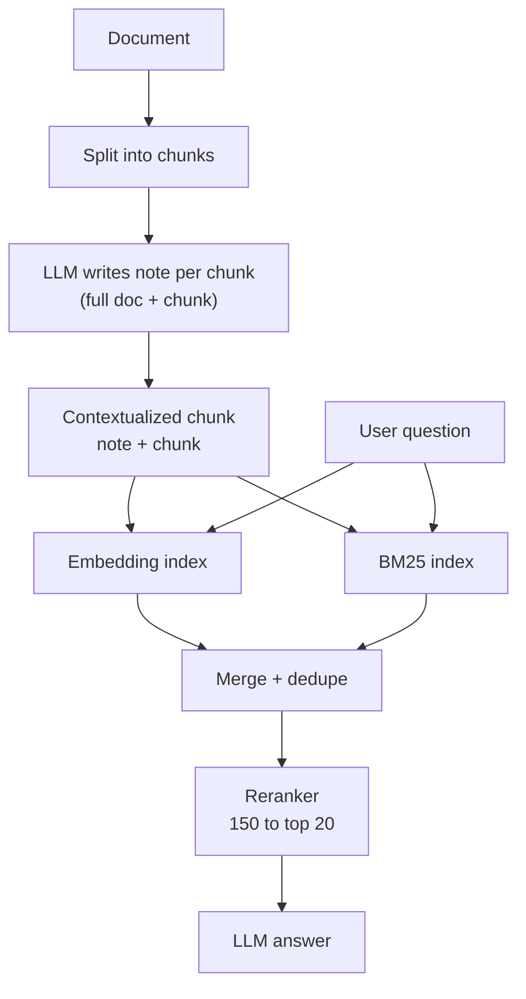

# How does Contextual Retrieval work?

> **Step 9: Vector Search and RAG** · ⏱️ 16 min read · [Read original](https://outcomeschool.com/blog/how-does-contextual-retrieval-work)

## TL;DR
Contextual Retrieval (introduced by Anthropic, 2024) improves RAG by having an LLM write a short note for every chunk that says where the chunk fits in the whole document, and prepending it before indexing. Chunks then carry names, dates and sections that chunking tore away, so both embedding search and BM25 find them. Combined with BM25 and reranking it cuts retrieval failures by 67%.

## Key Concepts
- **Chunk** — a few-hundred-word piece of a long document; only top chunks go to the LLM.
- **Embedding / semantic search** — list of numbers for meaning; search by closeness of meaning.
- **BM25** — classic keyword search; scores higher for exact (esp. rare) words. Good for names, codes (e.g. TS-999), IDs, dates.
- **Hybrid search** — run embeddings + BM25 and merge.
- **Context loss** — a chunk torn from its document no longer says which company, quarter, section.
- **Contextualized chunk** — context note + original chunk.
- **Contextual Embeddings / Contextual BM25** — embedding index / BM25 index built from contextualized chunks.
- **Reranker** — model reading question + each candidate together for a precise relevance score (slow, so used on a shortlist).
- **Prompt caching** — provider remembers the processed repeated part of a prompt, making later calls cheaper and faster.
- **Retrieval failure rate** — how often the correct chunk is missing from the top 20.

## How It Works
### The problem
Chunk "The company's revenue grew by 3% over the previous quarter." lacks "ACME Corp" and "Q2 2023" (on page 1, another chunk). Result: embedding does not carry ACME/Q2 2023, BM25 has no word match, and with reports of ten companies the chunks are indistinguishable. (Like a torn-out page saying "He opened the door".)

### Steps
1. Split document into chunks (as normal RAG).
2. For each chunk, give an LLM the full document + the chunk, ask for a short succinct context to situate the chunk "for the purposes of improving search retrieval", answer only with the context. Output is about 50-100 tokens (2-4 sentences).
3. Prepend the note to the chunk. Example: "This chunk is from an SEC filing on ACME Corp's performance in Q2 2023; the previous quarter's revenue was USD 314 million." + original line.
4. Index the contextualized chunk in the vector index and the BM25 index.
5. Answer as usual: search, top chunks, LLM.

- The note is created once at data-prep time; no extra LLM call at question time, so answering is not slower.
- Contextual Embeddings: embedding now means "ACME's revenue grew 3% in Q2 2023".
- Contextual BM25: "ACME", "Q2", "2023" now exist as words in the chunk text.

### Combine and rerank
Take top chunks from both searches, merge, dedupe; chunks high in both rank better. Reranker then rescores (e.g. 150 candidates, keep best 20). Not used on all chunks because it reads pair by pair and is slow. (Resume screening shortlist, then detailed interviews.)

### Results (Anthropic; code, fiction, research and science papers; failure rate in top 20)
| Setup | Failure rate | Reduction |
|---|---|---|
| Normal embeddings | 5.7% | baseline |
| Contextual Embeddings | 3.7% | 35% |
| + Contextual BM25 | 2.9% | 49% |
| + Reranking | 1.9% | 67% |

### Cost
500 chunks would mean sending the whole document 500 times, but with prompt caching the document is cached once and only the chunk changes. Anthropic estimate: about USD 1.02 per million document tokens with Claude 3 Haiku (a small cheap model suffices; the job is easy). Paid once; if documents change, redo only the changed ones.

### Code
```python
def contextualize(document, chunks):
    result = []
    for chunk in chunks:
        note = call_llm(PROMPT.format(doc=document, chunk=chunk))
        result.append(note + "\n" + chunk)
    return result

ctx = contextualize(document, chunks)
vector_db.add(embed_model.embed(ctx), ctx)   # Contextual Embeddings
bm25_index.add(ctx)                          # Contextual BM25
```
Rest of pipeline unchanged; in real code enable prompt caching on the document part.

## Diagram(s)
### Indexing and query pipeline


## Trade-offs & Pitfalls
- Works well when chunks say "the company", "it", "the above table"; many similar documents (reports of many companies, manual versions); users search names/codes/dates that appear only at document top.
- One LLM call per chunk at prep time: time and money for huge collections, even with caching.
- LLM-written notes can be wrong and mislead search.
- Self-contained chunks (FAQ repeating the question) gain little.
- Knowledge base under about 200,000 tokens (about 500 pages): skip RAG, put it all in the prompt (Anthropic).
- Customize prompt per domain (e.g. legal: always mention case name and section number).
- It improves the chunk side; HyDE and Query Rewriting/Multi-Query improve the question side.

| Point | Normal | Contextual |
|---|---|---|
| Stores | Raw chunk | Note + chunk |
| Knows company/date/section | Only if in chunk | Yes |
| Prep work | None | One LLM call per chunk |
| Query-time work | None | None |
| Cost | Lower | Slightly higher, one time |
| Quality | Good | Better, fewer misses |

FAQ: Contextual Embeddings alone are usable (5.7% to 3.7%). Large LLM not needed. Doc changes: only redo changed docs.

## Key Takeaways
- Chunking strips context; Contextual Retrieval adds it back with an LLM-written note per chunk.
- Apply to both embeddings and BM25; BM25 is strong for names, codes, dates.
- Failure rate 5.7% to 1.9% with embeddings + BM25 + reranking (67% fewer).
- Cost is one-time at indexing, kept low by prompt caching and a small model.
- No added query-time latency.
- Skip it for self-contained chunks or tiny knowledge bases (under about 200K tokens).
