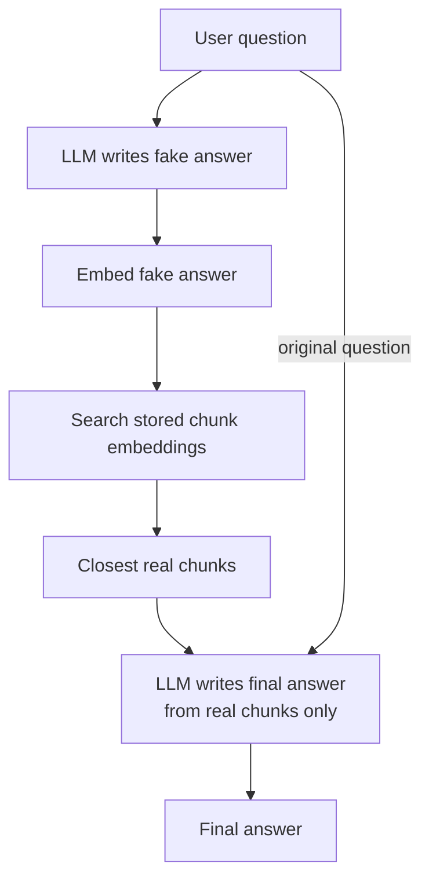

# How does HyDE work in RAG?

> **Step 9: Vector Search and RAG** · ⏱️ 16 min read · [Read original](https://outcomeschool.com/blog/how-does-hyde-work)

## TL;DR
HyDE (Hypothetical Document Embeddings) has the LLM write a fake answer to the question, then searches with that fake answer instead of the question. A fake answer is shaped like a real answer, so its embedding lands close to the real chunks. The final answer is written only from real retrieved documents.

## Key Concepts
- **RAG** — Retrieval (fetch right text) + Augmented (add to prompt) + Generation (LLM answers from it).
- **Embedding** — list of numbers representing meaning; similar meaning gives similar numbers.
- **Chunk** — short block of text (like a paragraph); stored as embeddings in a vector database.
- **Hypothetical document** — the made-up answer; never shown to the user, not trusted, used only as a search key.
- **Shape vs facts** — HyDE works due to answer-like vocabulary, not correct facts.

## How It Works
### Why question search is weak
RAG matches meaning via embeddings: embed chunks, embed question, pick closest chunks. But questions and answers are written differently. "Why is my laptop battery draining so fast?" (short, "draining", "fast") vs answer "Background applications, high screen brightness, and old battery health reduce battery life..." So the question embedding can sit far from the perfect answer chunk.

### Why a fake answer works
The model's fake answer naturally uses "background apps", "screen brightness", "battery health" - same words as the real answer. Embeddings become close even if some facts are wrong; wrong facts are discarded since the final answer uses only real docs.

### Steps
1. User asks a question.
2. Ask the model: "Write a short answer, even if you are not sure" - hypothetical document.
3. Embed the fake answer.
4. Compare with stored chunk embeddings, pick closest real chunks.
5. Send real chunks + original question to the model.
6. Model writes final answer from real chunks.

### Normal RAG vs HyDE
| Stage | Normal RAG | HyDE |
|---|---|---|
| Search with | User question | Fake answer |
| Text shape | Short, question-like | Detailed, answer-like |
| Closeness to real answers | Often far | Often close |
| Final answer source | Real docs | Real docs |

Illustrative closeness (0-1): question vs real chunk 0.55; fake answer vs real chunk 0.88 (numbers for understanding only).

### Code
```python
def hyde_search(question, model, vector_store):
    fake_answer = model.generate("Write a short answer to this question: " + question)
    emb = model.embed(fake_answer)
    return vector_store.search(emb, top_k=5)

def answer_with_hyde(question, model, vector_store):
    chunks = hyde_search(question, model, vector_store)
    context = "\n".join(chunks)
    return model.generate("Use the context below...\nContext: " + context + "\nQuestion: " + question)
```
Never search with the original question; the fake answer never touches the final answer.

## Diagram(s)
### HyDE flow


## Trade-offs & Pitfalls
| Advantages | Disadvantages |
|---|---|
| Closes question/answer gap | Slower (extra LLM call) |
| Often finds better chunks | Costs more compute |
| Works with short or vague questions | Fake answer can drift off topic and misdirect search |
| No training or fine-tuning needed; only changes search | Little gain for simple questions |

- Use when questions and answers look very different: short questions, support tickets, technical document search.
- For short direct lookups plain search may suffice; best practice: test both on the same questions and keep the better.
- Related: Query Rewriting / Multi-Query (also question side), Contextual Retrieval (chunk side).

## Key Takeaways
- Search with a fake answer to find the real one.
- It is about shape, not facts; wrong facts are discarded.
- The fake answer is never shown to the user and never used in the final answer.
- No model training needed; only the search step changes.
- Costs one extra LLM call: slower and pricier.
- Evaluate against plain RAG on your own data.
