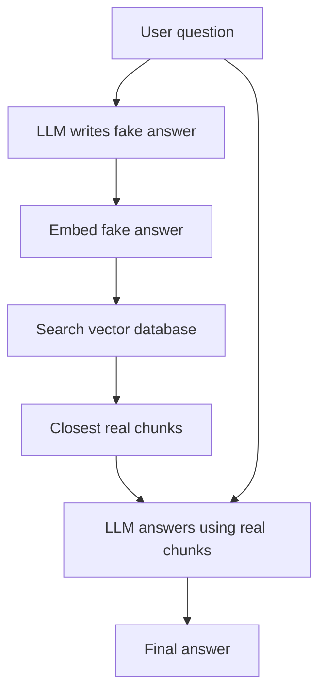

# How does HyDE work in RAG?

> **Step 9: Vector Search and Retrieval-Augmented Generation (RAG)** · ⏱️ 16 min read · [Read original](https://outcomeschool.com/blog/how-does-hyde-work)

## TL;DR
HyDE (Hypothetical Document Embeddings) has the LLM write a fake answer to the question and uses that fake answer, not the question, as the search key. Because an answer looks like an answer, it lands closer to the real chunks; the final response is still written only from the retrieved real documents.

## Key Concepts
- **RAG** — retrieve relevant text, augment the prompt, generate the answer.
- **Embedding** — list of numbers capturing meaning; similar meaning gives similar numbers.
- **Chunk / vector database** — small text blocks stored as embeddings and searched by closeness.
- **Hypothetical document** — the made-up answer written by the model; never shown to the user and not trusted for facts.
- **Search key** — the text we embed and search with.

## How It Works
**The weakness.** RAG search compares meaning, but a question ("Why is my laptop battery draining so fast?") and its answer ("Background applications, high screen brightness, old battery health reduce battery life...") are shaped differently, so their embeddings can be far apart and the right chunk can be missed.

**The trick.** Search with something shaped like the answer. A fake answer naturally uses answer-like words (background apps, brightness, battery health). The shape matters, not the facts: even a partly wrong fake answer points the search in the right direction, and wrong facts vanish because the final answer uses only real documents.

**Steps**
1. User asks a question.
2. LLM writes a short fake answer ("even if you are not sure").
3. Embed the fake answer.
4. Search stored chunk embeddings and pick the closest real chunks.
5. Send the real chunks plus the original question to the LLM.
6. LLM writes the final answer from real chunks only.

```python
fake_answer = model.generate("Write a short answer to this question: " + question)
top_chunks  = vector_store.search(model.embed(fake_answer), top_k=5)
```

Illustrative closeness (not real measurements): question to real chunk 0.55, fake answer to real chunk 0.88.

| | Normal RAG | HyDE |
|---|---|---|
| Searches with | The question | A fake answer |
| Text shape | Short, question-like | Detailed, answer-like |
| Closeness to real answers | Often far | Often close |
| Final answer from | Real documents | Real documents |

**Pros:** closes the question-answer gap; better chunks; helps short or vague questions; no extra model training.
**Cons:** extra LLM call (slower, costlier); the fake answer can drift off topic; little gain on simple direct lookups.
**When to use:** questions and answers look very different (short questions, support tickets, technical docs). Test plain search and HyDE on the same questions and keep the better one. Related: Query Rewriting and Multi-Query Retrieval (question side), Contextual Retrieval (chunk side).

## Diagram


## Key Takeaways
- Questions and answers are shaped differently, so searching with the question can miss the right chunk.
- HyDE searches with an LLM-written fake answer because it resembles real answers.
- It works on shape, not facts; the fake answer is discarded after search.
- The final answer is grounded in real retrieved chunks only.
- Cost: one extra LLM call; test it against plain RAG on your data.
