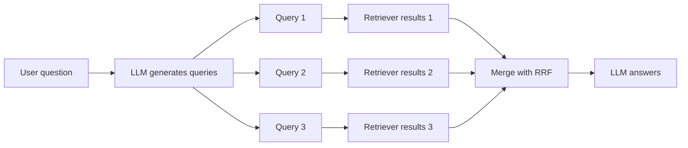

# How do Query Rewriting and Multi-Query Retrieval work?

> **Step 9: Vector Search and Retrieval-Augmented Generation (RAG)** · ⏱️ 15 min read · [Read original](https://outcomeschool.com/blog/how-do-query-rewriting-and-multi-query-retrieval-work)

## TL;DR
Users type messy questions, which make poor search queries. Query Rewriting uses an LLM to turn the question into one clean query; Multi-Query Retrieval turns it into several queries, searches with each, and merges the results. Both improve RAG retrieval without changing documents or the retriever.

## Key Concepts
- **Search query** — the text actually used to search; in naive RAG it is the raw user question.
- **Query Rewriting** — an LLM rewrites the question into a clear, standalone, search-friendly query before searching.
- **Multi-Query Retrieval** — an LLM generates several query variants, each is searched separately, and results are merged.
- **Query decomposition** — splitting a big question into smaller ones (for example one query per phone per attribute).
- **Reciprocal Rank Fusion (RRF)** — merges ranked lists by scoring each chunk on its position in each list.
- **RAG-Fusion** — Multi-Query Retrieval combined with RRF.
- **HyDE** — a cousin technique where the LLM writes a hypothetical answer and we search with that.

## How It Works
### Why raw questions fail
Follow-ups ("And what about the Basic one?"), vague questions, vocabulary mismatch ("get my money back" vs "refund process"), noise, and many-questions-in-one all lead to poor chunks and poor answers.

### Query Rewriting
Send chat history plus the latest question to an LLM, ask for a standalone search query, search with it, then answer using the original question and the retrieved chunks. The user never sees the rewritten query.

Types:
- **Standalone** — fold chat history into the follow-up (most common in chat apps).
- **Clarifying/cleaning** — remove noise, fix spelling.
- **Expanding** — add words the documents likely use.
- **Step-back** — generalize a very specific question to find background info.

Limit: one query sees only one angle, and a bad rewrite has no backup.

### Multi-Query Retrieval
1. LLM writes N queries from different angles (processor, display, battery for "Is the new phone good for gaming?").
2. Search each separately.
3. Merge and dedupe.
4. Give merged chunks plus the original question to the LLM.

Many systems keep the original question as one of the queries.

### Merging with RRF
$$\text{RRF}(d) = \sum_{\text{lists}} \frac{1}{k + \text{rank}(d)}, \quad k = 60$$

Only positions are needed, not raw scores, so it works across different search types (also the common way to merge keyword and semantic results in hybrid search). In the blog's example, D5 is near the top of all three lists, so it scores about 0.0489 and wins over D2 at about 0.0484; chunks seen in only one list rank lower.

### Comparison
| Point | Query Rewriting | Multi-Query Retrieval |
|---|---|---|
| LLM output | One better query | Several queries |
| Searches | One | One per query |
| Strength | Follow-ups, vague, noisy | Info spread across places |
| Backup vs bad rewrite | None | Other queries |
| Merge needed | No | Yes (union or RRF) |
| Cost | One extra LLM call | Extra call plus many searches |
| Best for | Chat with follow-ups | Broad or multi-part questions |

They can be combined: rewrite first, then expand into multiple queries.

## Diagram

## Key Takeaways
- Retrieval quality depends on the search query, and the raw user question is often a bad one.
- Query Rewriting fixes follow-ups and noise; Multi-Query improves recall for broad questions.
- RRF scores each chunk by $1/(k+\text{rank})$ summed across lists, with $k$ commonly 60.
- Costs: an extra LLM call, and the rewrite can drop details such as a version number.
- Multi-Query can add loosely related chunks; a reranker after the merge helps.
