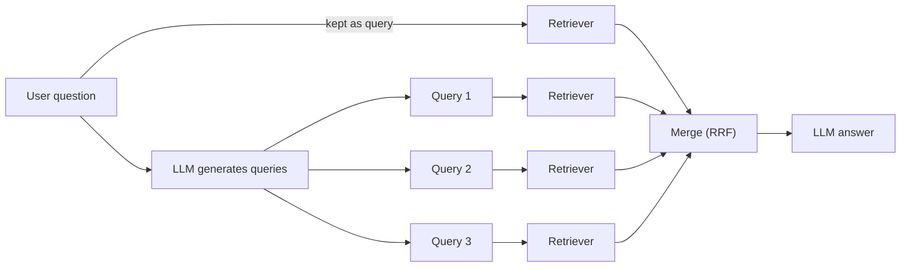

# How do Query Rewriting and Multi-Query Retrieval work?

> **Step 9: Vector Search and RAG** · ⏱️ 15 min read · [Read original](https://outcomeschool.com/blog/how-do-query-rewriting-and-multi-query-retrieval-work)

## TL;DR
The user's raw question is often a poor search query. Query Rewriting has an LLM turn it into one clear standalone query; Multi-Query Retrieval has an LLM produce several different queries, searches with each, and merges results (often with Reciprocal Rank Fusion). Both improve retrieval without changing documents or the retriever.

## Key Concepts
- **Search query** — the text retrieval actually searches with.
- **Query Rewriting** — LLM rewrites the question into a clear, complete, search-friendly query. The answer is still written from the original question.
- **Multi-Query Retrieval** — LLM generates several query versions, search each separately, merge into one list.
- **Query decomposition** — splitting a big question into smaller ones.
- **Union** — merge by taking all chunks, deduped; no importance info.
- **RRF (Reciprocal Rank Fusion)** — score-by-position merge. Multi-Query + RRF = RAG-Fusion.
- **Recall** — finding more of the useful chunks.

## How It Works
### The problem
Real queries are imperfect: follow-ups ("And what about the Basic one?"), vague ("My thing is not working after the update"), vocabulary mismatch ("get my money back" vs "refund process"), noise ("Hi, hope you are well..."), many-in-one ("Compare battery life and price of phone A and B").

### Query Rewriting
Flow: question + chat history -> LLM rewrite -> clear query -> retriever -> chunks -> LLM answer (with original question). Example: after Pro plan refund talk, "And what about the Basic one?" becomes "Refund policy of the Basic plan". (Librarian turning "boy wizard book" into "Harry Potter".) The user never sees the rewritten query.

Types:
- **Standalone** — follow-up made complete using history (most common in chat).
- **Clarify/clean** — remove noise, fix spelling: "Hi, quick question, how many leaves..." becomes "Annual leave policy number of days".
- **Expanding** — add likely document words: "How do I get my money back?" becomes "refund process, return money, get refund".
- **Step-back** — specific to general: "Why did my order #4521 get delayed in Mumbai?" becomes "Reasons for order delivery delays".
Close cousin: HyDE.

```python
def rewrite_query(chat_history, question):
    return call_llm(prompt_with(chat_history, question)).strip()
def answer(chat_history, question):
    q = rewrite_query(chat_history, question)
    chunks = retriever.search(q, top_k=5)
    return call_llm(f"Context:\n{chunks}\n\nQuestion: {question}\nAnswer:")
```

### Limit of rewriting
One query = one angle. "Is the new phone good for gaming?" needs processor, refresh rate, heating/battery chunks with different words. One bad rewrite has no backup.

### Multi-Query Retrieval
1. User question. 2. LLM makes (e.g.) 3 queries: processor/graphics; display refresh rate/touch; heating/battery. 3. Search each. 4. Merge, dedupe. 5. LLM answers with merged chunks + original question. Many systems keep the original question as one of the queries (never lose a plain search's results, and backup against bad rewrite). Also handles many-in-one via decomposition: "phone A battery life", "phone A price", "phone B battery life", "phone B price". (Lost key: three people searching different rooms.)

### Merging with RRF
$$\text{RRF}(d)=\sum_{\text{lists}} \frac{1}{k+\text{rank}(d)}$$
rank = position (1 = top), k = constant, commonly 60. Needs only positions, not raw scores, so it also merges keyword + semantic results (common in Hybrid Search).

Example (k = 60): Q1 [D2,D5,D1], Q2 [D5,D3,D2], Q3 [D5,D2,D4].
- D5 = 1/62+1/61+1/61 = 0.0489; D2 = 1/61+1/63+1/62 = 0.0484; D3 = 0.0161; D1 = D4 = 0.0159.
- Order: D5, D2, D3, then D1/D4 tie. D5 wins by being near the top of all lists.

```python
def rrf_merge(result_lists, k=60):
    scores = {}
    for results in result_lists:
        for rank, cid in enumerate(results, start=1):
            scores[cid] = scores.get(cid, 0) + 1 / (k + rank)
    return sorted(scores, key=scores.get, reverse=True)
```
`generate_queries` returns `[question] + llm queries`; `multi_query_search` runs retriever per query then RRF, returns top_k.

## Diagram(s)
### Multi-Query flow


## Trade-offs & Pitfalls
| Point | Query Rewriting | Multi-Query |
|---|---|---|
| LLM output | One better query | Several queries |
| Searches | One | One per query |
| Strength | Follow-ups, vague, noisy | Info spread across places |
| Bad-rewrite safety | None | Other queries back up |
| Merge needed | No | Yes (union/RRF) |
| Speed/cost | One extra LLM call | Extra LLM call plus many searches |
| Best for | Chat with follow-ups | Broad/multi-part questions |

- Use both: rewrite to standalone first, then create multiple queries.
- Pros: no document/retriever change, better chat follow-ups, better recall, any retriever.
- Cons: extra LLM call (time/cost); LLM may change meaning (drop a version number) so test prompts; multi-query adds loosely related noise (use a reranker after merge); little benefit for simple clear questions.
- Agentic RAG goes further: the agent decides when to rewrite and re-search.
- Contextual Retrieval improves the chunk side.

## Key Takeaways
- Raw user questions make poor search queries.
- Rewriting fixes follow-ups, vagueness, noise; it never changes the user-facing question.
- Multi-query searches from many angles for better recall and a backup against one bad rewrite.
- RRF: sum 1/(k+rank), k = 60; rank-based so works across retriever types.
- Keep the original question in the query set.
- Add a reranker to cut noise.
