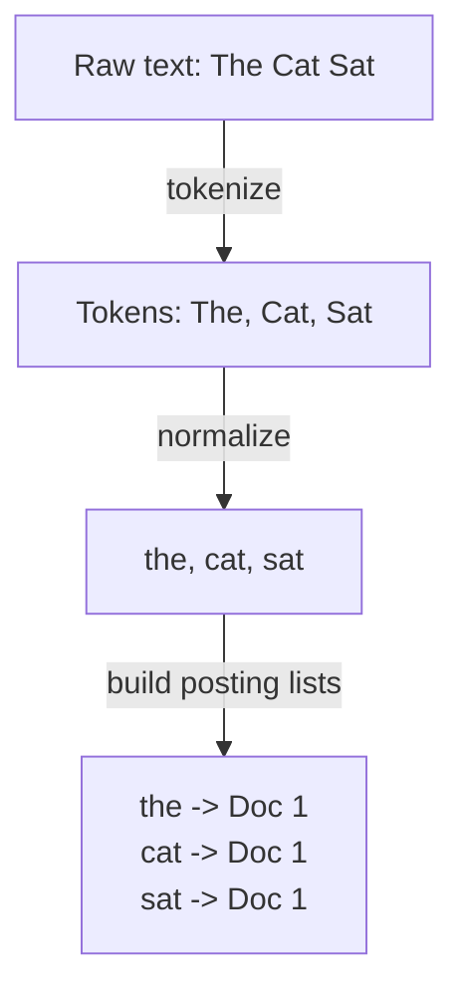
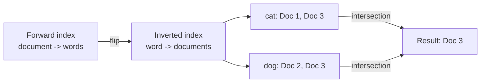

# How does an Inverted Index work?

> **Step 9: Vector Search and Retrieval-Augmented Generation (RAG)** · ⏱️ 17 min read · [Read original](https://outcomeschool.com/blog/inverted-index)

## TL;DR
An inverted index maps each word to the list of documents that contain it, like the index at the back of a book. We do the hard work once while building it, then each search is a quick lookup instead of reading every document. It powers search engines, Lucene and Elasticsearch.

## Key Concepts
- **Document** — any piece of text (web page, product description, email, sentence).
- **Forward index** — document to its words.
- **Inverted index** — word to its documents (the forward index flipped).
- **Posting list** — list of documents stored next to a word.
- **Token** — a single word after tokenization.
- **Normalization** — clean tokens so forms of a word match (lowercase, optionally stop word removal, stemming).
- **Stop words** — very common words (the, is, on, and); optional to remove, modern systems often keep them.
- **Stemming** — cut to root (running, runs become run); optional.
- **Intersection** — common documents between posting lists.
- **Phrase search** — words adjacent and in order.

## How It Works

### Problem without an index
Docs: D1 "the cat sat on the mat", D2 "the dog sat on the log", D3 "the cat and the dog played". Searching "cat" naively reads every word of every document. With 1 million docs of 1,000 words, one search reads 1 billion words, repeated for every query. Does not scale.

### Forward index
```
Doc 1 -> the, cat, sat, on, the, mat
Doc 2 -> the, dog, sat, on, the, log
Doc 3 -> the, cat, and, the, dog, played
```
Answers "what words are in this document", but search asks "which documents contain this word", so we would still scan every document.

### Flipping into the inverted index
```
the    -> Doc 1, Doc 2, Doc 3
cat    -> Doc 1, Doc 3
sat    -> Doc 1, Doc 2
on     -> Doc 1, Doc 2
mat    -> Doc 1
dog    -> Doc 2, Doc 3
log    -> Doc 2
and    -> Doc 3
played -> Doc 3
```
Searching "cat" is one lookup returning Doc 1 and Doc 3, with no document read.

### Building it step by step
1. **Collect documents.**
2. **Tokenize** — "the cat sat on the mat" becomes the, cat, sat, on, the, mat.
3. **Normalize** — lowercase (Cat, CAT, cat all become cat; otherwise a lowercase query would miss "Cat"). Optional stop word removal (saves space) and stemming (search "run" matches "running"; depends on use case).
4. **Build posting lists** — for each token add the document to the word's list; do not add a duplicate (second "the" in Doc 1 is skipped). Repeat for all documents.

### Querying
1. Normalize the query exactly as documents were normalized (otherwise no match).
2. Look up the word (e.g. "dog").
3. Return its posting list: Doc 2, Doc 3.
Speed depends on one lookup plus reading one posting list, not on total text.

### Multiple words
- Query "cat dog" usually means documents containing both.
- cat: Doc 1, Doc 3; dog: Doc 2, Doc 3; intersection gives Doc 3.
- Keep posting lists sorted by document number so both lists can be walked together to find matches fast.

### Positions for phrase search
- Plain index does not know where a word is. Store position per document: in Doc 1, the=1, cat=2, sat=3, on=4, the=5, mat=6, so cat -> Doc 1 (position 2), sat -> Doc 1 (position 3).
- Phrase "cat sat": sat position (3) equals cat position (2) + 1, so adjacent and in order; Doc 1 matches.

### Why it is fast
- Without it, work grows with total text.
- With it, work is one lookup plus the posting list; the cost is paid upfront at build time, so every future search is cheap.

### Real-world use
- Search engines (Google) finding pages by words.
- Search libraries and databases: Apache Lucene, Elasticsearch.
- E-commerce search over titles and descriptions.
- Email and document search.
- Code search (function names, keywords).
- This is keyword search; Hybrid Search combines it with Semantic Search (by meaning).

## Diagram(s)

### Build pipeline


### Forward flipped to inverted, and query intersection


## Trade-offs & Pitfalls
- Query must be normalized the same way as documents, or matches are missed.
- Stop word removal and stemming are optional and use-case dependent.
- Basic index cannot do phrase search; positions must be stored.
- Upfront build cost in exchange for cheap searches.
- Exact keyword matching only; semantic matching needs other approaches.

## FAQ
- What is a posting list? → Documents next to a word (optionally with positions).
- Normalize the query too? → Yes, identically.
- Remove stop words? → Optional; modern systems often keep them.
- Why sorted posting lists? → Faster intersection for multi-word queries.
- Is Elasticsearch built on one? → Yes, as is Lucene.

## Key Takeaways
- Inverted index = word to list of documents, flipping the forward index.
- Each list is a posting list; searching is one lookup.
- Build: collect, tokenize, normalize, add to posting lists.
- Normalize queries and documents identically.
- Multi-word search is an intersection of sorted posting lists.
- Storing positions enables phrase search (adjacent positions).
- Pay cost once at index time so every search is fast.
- Foundation of Google-style search, Lucene, Elasticsearch, e-commerce and code search.
